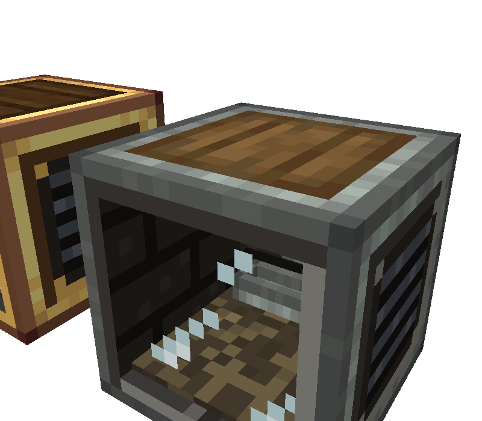
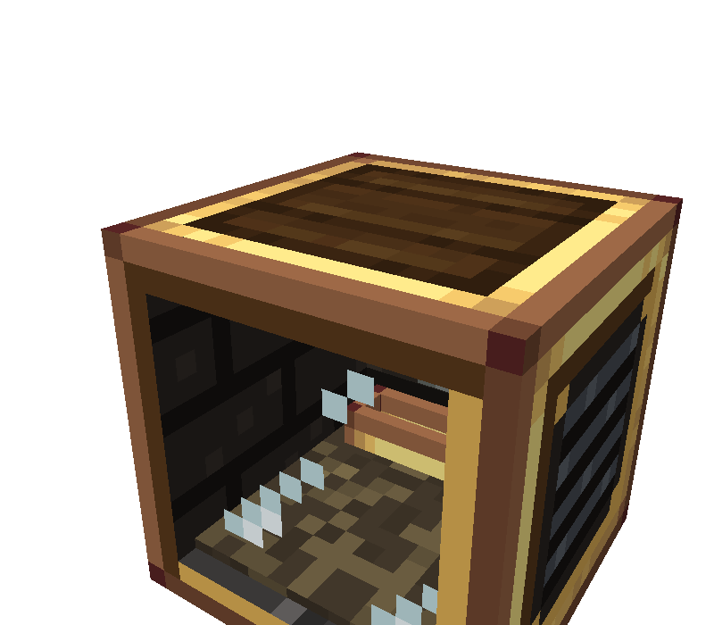
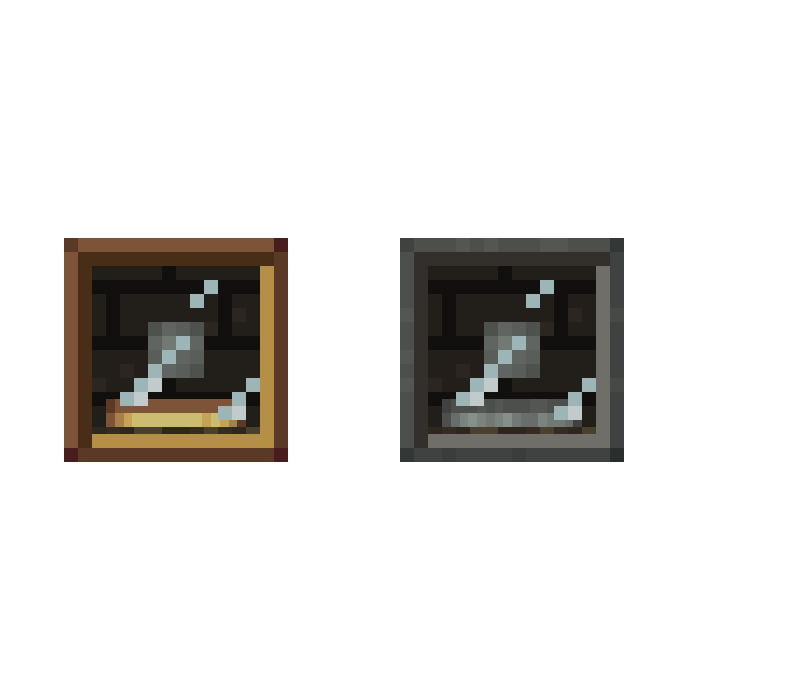
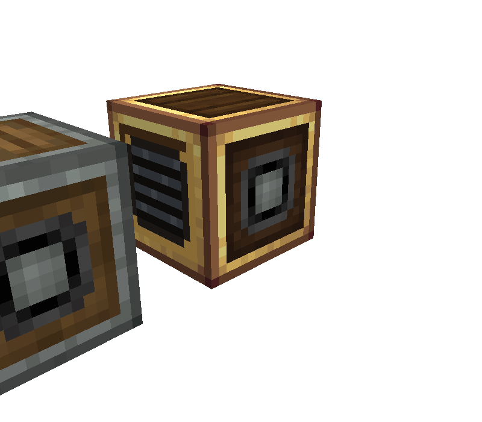

# Code Dossier: Animal Pens (Animal Pen and Brass Animal Pen)

Path keys used in citations:
- `J/` = `src/main/java/com/comedymonkey/createaddons/`
- `A/` = `src/main/resources/assets/comedymonkeysaddons/`
- `D/` = `src/main/resources/data/comedymonkeysaddons/`
- `Block` = `J/content/pen/AnimalPenBlock.java`, `BE` = `J/content/pen/AnimalPenBlockEntity.java`, `PenAnimal` = `J/content/pen/PenAnimal.java`, `Renderer` = `J/client/AnimalPenRenderer.java`, `CGR` = `J/client/CobbleGeneratorRenderer.java`, `Client` = `J/client/ComedyMonkeysCreateAddonsClient.java`, `Mod` = `J/ComedyMonkeysCreateAddons.java`
- `pen.json` = `A/models/block/animal_pen.json`, `brass.json` = `A/models/block/brass_animal_pen.json`. The two files are line-for-line identical except texture lines 6–11 and 16 (`diff` of the two files), so element line numbers below hold for both.

## Identity

- **Registry ids:** `animal_pen` (`J/registry/ModBlocks.java:153`) and `brass_animal_pen` (`ModBlocks.java:156`). Both are plain BlockItems (`J/registry/ModItems.java:53-54`). There is one block entity type, `animal_pen`, shared by both blocks (`J/registry/ModBlockEntities.java:75-78`), and one menu, `animal_pen` (`J/registry/ModMenus.java:36-37`).
- **Kind:** a single-block Create kinetic machine (`Block:35`, `extends KineticBlock implements IBE`). It is not a multiblock.
- **Classes:**
  - `AnimalPenBlock` (one class for both tiers, with a `brass` flag, `Block:39-49`)
  - `AnimalPenBlockEntity` (a `KineticBlockEntity`, `BE:94`)
  - `PenAnimal` (the client-side wandering animals)
  - `AnimalPenRenderer` (the BER, registered at `Client:88`)
  - `AnimalPenMenu` and `AnimalPenScreen` (wrench screen, `Client:78`)
  - Supporting items: `BottledAnimalItem`, `AnimalCapture` (Capture Bottle catching, hooked at `Mod:108`) and `J/client/BottledAnimalRenderer.java` (registered at `Client:133-142`)
  - There is no Flywheel visual.
- **Footprint:** 1×1×1. There is no `getShape` or `getCollisionShape` override anywhere in `Block` (`Block:35-143`), so the block uses the full-cube default.

## What It Does

1. **Catching.** Using a Capture Bottle on any `Animal` turns it into a Bottled Animal (`J/content/pen/AnimalCapture.java:40-58`). The animal must be alive, not ridden, not in the `pen_blacklist` tag, and not owned by another player (`AnimalCapture.java:32-38`). The tag ships empty (`D/tags/entity_type/pen_blacklist.json`). The bottle keeps the animal's full NBT (colour, variant, name, age) but drops its position, UUID and leash (`BottledAnimalItem.java:39-48`).
2. **Moving it in.** Using a Bottled Animal on an empty pen moves it in (`BE:370-376`, `BE:317-351`). Any face can be clicked: `useItemOn` has no face check (`Block:85-90`). A bottled baby arrives as a baby with the growing time it had left. Any other bottle arrives as 1 adult (`BE:322-328`). Food left over from a previous animal that this one doesn't eat goes to the output (`BE:333-341`).
3. **Feeding.** The animal's breeding food goes in by hand (`BE:397-404`) or by automation from any side (`BE:1071-1106`, registered for all sides at `Mod:140-141`). The trough has normal 64-stacks (`BE:946-950`): 2 slots on the base pen and 8 on the brass one (`BE:99-100`).
4. **Running.** The pen works only while the shaft turns, it is not overstressed, and it holds an animal (`BE:609-611`). Stress is fixed at **256 SU** (base) or **1,024 SU** (brass) at any speed, and 0 while empty (`BE:620-623`, `J/config/CMConfig.java:239-246`, `J/content/FixedStress.java:13-16`).
5. **Breeding.** Every 300 s (`CMConfig.java:247-251`, `BE:163-167`), every adult eats one food and has one baby. Births are limited by adults, free room and food (`BE:563-577`). Each birth plays the vanilla chicken-egg sound at volume 0.4, pitch 1.6 (`BE:572`).
6. **Growing up.** A litter grows up 1,200 s after it is born (`CMConfig.java:252-256`, `BE:170-174`, `BE:548-561`). Only adults breed, drop, shear, lay or milk (`BE:89`, `BE:566`, `BE:587`, `BE:599`).
7. **Fruitful.** Fruitful I–III on the item divides both breed time and grow time by 1 + 0.5 × level (`BE:165-173`, `J/content/MachineEnchantments.java:52-55`, `CMConfig.java:257-260`). The enchantment is kept when the block is broken (`BE:847-865`, `D/loot_table/blocks/animal_pen.json:11-19`).
8. **Wool.** Sheep regrow wool 60 s after shearing (`CMConfig.java:261-264`, `BE:578-583`). Shears give 1–3 wool per adult, in that sheep's colour (`BE:467-496`).
9. **Eggs and scutes.** Chickens lay eggs and armadillos shed scutes (`BE:306-315`). Each adult adds 1 per tick towards 20 × 450 ticks, so output is deterministic: one item per adult per 450 s. When the output is full, it holds the next item ready (`BE:584-597`, `CMConfig.java:265-268`).
10. **Milk.** Cows, mooshrooms (a subclass of `Cow`) and goats (`BE:302-304`) make 125 mB of milk per adult per minute (`BE:598-605`, `CMConfig.java:269-272`). The tank holds **8,000 mB** (base) or **32,000 mB** (brass) (`BE:142`). There are three ways to take it out:
    - a bucket takes 1,000 mB (`BE:387-391`)
    - a bowl on a mooshroom takes 250 mB as stew (`BE:392-396`)
    - pipes can drain it from any side, but nothing can be piped in (`BE:1108-1144`, `Mod:142-143`)
11. **Sword.** A sword kills round(adults/2) adults but always leaves one (`BE:412-437`). The drops come from the animal's real loot table, as if killed by the player, so Looting and Fire Aspect count (`BE:440-465`). XP goes to real players (`BE:424-429`). The swing costs 1 sword durability and shows a sweep particle and sound just in front of the window (`BE:430-433`).
12. **Output.** Drops, wool and eggs go into a buffer of **9** slots (base) or **18** (brass) (`BE:136`). Anything that doesn't fit is thrown out 0.6 blocks from the centre, through the front (`BE:505-520`). The buffer empties to automation from any side (`BE:1092-1095`) or into the player's inventory on an empty-hand click (`Block:93-101`).
13. **Wrench.** A wrench opens the screen (`Block:103-113`). Taking the bottle out there butchers the other adults into the output (`BE:353-363`, `BE:1030-1033`).
14. **Comparator.** The comparator output is 1–15 for how full of animals the pen is (`Block:123-132`, `BE:820-823`).
15. **Breaking.** Breaking the pen drops the bottle, the food, the output and the extra adults' drops (`BE:802-818`). Moving it with a piston or contraption keeps the herd (`Block:115-121`).

## What the Player Is Told

- **Names.**
  - "Animal Pen", "Brass Animal Pen" (`A/lang/en_us.json:900`, `:910`)
  - "Capture Bottle", "Bottled %s" (`en_us.json:945`, `:894`)
- **Summary.**
  - Base: "Keeps _one captured animal_ and breeds it up: their drops, wool, eggs and milk without a mob farm." (`en_us.json:901`)
  - Brass: "An _Animal Pen_ for _512_ animals, with twice the room for what they make." (`en_us.json:911`)
- **Tooltip sections:** Starting, Harvesting, By Itself, With a Wrench, Fruitful (`en_us.json:902-909`, `:953-956`). They promise "a _shaft_ turning in the _back_", "every five minutes", "Up to 128/512", the fixed stress and the milk "for pipes".
- **Goggles.** The header is "Animal Pen:" (`en_us.json:920`), followed by:
  - the herd line, e.g. "Cow: 40 + 24 young / 128" (`BE:738-746`)
  - the status: Needs rotation, Full, Young growing up, Needs its food to breed, or Breeding n% (`BE:714-726`, `en_us.json:921-925`, `:959`)
  - Fruitful n (`BE:756-759`)
  - wool ready or growing (`BE:760-762`)
  - milk mB / capacity (`BE:763-767`)
- **Ponder** "Animal Husbandry" (`J/client/ponder/FarmScenes.java:136-280`, text at `en_us.json:985-996`). The pen faces north with a motor on its back, south (`FarmScenes.java:143-145`, `A/ponder/animal_pen.nbt` facing=north). The steps:
  1. introduces the pen
  2. a cow is caught with a bottle
  3. the bottle is used on the pen
  4. wheat goes into the trough (pointer at the trough, `FarmScenes.java:195`)
  5. a shaft turns at the back (pointer at the SOUTH face, `FarmScenes.java:206`)
  6. the herd grows 1+1, then 2+2, then 4+4
  7. a sword sends beef and leather flying out of the front (`FarmScenes.java:221-228`)
  8. buckets, shears and eggs
  9. Deployers
  10. the wrench
  11. Fruitful and the 512 brass pen
- **Recipes.**
  - Animal Pen: andesite alloy corners, 4 wooden fences, Andesite Casing in the centre and a hay bale (`D/recipe/animal_pen.json:4-21`).
  - Brass Animal Pen: 5×5 Mechanical Crafting of brass sheets, brass casing, electron tubes, hay bales and an Animal Pen in the centre (`D/recipe/mechanical_crafting/brass_animal_pen.json:5-27`).
  - Capture Bottle: copper nugget on a glass bottle (`D/recipe/capture_bottle.json:4-15`).
  - Material language: andesite/brass casing, fences and hay.
- **Advancements:** Message in a Bottle, Animal Husbandry, Factory Farming, Thinning the Herd, Full House, Be Fruitful and Multiply, Cattle Baron (`en_us.json:932-937`, `:968-975`).
- **README:** "Same box as the Auto Harvester, with straw on the floor and a feeding trough at the back, and the real animals wandering about behind the glass." (`README.md:157`). The full feature list is at `README.md:155-170`.
- **Sounds:** the pens have no entries in `sounds.json` (no matches for "pen"). They use only vanilla sounds:
  - bottle fill/empty (`AnimalCapture.java:55`, `BottledAnimalItem.java:96`)
  - chicken egg on each birth (`BE:572`)
  - attack sweep (`BE:433`)
  - sheep shear (`BE:493`)
  - cow/mooshroom milk (`BE:389`, `BE:394`)
  - block sounds: stone (base, copied from the Auto Harvester, `ModBlocks.java:147`, `:154`) and netherite (brass, copied from the Brass Cobble Generator, `ModBlocks.java:90`, `:157`)

## States

| State | Source | How the player can tell today |
|---|---|---|
| `facing` = north / east / south / west | `Block:37`, `Block:52-54`; blockstates `A/blockstates/animal_pen.json:3-17`, `brass_animal_pen.json:3-17` | The window side. The whole model is rotated y 0/90/180/270. |
| Empty (no animal) | `BE:182-184` | Empty window. If food was left from the last animal, one item still lies in the trough (`Renderer:55-60`: `getTroughFood` ignores the food check, and `getFoodCount` is 0 so `shown` = 1). |
| Running vs stopped / overstressed | `BE:609-611` | Animals walk only while running and stand still otherwise (`BE:665`, `PenAnimal:48-68`). The back shaft stub turns with the network (`CGR:65-79`). |
| Herd size 1…128 / 1…512 | `BE:186-200` | Only `min(count, 4)` animals are drawn (`BE:96`, `BE:648-657`). 4 animals and 512 animals look the same. |
| Adults vs young mix | `BE:658-662` | The last `babies` of the 4 shown are drawn as babies (vanilla baby model). That is all of them when there are no adults, and at least one adult and one baby when both exist and 2 or more are shown. |
| Sheep wool ready / sheared | `BE:118`, synced at `BE:887` | Every sheep shown is drawn sheared while the wool regrows (`BE:663-664`). |
| Animal type and variant | `BE:103` (Captive bottle NBT) | The real vanilla or modded entity model with its own colour and variant (`BE:653`, `BottledAnimalItem.java:64-72`). |
| Trough food amount | `BE:109`, `BE:252-258` | 1 item lies in the trough for 1–7 food, 2 for 8–31, 3 for 32 or more (`Renderer:59-60`). No food means an empty trough. |
| Breeding / Hungry / Growing / Full status | `BE:714-736` | Shown only in goggle text and the screen. An empty trough hints at Hungry. All-baby animals hint at Growing. |
| Breed progress (`breedTicks`) | `BE:117`, `BE:886` | Shown only in the screen gauge (`J/client/AnimalPenScreen.java:61`). |
| Litter grow-up timers | `BE:108`, `BE:875-882` | Shown only in the screen tooltip (`AnimalPenScreen.java:106`). |
| Milk level (`milk` tank) | `BE:113`, `BE:885` | Shown only in the screen gauge and goggles (`AnimalPenScreen.java:62-63`, `BE:763-767`). |
| Output buffer (eggs, wool, drops) | `BE:112`, `BE:884` | Shown only in the screen. Nothing is drawn on the block. |
| Egg / milk progress | `BE:120-121`, `BE:889-890` | Not shown anywhere. |
| Fruitful level | `BE:105`, `BE:891-893` | Goggles only. The placed block has no glint (only the item has vanilla's enchant glint). |
| Brass vs base tier | `Block:39`, `BE:150-160` | Different textures (see Current Look). The same geometry and the same 4 animals. |

Everything in `write` is sent on client packets too (`BE:869-894`, with no `clientPacket` filter), so all of the above is available to the client.

## Moving and Changing Parts

| Part | Model file | Driven by | Axis / pivot / range | Source |
|---|---|---|---|---|
| Back shaft stub | `A/models/block/cobble_generator_shaft.json` (standalone, `CGR:36-37`, registered at `Client:109`) | Kinetic angle, `KineticBlockEntityRenderer.getAngleForBe` | Spins about the world X or Z axis (the FACING axis) through the block centre (0.5, 0.5, 0.5), exactly like Create's shafts. The stub is modelled going into the north face (`shaft.json:9`, x/y 6–10, z −0.02–3.5) and is turned to the back face. In pen model space it occupies x 6–10, y 6–10, z 12.5–16.02. It is drawn into `RenderType.solid()`. | `Renderer:43`, `CGR:65-79` |
| Animals (0–4) | None. Each is drawn by the vanilla entity renderer from a fresh entity made from the bottle (`BE:653`). | `PenAnimal.tick`, client tick, only while `isRunning()` | Feet at y = 2.5 px. Wander x 3.5–12.5, z 2.5–9.5 px. Walk speed 0.18 px/tick. Turn at most 12°/tick towards the target. Wait 40–139 ticks between walks (0–59 at first). Shadows are off. Scale and clearances are in the Code Contract. | `Renderer:73-90`, `PenAnimal:15-17`, `:29-32`, `:48-78` |
| Baby / adult swap | Same entity | `BE:658-662` → `PenAnimal.setBaby` → `setAge(-24000 / 0)` | Vanilla baby model. The scale factor is unchanged (see contract), so babies come out at about half the adult size. | `PenAnimal:39-45` |
| Sheep wool | Same entity | `woolReady` | `setSheared` drops the vanilla wool layer. | `BE:663-664` |
| Walk cycle and head | Same entity | `walkAnimation.update(walking ? 0.6 : 0)`, body and head yaw = travel yaw | Vanilla leg swing. The head is locked to the body. | `PenAnimal:69-77` |
| Trough food (0–3) | None. The item renderer draws the first trough stack, `ItemDisplayContext.FIXED`. | Food count | Lies flat (X 90°). Yaw −40°, 30°, 100° for items 0, 1, 2. Scale 0.3. Positions are in the Code Contract. | `Renderer:31-32`, `:54-71` |
| Shell, window, bedding, trough | `pen.json` / `brass.json` (static block model) | No part of it moves | — | blockstates above |

## Code Contract

### Model files the code loads
- `models/block/animal_pen.json` and `models/block/brass_animal_pen.json` are loaded only through the blockstates (`A/blockstates/animal_pen.json:4-16`, `brass_animal_pen.json:4-16`). Java never names them, so they can be renamed if the blockstates and item models change with them.
- The item models are simply `{"parent": <block model>}` (`A/models/item/animal_pen.json:2`, `brass_animal_pen.json:2`). The inventory icon is the block model with `block/block` display transforms.
- The only part model Java loads for the pens is **`comedymonkeysaddons:block/cobble_generator_shaft`** (`CGR:36-37`, `Client:109`). There are no pen-specific `PartialModel`s or standalone models.

### Part split
- There is one static block model. The renderer adds the shaft stub, the animals and the food. Nothing in the block model is animated, and any new moving part would need renderer code.

### Orientation
- The model is built with its **front (window) facing north (z = 0)** and its back (shaft) at south (z = 16).
- The blockstates rotate it y 90 for east, 180 for south and 270 for west (`animal_pen.json:7-16`).
- The renderer rotates its contents by the same rule, `YP(-(front.toYRot() + 180))` about the centre (`Renderer:45-48`). A new model must keep this orientation, or the animals and trough food will no longer sit in it.
- Placement puts the window towards the player (`Block:57-60`). `rotate` and `mirror` turn FACING (`Block:73-81`).

### Voxel shape
- The shape is the full cube 0–16 (no override, `Block:35-143`). The model should read as a full block. The collision is solid even where the model is glass.

### Shaft face
- **Only the back** (`FACING.getOpposite()`) takes a shaft (`Block:62-66`). The rotation axis is the FACING axis (`Block:68-71`).
- The stub's outer face sits at z = 16.02 over a 4×4 px opening at x 6–10, y 6–10 of the back face. Its inner end pokes 1.5 px into the chamber (z 12.5–14), centred at the back wall at the height of an animal's head.
- A new back must keep a 4×4 centred shaft socket. Nothing in x 6–10, y 6–10 may sit in front of z 12.5 inside the chamber unless the stub is meant to vanish into it.
- No other face shows a shaft.

### Item, fluid and redstone faces
- Item insert (food) and extract (output), the milk drain and the comparator all work **from every side** (`Mod:140-143`, `Block:123-132`). Clicks also work on every face (`Block:85-113`).
- There are no side-specific ports, so the look must not imply that only one face is an inlet.
- Milk is a real NeoForge fluid (`NeoForgeMod.MILK`, `BE:142`) that pipes can pull out but not push in (`BE:1125-1133`).
- There is no FE, no filter slot, no `ValueBoxTransform` and no scroll value. The only Create behaviour is the goggle tooltip (`BE:748-771`).

### Clear interior the renderer needs (pen model space, pixels)
- **Floor surface at exactly y = 2.5.** Animal feet are placed there (`Renderer:27`, `:82`). Today that is the bedding top (`pen.json:275`, element #9 y 2–2.5). Raising or lowering the floor makes animals sink or float unless `FLOOR_Y` changes.
- **Wander rectangle:** feet anywhere in x 3.5–12.5, z 2.5–9.5 (`PenAnimal:15`).
- **Animal scale:** `min(0.26, 0.4 / max(bbHeight, bbWidth))` (`Renderer:29`, `:80`).
  - Typical heights (vanilla hitboxes × scale): chicken 0.7 × 0.26 ≈ 2.9 px, pig ≈ 3.7 px, sheep ≈ 5.4 px, cow ≈ 5.8 px.
  - Anything with a hitbox side over 1.54 blocks (horse, camel) is capped to **6.4 px (0.4 block)**, its largest hitbox side.
  - So heads reach up to y ≈ 8.9. Leave headroom to at least y 10–11. The ceiling is at y 14 today.
- **Body length is not bounded by the code.** Only the feet are held inside the rectangle, and the head leads in the direction of travel (`PenAnimal:60-61`).
  - Estimate from vanilla `CowModel` proportions (head about 14 px ahead of the origin, tail about 12 px behind, × 0.26): an adult cow reaches about 3.6 px ahead of its feet and about 3.1 px behind. **Not measured in game.**
  - At the rectangle's edges that reaches about x 0 / 16 and z −1.1. That is past today's inner side walls (x 2 / 14) and past the glass plane (z 0.9).
  - Toward the back it reaches about z 13, over the trough. Animals "eat at the trough" by accident of this.
  - **Any thicker walls, an inset window or a trough further forward will make clipping worse** unless the bounds in `PenAnimal:15` shrink with them.
- **Trough food:**
  - Item centres at (5.5, 3.1, 12), (8, 3.1, 12) and (10.5, 3.1, 12) (`Renderer:31-32`, `:64`).
  - Each lies flat at 0.3 scale. A flat item sprite is about 4.8 px square (the vanilla `item/generated` fixed scale is 1). A block item such as a hay bale is about a 2.4 px cube (the vanilla `block/block` fixed scale is 0.5).
  - With the yaw values above, a sprite's corners reach about z 8.6–15.4.
  - Today's trough inner well is x 3.75–12.25, z 11.25–12.75, floor y 3, rims to y 4.5 (`pen.json:307-528`). The sprites already overhang the 1.5 px well and clip into the rims and toward the back wall (z 14).
  - A trough must stay centred on z = 12 and span roughly x 3–13 with its bed just under y 3.1, or `FOOD_X/Y/Z` must change.
- **Window:** the interior is seen through the 12×12 px opening x 2–14, y 2–14 on the north face. Glass is a zero-thickness plane at z = 0.9, both faces, `shade: false` (`pen.json:530`). A smaller window hides animals at the rectangle's edges.

### Render settings
- `render_type: minecraft:cutout` and `ambientocclusion: false` (`pen.json:3-4`). Glass therefore has to be cutout (fully clear or fully opaque pixels). Translucent glass would need the render type changed.
- `noOcclusion` and `isViewBlocking = false` (`ModBlocks.java:148-149`, copied to both pens at `:154`, `:157`).

### Light level
- Both pens are **0**. The base pen copies the Auto Harvester, which has no `lightLevel` (`ModBlocks.java:143-150`, `:154`). The brass pen copies the Brass Cobble Generator but explicitly overrides its light 7 to `0` (`ModBlocks.java:95`, `:157`).
- Animals and food are lit with the block's world light (`Renderer:68`, `:84`). A glowing part in the model would have no code behind it.

### Strength
- Base: stone, strength 2.5/6 (`ModBlocks.java:145-147`).
- Brass: netherite sound, strength 3/6 (`ModBlocks.java:88-90`).
- Both need a pickaxe (`src/main/resources/data/minecraft/tags/block/mineable/pickaxe.json:42-43`).

### Shared geometry
- The 9-element windowed shell (elements #0–#8, `pen.json:22-273`) and the glass plane (#15, `pen.json:530`) are **copy-pasted, not inherited**. The same numbers appear in `auto_harvester.json:22-273/552` and `andesite_cobble_generator.json:20-271/389`.
- Editing the pen's JSON geometry does not change the other blocks. Editing the shared **textures** does.
- The trough rims are a resized copy of the Auto Harvester's planter rim (`auto_harvester.json:298-497`).

### Shared assets (changing one changes every block listed)

| Asset | Pen key / use | Also used by |
|---|---|---|
| `block/cobble_generator_shaft.json` (model, rendered in Java) | Back shaft stub (`Renderer:43` → `CGR:65-79`) | All 14 Cobble, Basalt, Blackstone and Tuff Generators (`CGR:57`, `ModBlocks.java:133-139`, `ModBlockEntities.java:54-57`); Auto Harvester (`J/client/AutoHarvesterRenderer.java:66`); **Cuckoo Clock (hands-off, `J/client/CuckooClockRenderer.java:88`)**; String Tangler and Stone Infuser (`J/client/MachineRenderers.java:60`); Electric Motor (`J/client/ElectricRenderers.java:85`); Magma Engines (`J/client/MagmaEngineRenderer.java:60`); Torque Rotor (`J/compat/sable/client/AeronauticsRenderers.java:129`). Because the Cuckoo Clock is hands-off, this model is effectively frozen. A new pen shaft look needs its own model and a renderer change. |
| `textures/block/cobble_generator_glass.png` | `glass` (`pen.json:15`, `brass.json:15`) | Every generator model (andesite, brass, wireless, powered: cobble, basalt, blackstone, tuff), `auto_harvester`, `auto_harvester_dirt`, `stone_infuser` (grep of `A/models/block`) |
| `textures/block/cobble_generator_chamber.png` | `chamber`: inner walls | `andesite_cobble_generator`, `brass_cobble_generator`, their 4 wireless/powered variants, `auto_harvester`, `auto_harvester_dirt` |
| `textures/block/cobble_generator_floor.png` | `floor` | Same set as chamber |
| `textures/block/cobble_generator_ceiling.png` | `ceiling` | Same set as chamber |
| `textures/block/andesite_cobble_generator_front.png` | base `front`: window frame | `andesite_cobble_generator`, `wireless_andesite_cobble_generator(_powered)`, `auto_harvester`, `auto_harvester_dirt` |
| `textures/block/brass_cobble_generator_front.png` | brass `front` | `brass_cobble_generator`, `wireless_brass_cobble_generator(_powered)` |
| `textures/block/auto_harvester_side.png` | base `side` and `particle` | `auto_harvester`, `auto_harvester_dirt` |
| `textures/block/andesite_cobble_generator_bottom.png` | base `bottom` | All andesite generators (cobble, basalt, blackstone, tuff, wireless, powered) and `auto_harvester(_dirt)` |
| `textures/block/brass_cobble_generator_bottom.png` | brass `bottom` | All brass generators (cobble, basalt, blackstone, wireless, powered) |
| `create:block/gearbox` (Create's) | base `back` | All andesite generators and `auto_harvester(_dirt)` |
| `create:block/brass_gearbox` (Create's) | brass `back` | All brass generators and `pressure_crucible` |
| `create:block/andesite_casing` (Create's) | base `top` and `casing` (trough rims) | `auto_harvester(_carriage/_dirt)`, `incinerator(_lit)`, `stone_infuser`, `torque_rotor(_blades)`, **`trade_bot` (hands-off)**. Being Create's, it can't be edited, only swapped out. |
| `create:block/brass_casing` (Create's) | brass `top` and `casing` | `compact_gyroscope`, `pressure_crucible`, `torque_rotor(_blades)` |
| `minecraft:block/spruce_planks` (vanilla) | `trough_inside` | Only the two pens in this mod |
| `textures/block/animal_pen_bedding.png` | `bedding` | Only the two pens. Free to change. |
| `textures/block/animal_pen_brass_side.png` | brass `side` and `particle` | Only the brass pen. Free to change. |

### Related items
- The Bottled Animal is drawn by `BottledAnimalRenderer`, which loads the item model **`comedymonkeysaddons:capture_bottle`** as the jar (`BottledAnimalRenderer.java:34`, `:75-78`). It draws the animal inside first.
  - It assumes an inner room 8 px wide and 9 px high: room 5.5 px, floor 0.3 px, scale `5.5/16 / max(h, 1.7 × w)`, facing 135° (`BottledAnimalRenderer.java:35-40`, `:61-68`).
  - The jar model's glass element is x/z 4–12, y 0–9 (`A/models/item/capture_bottle.json:11-21`). Its neck and lid are at `:80-150`. The item is translucent (`:2`).
  - Reshaping the jar means keeping that room, or editing those constants.
- There are two screen textures, `A/textures/gui/animal_pen.png` and `brass_animal_pen.png`, chosen by tier (`AnimalPenScreen.java:29-30`, `:60`).

## Current Look

Screenshots, from `animal-pen/before.bbmodel`. It's built from the game's own model files by `tools/gen-before.js`. The animals and trough food are drawn by the renderer from real entity models, so they aren't in these shots, and the shaft's spin isn't shown.

| | |
|---|---|
|  |  |
| Andesite pen. Through the glass: straw bedding and the casing-strip trough against the back wall. The near-white glass glints are the brightest thing on it. | Brass pen. The same box with bright yellow brass on every edge and frame, the furthest from the house style of the two. |
|  |  |
| Straight on (brass left, andesite right): the trough across the back, the chamber mostly dark wall. | Back: Create's gearbox and brass gearbox faces. |

### Geometry (both tiers, `pen.json` / `brass.json`)
A full-block box seen through a north window:
- **Front frame:** top bar #0 (y 14–16, z 0–1), bottom bar #1 (y 0–2), side jambs #2 and #3 (x 0–2 and 14–16), all 1 px deep (`pen.json:22-137`).
- **Walls and slabs:**
  - back wall #4, z 14–16 (`:138`)
  - side walls #5 and #6, 2 px (`:175`, `:204`)
  - ceiling slab #7, y 14–16 (`:233`)
  - floor slab #8, y 0–2 (`:254`)
- **Inside:**
  - a 0.5 px straw bed #9 over x 2–14, z 1–14 (`:275`), with a 0.5 px front lip (north face) behind the glass
  - a trough at the back: base #10 x 3–13, z 10.5–13.5, y 2.5–3 with spruce-plank top (`:307`), and four casing rims #11–#14 up to y 4.5, 0.75 px thick (`:330-528`). The rims' UV squashes the top 2 px band of Create casing across them.
  - the glass plane #15 at z 0.9 (`:530`)
- That is 16 elements and no rotations. The chamber is 12 × 11.5 × 13 px of open space. The visible parts are the frame, the straw, the trough and the shaft stub end poking out of the dark back wall.

### Textures (all 16×16)
- **`animal_pen_bedding`:** dark olive-brown speckle, 5 colours `#3a3125`–`#776846`, gently mottled. It is in tone with the house style, but reads closer to compost or dirt than straw.
- **Base `front` (`andesite_cobble_generator_front`):** only its 2 px border shows on the pen, because the plank crate centre falls inside the window opening. The border is an andesite grey ring (`#505351`–`#8c8a82`) with a dark `#3e3b37` inner bevel top-left and light `#8c8a82` bottom-right. It sits at the house andesite ceiling.
- **Base `side` (`auto_harvester_side`):** an andesite frame around a grille of steel slats (`#4a4f57`, `#5f656e`) on near-black (`#171412`, `#2a2521`). The frame highlights reach `#9aa49d`–`#a8b3ab`, **lighter than the house andesite ceiling `#8a8c86`**. The steel slats are on-style.
- **Brass `side` (`animal_pen_brass_side`):** the same grille, framed in a copper ring (`#724731`/`#9e6947`, maroon `#592424` corners) and a **bright brass band `#e2b356`–`#f7cb6c` with `#ffeb8c` highlights**. That is far above the house brass `#8f7638`–`#b08f45` and close to near-white yellow, and it is the most off-style texture on the block.
- **Brass `front`:** a copper outer ring with a dark brown `#3a2411` inner bevel top-left and a bright `#e2b356` line bottom-right. That line is a bright accent framing the window on two sides.
- **Bottoms:**
  - Base: an andesite ring, a brown wood band and grey vertical bars.
  - Brass: a copper ring, bright brass `#e2b356`/`#ffeb8c` and grey bars.
- **`cobble_generator_chamber` (inner walls):** very dark brown-black brick, `#171412` mortar, `#2a2521` bricks, a few `#362f29` flecks. It is dark and muted, and it makes the window read as a dark hole in which small animals can be hard to see.
- **`cobble_generator_ceiling`:** a flat 4×4 checker, `#2b2a29`/`#3a3837`.
- **`cobble_generator_floor`:** a dark chevron grate, `#3a3837` with `#5e5b5a` lines. On the pen it shows only as the 12 × 0.9 px sill in front of the glass. The rest is under the straw.
- **`cobble_generator_glass`:** fully clear except 13 streak pixels `#c6e2e6`/`#f4fdff`, **near-white glints**, off-style per the house rule.
- **Create textures:** `andesite_casing` and `brass_casing` (top, trough rims), and `gearbox` and `brass_gearbox` (back) are Create's own and can't be recoloured. Spruce planks are vanilla (trough bed, mostly covered by the food).

### Against the house style
- What works:
  - The interior is dark and muted.
  - The steel grille slats are in the steel range.
  - The straw mottling is gentle.
  - The real mini animals give the block life.
- What doesn't:
  - The block has no identity of its own. The base pen is the Auto Harvester's shell with a straw floor, and the brass pen is the Brass Cobble Generator's frame with a different side.
  - The fences and hay in the recipe ("pen") appear nowhere except the straw.
  - The brass tier's bright yellow band and highlights, and the near-white glass glints, break the "glows muted, never near-white" and "muted brass" rules.
  - The brass accents are bands round every face, not trims.
  - The base side frame highlights are a step too light.
  - The near-black chamber swallows dark animals.
  - The trough is a thin casing box that the food sprites overhang.

### Brass vs base, in look
- The geometry is identical.
- Seven texture keys swap (`brass.json:6-11`, `:16` vs `pen.json` same lines): particle, side, front, back, top, bottom and casing go brass.
- The bedding, chamber, floor, ceiling, glass and trough bed are shared.

## How the Brass Tier Differs (code)

| | Animal Pen | Brass Animal Pen | Source |
|---|---|---|---|
| Capacity | 128 | 512 | `BE:98`, `BE:158-160` |
| Trough slots (×64) | 2 | 8 | `BE:100`, `BE:135` |
| Output slots | 9 (3 columns) | 18 (6 columns) | `BE:136`, `J/content/pen/AnimalPenMenu.java:69-72` |
| Milk tank | 8,000 mB | 32,000 mB | `BE:142` |
| Stress (fixed) | 256 SU | 1,024 SU | `CMConfig.java:239-246`, `BE:621` |
| Breed / grow / wool / egg / milk rates | same | same | `BE:163-174`, `BE:578-605` |
| Animals drawn | 4 max | 4 max | `BE:96` |
| "Full" advancement | `pen_full` | `brass_pen_full` | `BE:570-571` |
| Block properties | Auto Harvester copy: stone map colour, stone sound, 2.5/6 | Brass Cobble Generator copy: terracotta-yellow map colour, netherite sound, 3/6, light forced to 0 | `ModBlocks.java:143-157` |
| Screen texture | `gui/animal_pen.png` | `gui/brass_animal_pen.png` | `AnimalPenScreen.java:29-30` |

Recipe: the brass pen is crafted from a base pen (`D/recipe/mechanical_crafting/brass_animal_pen.json:25-27`).

## Function the Look Doesn't Show

1. **Milk level.** It is synced (`BE:885`) and the tank goes to 8,000 or 32,000 mB, but nothing on the block shows it. There is also no tap, spout or pipe socket, although pipes drain it from any side (`Mod:142-143`).
2. **Eggs, wool and drops waiting in the output** (`BE:884`). There is no hatch, tray or visible pile. Overflow is thrown out of the front, but no chute suggests it (`BE:505-514`).
3. **Breeding countdown** (`breedTicks`, `BE:886`). It appears only in the screen gauge. There is no clock, pointer or "litter due" sign.
4. **Fruitful level** (`BE:891-893`). It appears in goggles only, and the placed block doesn't change.
5. **Herd size beyond 4 and fullness.** A pen of 5 and a pen of 512 look the same (`BE:96`, `:649`). The comparator knows (`BE:820-823`), but the model doesn't.
6. **Capacity tier.** The brass pen holds 4× as many but draws the same 4 animals in the same box.
7. **Hungry vs simply stopped vs overstressed.** "Needs rotation" and "Needs its food" are text only (`BE:717-724`). The animals stand still when stopped and still wander when hungry but running.
8. **Food quantity beyond 32** (`Renderer:60`). A trough of 32 and a trough of 512 look the same.
9. **Litter grow-up timers** (`BE:879`), and egg/milk progress (`BE:889-890`).
10. **All-sides ports.** Items in and out, milk out and the comparator work on every face (`Mod:140-143`). The look marks no face as a port.
11. **Fixed stress / power draw.** The pen draws a steady load and none while empty (`BE:620-623`). Only the shaft spin tells.

## Look the Code Doesn't Back Up

1. **Gearbox back face** (`create:block/gearbox` / `brass_gearbox`, `pen.json:8`). It reads as a Create gearbox, which suggests shafts could connect on several faces. Only the back takes one (`Block:62-66`).
2. **Ventilation grille sides** (`auto_harvester_side`, `animal_pen_brass_side`). They suggest airflow or a side intake. The sides do nothing different from any other face.
3. **Cobble Generator / Auto Harvester frame textures.** The base pen's frame and bottom are the andesite generator's and the brass pen's are the brass generator's, so the pen reads as a generator or harvester. The bottom's grate bars suggest a drain or output underneath, which the pen doesn't have (output works from any side).
4. **Floor grate sill** (`cobble_generator_floor` chevrons in front of the glass). It suggests a drain. There is none.
5. **Brass trims and bright brass bevels.** They suggest a higher-tech machine (the recipe has electron tubes). In code the brass pen differs only in capacity, buffers, tank and stress. It has no new behaviour and no extra animation.
6. **Straw bedding.** It reads as consumable bedding (and the recipe has hay). The pen never uses bedding, and only the trough food matters.
7. **The trough on the inside back wall.** It suggests food is fed from the back. Food goes in from any side or by clicking any face (`BE:1088-1090`, `Block:85-90`).

## History

- Added in **release 1.9.0**, commit `1c3c267` ("Release 1.9.0: Animal Pens, Capture Bottle, Fruitful", 2026-10-20). It introduced:
  - both block models, the blockstates, `animal_pen_bedding.png` and `animal_pen_brass_side.png`
  - the GUI textures and the capture bottle textures and models
  - the renderer, PenAnimal and the ponder (`git show --stat 1c3c267`)
- `git log --follow` on `models/block/animal_pen.json` also lists `bfb73f2` (1.8.0, Auto Harvester) and `6a38571` (Initial Checkin). Git's copy detection links the pen model to the harvester and generator model it was made from. That fits the copy-pasted shell above.
- Commit `26adbd3` ("Code review fixes...") made these changes:
  - capacity fixed at 128/512
  - the trough made 2/8 normal slots
  - "baby and grow-up display fixed"
  - the renderer changed to draw `getTroughFood()` and count food over all slots, instead of using slot 0 only (`git diff 1c3c267 26adbd3 -- J/client/AnimalPenRenderer.java`)
- No brief, spec or plan exists for the pens. `design/briefs`, `design/specs` and `design/plans` hold only Trade Bot files.
- The redesign survey (`design/dossiers/survey.md:17`) ranks the Animal Pens #11 (score 9, size small–medium) with these notes:
  - "Shared box shell. Lively mini animals inside. The brass version only swaps the side texture"
  - unshown function: "Milk level, eggs, breeding countdown, Fruitful"
- Its families note (`survey.md:36`) groups the pens with the Cobble Generators and Auto Harvester as the "Sealed process box": "Redesign the shell once and give each its own interior."
- Hands-off check: nothing in the pen's own files is hands-off. Two shared assets also serve hands-off blocks: the shaft model is used by the Cuckoo Clock, and `create:block/andesite_casing` is used by `trade_bot`. The casing is Create's own and can't be edited anyway.
