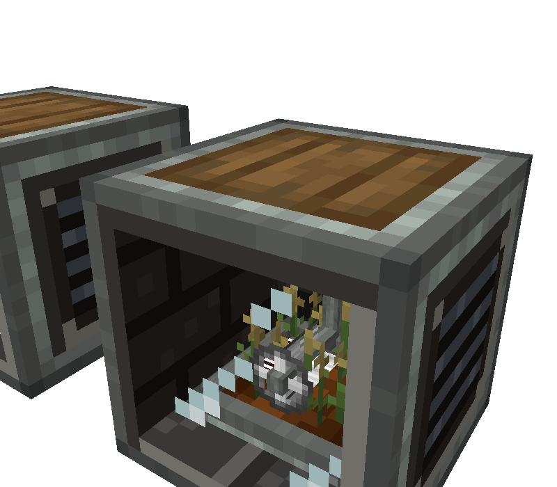
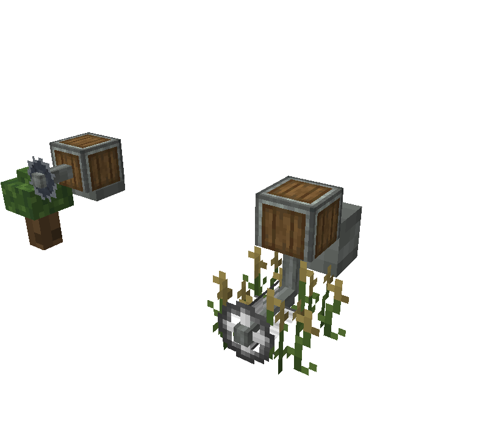
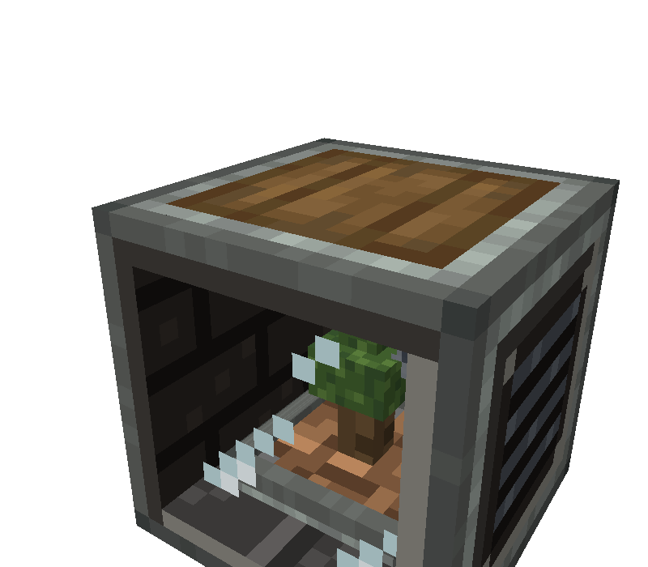
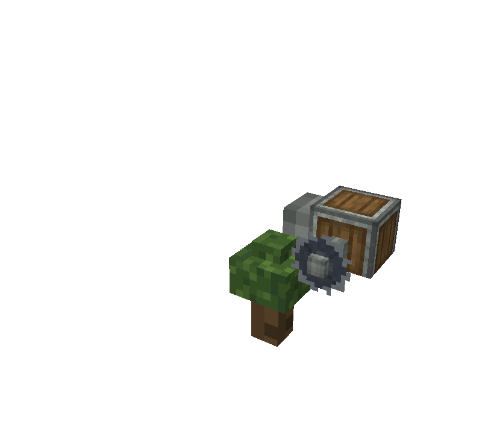
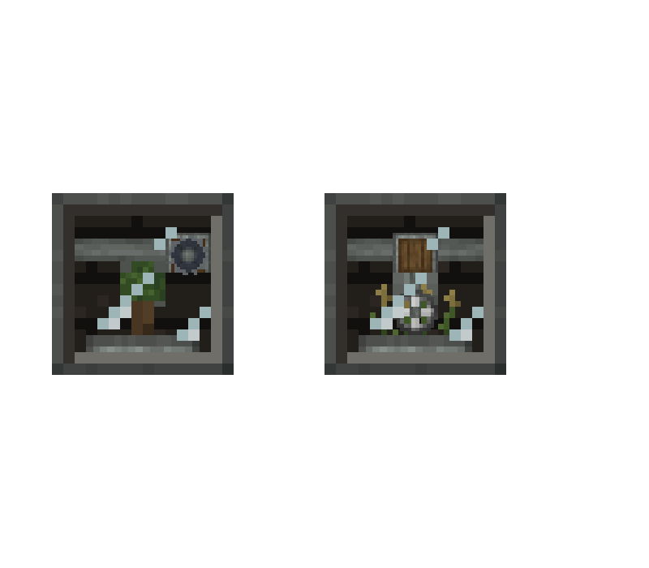
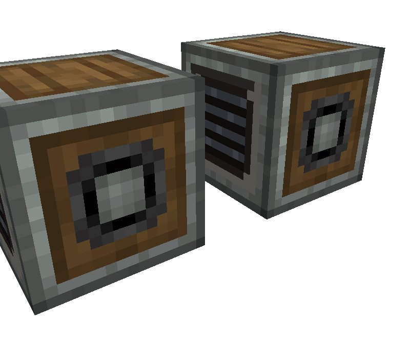

# Code Dossier: Auto Harvester

Path shorthands used in citations:
`J/` = `src/main/java/com/comedymonkey/createaddons/` ·
`A/` = `src/main/resources/assets/comedymonkeysaddons/` ·
`D/` = `src/main/resources/data/comedymonkeysaddons/`.
Line numbers in block/item model JSON point at the element's `"from"` line.
All pixel coordinates are in the renderer's model space: **front (window) facing north**, x = 0 west → 16 east, y = 0 bottom → 16 top, z = 0 front/north → 16 back/south (`J/client/AutoHarvesterRenderer.java:28`).

## Identity

- Registry id: `auto_harvester` (block `J/registry/ModBlocks.java:143`, block entity `J/registry/ModBlockEntities.java:60-62`, block item `J/registry/ModItems.java:52`, menu `J/registry/ModMenus.java:33-34`).
- Type: a single-block kinetic machine (`KineticBlock`, `J/content/harvester/AutoHarvesterBlock.java:36`; `KineticBlockEntity`, `J/content/harvester/AutoHarvesterBlockEntity.java:58`). Not a multiblock.
- Classes: `AutoHarvesterBlock`, `AutoHarvesterBlockEntity`, `AutoHarvesterMenu`, `HarvesterPlants`, `PlantKind` (`J/content/harvester/`); renderer `J/client/AutoHarvesterRenderer.java` (registered `J/client/ComedyMonkeysCreateAddonsClient.java:86`); plant drawing helper `J/client/RealPlants.java`; screen `J/client/AutoHarvesterScreen.java` (registered `ComedyMonkeysCreateAddonsClient.java:77`); shaft stub helper `J/client/CobbleGeneratorRenderer.java:65-79`. No Flywheel visual and no contraption-specific renderer (no Auto Harvester references under `J/compat/`).
- Footprint: 1 × 1 × 1 block.

## What It Does

1. **Place it.** The window turns to face the player (`AutoHarvesterBlock.java:53-56`). Power has to come from a shaft into the **back** face only (`AutoHarvesterBlock.java:58-62`).
2. **Plant it.** Use a plantable item on it while the planter is empty; one item is taken (`AutoHarvesterBlock.java:80-89`). It also takes a plant through the wrench screen's planter slot (`AutoHarvesterMenu.java:45`) or from a funnel or arm into automation slot 9 (`AutoHarvesterBlockEntity.java:585-608`). Crops, stems, berry bushes, nether wart, pitcher pods, flowers, mushrooms, cane, cactus, bamboo, cocoa and vines count as **CROP**; saplings and nether fungi with a findable log count as **TREE** (`HarvesterPlants.java:69-94`). Planting sets the `plant` blockstate (`AutoHarvesterBlockEntity.java:138-146`) and plays the crop-planted or grass-place sound (`AutoHarvesterBlockEntity.java:124-125`).
3. **Grow.** While it's running (shaft turning, not overstressed, planted, not blocked: `AutoHarvesterBlockEntity.java:246-254`), `growth` counts up 1 per tick to `growTicks` (`AutoHarvesterBlockEntity.java:187-194`). `growTicks` = 20 × crop seconds (default 40) × the plant's growth factor (0.2–2, from vanilla growth stages), or 20 × tree seconds (default 80), divided by (1 + 0.5 × Bountiful level), at least 20 ticks (`AutoHarvesterBlockEntity.java:148-157`; `J/config/CMConfig.java:214-225`; `HarvesterPlants.java:102-129`). Rotation speed has no effect on pace.
4. **Harvest.** Once grown, an 80-tick harvest runs (`HARVEST_TICKS`, `AutoHarvesterBlockEntity.java:60`). At tick 52 (`CUT_TICK`, `:62`) the plant is cut. Its drops go into a 9-slot buffer, and whatever doesn't fit is held in `pending` (`AutoHarvesterBlockEntity.java:196-197, 205-219`). It plays a crop-break or wood-break sound at volume 0.6, pitch 0.9–1.1 (`:213-214`) and grants the "Reap What You Sow" advancement nearby (`:215`). Growth resets to 0 at the cut (`:206`). At tick 80 the head is parked again (`:198-202`).
5. **Yield per harvest.** A crop gives the loot of its fully grown block, broken with no tool (stems give their melon or pumpkin) (`HarvesterPlants.java:132-141, 162-191`). A tree gives 4 + 0–2 logs plus 8 rolls of its leaves' drops (saplings, sticks, apples); a fungus also has a 1-in-3 chance of a shroomlight on each roll (`HarvesterPlants.java:143-160`; `CMConfig.java:226-233`).
6. **Cycle time** = `growTicks` + 80 ticks (`AutoHarvesterBlockEntity.java:355-358`). Wheat at defaults: 40 s growing + 4 s harvesting = 44 s.
7. **Blocked.** If a harvest overflowed, nothing more grows until `pending` has drained into the buffer (`AutoHarvesterBlockEntity.java:221-232, 251-254`). While blocked or empty it puts **no stress** on the network (`:265-268`; `J/content/FixedStress.java:13-16`).
8. **Stress.** A fixed 512 SU at any speed, because its impact per RPM is the SU divided by the speed (`AutoHarvesterBlockEntity.java:256-285`; `CMConfig.java:210-213`).
9. **Output.** Hoppers, chutes, funnels, pipes and arms can take items from slots 0–8 on **any side** (`J/ComedyMonkeysCreateAddons.java:136-138`; `AutoHarvesterBlockEntity.java:589-623`). Using it empty-handed gives the player everything in the buffer, sneak-using it returns the plant (`AutoHarvesterBlock.java:91-108`), and a wrench opens the screen (`:110-120`). A comparator reads how full the buffer is (`AutoHarvesterBlock.java:130-138`; `AutoHarvesterBlockEntity.java:398-400`).
10. **Bountiful** I–III comes from the item's enchantments (`AutoHarvesterBlockEntity.java:427-446`) and is kept when the block is broken (`D/loot_table/blocks/auto_harvester.json` copy_components). The tag is `D/tags/item/enchantable/bountiful.json:3`.
11. **Breaking** it drops the plant, the buffer and pending items. A block moved by a contraption or Aeronautics keeps them (`AutoHarvesterBlock.java:122-128`).

## What the Player Is Told

- **Name**: "Auto Harvester" (`A/lang/en_us.json:779`). Its advancement, "Green Thumb, Grey Box: Craft an Auto Harvester. The farm now fits in one block" (`en_us.json:883-884`), names the fantasy outright: a grey box with a garden inside.
- **Tooltip**: "A sealed _planter_ that grows a crop or tree and harvests it again and again. The plant itself is _never used up_." It says to plant with a seed, crop or sapling; that it needs a _shaft_ into its _back_ and uses 512 SU at any speed; and that it holds nine stacks, taken out from any side, and stops when full (`en_us.json:780-786`).
- **Goggles**: "Auto Harvester:", then the plant's name and one status of "Nothing planted", "Full: needs emptying (no stress)", "Needs rotation", "Growing: N%" or "Harvesting", then "N seconds per harvest", "Bountiful N" and "N items ready" (`en_us.json:787-795`; logic `AutoHarvesterBlockEntity.java:450-479`).
- **Ponder** "A Farm in a Box" (`J/client/ponder/FarmScenes.java:41-134`; `en_us.json:976-984`):
  1. It grows a crop or sapling behind its glass (arrow on the north/window face, `:53-57`).
  2. Plant wheat seeds; the scene sets 25% growth (`:60-71`).
  3. A motor turns the shaft in the back at 32 RPM; "512 SU, more speed won't make it faster" (`:74-82`).
  4. The scene jumps to 95% growth and starts a harvest: "the reel sweeps across it" (`:84-93`). The text arrow points at block-local (0.5, 0.4, 0.1), the window about 6 px up (`:90`).
  5. "Hoppers, chutes, funnels and pipes take the harvest out of any side", with the arrow on the east face (`:95-100`).
  6. It switches to `PLANT=tree` and an oak sapling at 95% and harvests: "Saplings grow into trees that a saw fells" (`:102-112`).
  7. Bountiful, shown with an enchanted book (`:114-122`).
  8. A wrench opens the screen (`:124-132`).
- **Recipe** (`D/recipe/auto_harvester.json:4-24`): andesite alloy in the corners, a Create **Mechanical Harvester** above, a **Mechanical Saw** below, dirt on either side and **Andesite Casing** in the middle. The material language is Create andesite with a harvester and a saw built in.
- **README**: "A Create-style botany pot: the Cobblestone Generator's box with a planter behind the glass" (`README.md:143`). "The head drops, sweeps the planter with a harvester reel (crops) or a saw (trees), and parks" (`README.md:149`).
- **Advancements**: `D/advancement/auto_harvester.json`, `harvester_harvest.json` ("Reap What You Sow", `en_us.json:964-965`) and `harvester_bountiful.json` ("Overgrown", `en_us.json:966-967`).
- **Sounds**: vanilla only. Crop-planted or grass-place on planting, crop-break or wood-break on the cut (`AutoHarvesterBlockEntity.java:124, 213`); block sound type STONE (`ModBlocks.java:147`). There are no custom sound events (`A/sounds/` holds only `trade_bot`).

## States

| State | Source | How the player can tell today |
|---|---|---|
| `facing` = north / east / south / west | blockstate, `AutoHarvesterBlock.java:38`; model y-rotation 0/90/180/270, `A/blockstates/auto_harvester.json` | The window points that way |
| `plant` = none | blockstate, `AutoHarvesterBlock.java:40`; `PlantKind.java:9-10`; uses model `auto_harvester_dirt` | Bare dirt soil, reel parked, no plant (the renderer draws the **reel** even when empty, `AutoHarvesterRenderer.java:137`) |
| `plant` = crop | `PlantKind.java:11-12`; uses model `auto_harvester` (moist farmland) | Farmland soil, crop in the window, reel tool |
| `plant` = tree | `PlantKind.java:13-14`; uses model `auto_harvester_dirt` | Dirt soil, sapling or little tree, saw tool instead of reel |
| `Plant` item | synced, `AutoHarvesterBlockEntity.java:490-491, 511` | The real plant drawn small through the window (`RealPlants.java:58-65`) |
| `Growth` / `GrowTicks` (0–1 grown) | synced, `:492, 494, 512, 514` | Plant growth stage or size (`RealPlants.java:83-115`); the generic fallback models scale (`AutoHarvesterRenderer.java:84-98`) |
| `HarvestTick` = -1 (growing, head parked) | synced, `:493, 513` | Head parked at the viewer's right, upper position |
| `HarvestTick` = 0–79 (harvesting) | same | Head plunges, sweeps, lifts and returns with the tool spinning; item particles and a break sound at tick 52 |
| `Blocked` (harvest didn't fit) | synced, `:495, 519` | **Not drawn.** It only shows indirectly: the head stays parked, the plant stays at growth 0 (seedling) and the shaft stub keeps turning |
| `Output` (9 slots) | synced, `:496, 515`, batched every 10 ticks (`:181-184`) | **Not drawn.** Goggles, screen and comparator only |
| `Pending` (overflow) | written in every packet, `:497-502` | Not drawn |
| `Enchantments` (Bountiful level) | synced, `:503-505, 520-523` | Not drawn on the block. Only faster growth, the goggles and the screen |
| Kinetic speed / overstressed | Create `KineticBlockEntity` base | Speed: the shaft stub spins (`CobbleGeneratorRenderer.java:68-72`). Stopped or overstressed: everything else freezes in place (`AutoHarvesterBlockEntity.java:171, 293, 301`). The two can't be told apart |
| Running / idle / working (derived) | `:246-254, 360-362` | Indirectly, through the motion above |

## Moving and Changing Parts

The renderer draws everything in the north-facing frame, rotated about Y through the block centre by `-(front.toYRot() + 180)`, which matches the blockstate rotation (`AutoHarvesterRenderer.java:70-73`). Every part uses `RenderType.cutout()` and the block's world light; nothing is full-bright (`:69, 145-149`).

**Harvest cycle** (driven by `t = (HarvestTick + partialTicks) / 80`, `AutoHarvesterBlockEntity.java:290-295`; partial ticks only while running, so a stop freezes it mid-move). Constants are at `AutoHarvesterRenderer.java:39-46`; path at `:101-117`; `ease` is smoothstep f²(3−2f) (`:141-143`).

| Phase | t | Ticks | Seconds | Hub X (px) | Hub Y (px) | Easing |
|---|---|---|---|---|---|---|
| Parked / growing | -1 | — | grow time | 4 (`PARK_X`) | 10.5 (`PARK_Y`) | — |
| Plunge | 0 – 0.15 | 0 – 12 | 0.6 | 4 | 10.5 → 5.5 (`CUT_Y`) | smoothstep |
| Sweep | 0.15 – 0.65 | 12 – 52 | 2.0 | 4 → 12 (`SWEEP_END_X`) | 5.5 | linear |
| **Cut** | 0.65 | 52 | — | 12 | 5.5 | server: drops into buffer; client: 10 particles, growth → 0 (`AutoHarvesterBlockEntity.java:240-243`) |
| Lift | 0.65 – 0.8 | 52 – 64 | 0.6 | 12 | 5.5 → 10.5 | smoothstep |
| Return | 0.8 – 1.0 | 64 – 80 | 0.8 | 12 → 4 | 10.5 | smoothstep |

Seen from in front of the window, x = 4 is on the **viewer's right**, so the head parks on the right and sweeps right to left (derived: a viewer facing the north face faces south, with west on their right).

| Part | Model file | Driven by | Axis / pivot / range | Source |
|---|---|---|---|---|
| Carriage | `A/models/block/auto_harvester_carriage.json` (one cube x2–6, y9–12.5, z8.5–12.5, `:11`) | Hub X | **Translate X only** by `(x − 4)/16`: 0 → +8 px, so the carriage runs x2–6 → x10–14. Never moves in Y or Z, never rotates | `AutoHarvesterRenderer.java:119-121` |
| Pole | `A/models/block/auto_harvester_pole.json` (1×1×1 px at x3.5–4.5, **y0–1**, z9.5–10.5; N/S/E/W faces only, `:11`) | Hub Y; inherits the carriage's X translate | `translate(0, y/16, 0)` then `scale(1, 9 − y, 1)`: the 1-px unit is **stretched in Y** from the hub centre up to y = 9 (`CARRIAGE_BOTTOM`), up to 3.5× at the cut. Drawn only while y < 9 (about ticks 4.4 – 59.6). No rotation | `AutoHarvesterRenderer.java:122-128` |
| Reel (crop and empty) | `A/models/block/auto_harvester_reel.json` (face plane x6–10, y6–10 at z4.5 `:12`; crossed fins at x=8 `:46` and y=8 `:80`, z4.5–8.25; axle 1×1 z4–9.5 `:114`) | Hub X/Y, plus spin = ticks × **18°/tick** (1440°, 4 turns per harvest; 0 while parked) | Modelled with the hub at (8, 8). `translate((x−8)/16, (y−8)/16, 0)`, then `rotate Z(−spin)` about (8, 8): the **axis points out through the window**. By the right-hand rule that reads counter-clockwise to a player at the window, i.e. rolling the way it travels (check in Blockbench) | `AutoHarvesterRenderer.java:115-116, 131-138` |
| Saw (tree) | `A/models/block/auto_harvester_saw.json` (disc plane x6–10, y6–10 at z6 `:13`; hub cube z5.5–6.5 `:47`; axle z6.5–9.5 `:115`) | Same path; spin **45°/tick** (3600°, 10 turns per harvest) | Same pivot and axis as the reel | same |
| Real plant | none: vanilla or modded block models via `renderSingleBlock` | Growth 0–1 | Centred on (8, 3, 8). A crop is one block at scale 0.45 (7.2 px), shown at the growth stage nearest its `age`. Stage-less plants scale 0.3 → 1 × that. Cane, cactus and bamboo are 1 then 2 blocks at 0.3 × (0.7–1). Two-block crops are two halves at 0.3. A sapling is 0.45 × (0.6–1) until growth 0.35, then a 2-log, 6-leaf tree in 2-px blocks scaled 0.65 → 1 (up to 8 px tall, 6 px wide) | `RealPlants.java:41-53, 67-115, 183-191`; called `AutoHarvesterRenderer.java:74-77` |
| Generic crop (fallback) | `A/models/block/auto_harvester_crop.json` (4 crossed planes x4–12 / z4–12, y3–8, `:11, 44, 77, 110`) | Growth | Scaled about (8, 3, 8): XZ 0.7 → 1, Y 0.15 → 1 | `AutoHarvesterRenderer.java:84-98` |
| Generic tree (fallback) | `A/models/block/auto_harvester_tree.json` (log x7–9 y3–6.5 `:12`, leaves x6–10 y6.5–9 `:62`, top x7–9 y9–10 `:130`) | Growth | Uniform scale 0.3 → 1 about (8, 3, 8) | same |
| Back shaft stub | `A/models/block/cobble_generator_shaft.json` (x6–10, y6–10, z−0.02–3.5 modelled into the north face, `:9`) | Kinetic angle from Create (`getAngleForBe`) | Turned to face the back, then spun about the **world** X or Z axis through the block centre like a Create shaft. In north-facing space it sits at x6–10, y6–10, **z12.5–16.02**, poking 1.5 px into the chamber past the back wall's inner face (z14). Always drawn, `RenderType.solid()` | `AutoHarvesterRenderer.java:66`; `CobbleGeneratorRenderer.java:65-79` |
| Cut particles | not a model: vanilla item particles of the plant | Tick 52 (client) | 10 particles at random x4.8–11.2, y3.5–7.5, z4.8–11.2, drifting up | `AutoHarvesterBlockEntity.java:305-319` |
| Soil | static, in the blockstate model | `plant` blockstate | Farmland (crop) or dirt (none, tree) | `A/models/block/auto_harvester.json:18` vs `auto_harvester_dirt.json:18` |

## Code Contract

**Model files the code loads by name** (renaming any of them breaks the renderer or the blockstate):
- Blockstate models: `block/auto_harvester` (plant=crop) and `block/auto_harvester_dirt` (plant=none and plant=tree), each with y-rotation 0/90/180/270 for north/east/south/west (`A/blockstates/auto_harvester.json`). The two files are identical apart from the soil texture (`:18`), so a redesign has to keep both in step.
- Standalone part models, registered in `AutoHarvesterRenderer.registerModels` (`AutoHarvesterRenderer.java:54-57`, called from `ComedyMonkeysCreateAddonsClient.java:110`): `block/auto_harvester_carriage`, `block/auto_harvester_pole`, `block/auto_harvester_reel`, `block/auto_harvester_saw`, `block/auto_harvester_crop`, `block/auto_harvester_tree` (`AutoHarvesterRenderer.java:31-36`).
- Shared: `block/cobble_generator_shaft` (`CobbleGeneratorRenderer.java:36-37`, registered `ComedyMonkeysCreateAddonsClient.java:109`).
- Item: `A/models/item/auto_harvester.json` is its **own full static copy** (946 lines). It has the shell and farmland (`:24-500`), the carriage parked (`:554`), the reel parked at hub (4, 10.5) (`:622-724`), wheat planes (`:792-891`) and the glass (`:924`), but no shaft stub. No renderer runs for the item, so a redesign has to rebuild this file with the head parked and a crop in place.
- A texture the code loads by name: `block/auto_harvester_crop` is drawn at 30% alpha as the ghost sprout in the empty planter slot of the screen (`AutoHarvesterScreen.java:25, 66-72`).

**Part split.** The static blockstate model holds the shell, planter and soil, the rail, and anything else that never moves. The carriage, pole, tool and plant must **not** be in the blockstate model, or they'd show twice and stay put. They are drawn by the block-entity renderer from the six part models above.

**Pivots and envelopes the part models must match** (the constants are in `AutoHarvesterRenderer.java:39-46`; changing any of them is a code change):
- **Carriage**: modelled at its **parked** position, centred on x = 4. It only slides +X by 0–8 px. To clear the walls (inner faces at x = 2 and x = 14) it has to fit within x2–6 when parked. Its underside should sit at **y = 9**, where the pole ends.
- **Pole**: has to be a **1-px-tall unit from y = 0 to y = 1**, centred on x = 4 (the hub column). It's stretched in Y to between 1.5 and 3.5 px, so any texture or detail gets stretched with it. Its Z (currently 9.5–10.5) should meet the back of the tool's axle.
- **Reel and saw**: modelled around the **hub at (8, 8)** in XY. They spin about the Z axis (the axis out through the window) through that point. In XY the spinning tool sweeps a circle, so its radius must be **≤ 2 px**. At the sweep ends the hub is at x = 4 and x = 12 (walls at 2 and 14), and at the cut the hub is at y = 5.5 (planter rim top at y = 3.5). The current tools are exactly 4 px across. Z depth is free between the glass (z = 0.9) and the shaft stub's tip (z = 12.5, at x6–10, y6–10). The reel currently spans z4–9.5.
- **Spin rates**: reel 18°/tick, saw 45°/tick, both resetting to 0 each harvest. 1440° and 3600° are whole turns, so there's no snap when it parks. The tool turns at the same rate whatever the shaft's RPM.
- **Plant volume**: soil top at **y = 3** (`AutoHarvesterRenderer.java:45`; `RealPlants.java:42`), with plants centred on (8, 8) in XZ. Keep x4.4–11.6, z4.4–11.6 and y3 up to about 12.6 free of static geometry: a 0.45-scale crop reaches y 10.2, two-block and stacked plants about y 12.6, the tree y 11. `CROP_SCALE` is documented as sized to "fit the planter, clear the parked head" (`RealPlants.java:43-44`).
- **Cut particles** spawn in x4.8–11.2, y3.5–7.5, z4.8–11.2 (`AutoHarvesterBlockEntity.java:313-314`). Keep that volume open, or particles will spawn inside geometry.
- **Shaft stub**: always drawn at x6–10, y6–10, z12.5–16.02 in north-facing space. The back face needs a 4 × 4 px socket centred at (8, 8). Inside the chamber, either leave room for the stub to poke 1.5 px through or make the back wall at least 3.5 px thick to hide it.
- **Rail**: static (block model `auto_harvester.json:498`, x2–14, y10–12, z9.5–11.5). It's free to redesign, as long as it still reads as what the carriage (y9–12.5, z8.5–12.5) rides along X.

**Facing and rotation**:
- `FACING` is horizontal, and the window faces the placing player (`AutoHarvesterBlock.java:38, 53-56`).
- `rotate` and `mirror` turn `FACING` (`:69-77`).
- The rotation axis is the facing axis (`:64-67`).
- Everything is modelled with the front facing north.

**Ports**:
- Kinetic: a shaft into the **back** face only (`AutoHarvesterBlock.java:58-62`).
- Items: on **all six faces** (the capability ignores side, `ComedyMonkeysCreateAddons.java:137-138`). Slots 0–8 are output, extract only. Slot 9 is the planter, insert only while empty (`AutoHarvesterBlockEntity.java:589-623`).
- No fluids, no FE.
- A comparator reads the buffer (`AutoHarvesterBlock.java:130-138`).

**Voxel shape**: no `getShape` or `getCollisionShape` override anywhere in `AutoHarvesterBlock.java` (`:36-149`), so it's the default **full cube 0,0,0 – 16,16,16**. It's `noOcclusion()` and `isViewBlocking = false` (`ModBlocks.java:148-149`), so a model that doesn't fill its faces won't cause see-through faces on its neighbours.

**Render types**: every model is `render_type: minecraft:cutout` with `ambientocclusion: false` (`auto_harvester.json:3-4`, and the same in each part model). Part models are drawn cutout (`AutoHarvesterRenderer.java:148`) and the stub solid (`CobbleGeneratorRenderer.java:76-77`). There's no translucent layer anywhere, so semi-transparent glass pixels get cut off at the alpha threshold: glass has to be fully opaque or fully clear pixels unless the render type changes.

**Light**: none. There's no `lightLevel` in its properties (`ModBlocks.java:144-150`), and the renderer uses world light only. A glow would need code.

**Filter slots, scroll values, value boxes**: none. The block entity adds no behaviours.

**Connected textures**: none.

**Other properties**: strength 2.5 / 6.0, STONE sound, requires the correct tool (`ModBlocks.java:146-150`), mineable with a pickaxe (`src/main/resources/data/minecraft/tags/block/mineable/pickaxe.json:41`). Particle texture: `auto_harvester_side` (`auto_harvester.json:6`).

**Borrowed Create and vanilla textures** (we can't edit these; pointing our JSON elsewhere affects only us): `create:block/gearbox` (back), `create:block/andesite_casing` (top, planter rim, carriage), `create:block/axis` (rail, pole, axles), `create:block/axis_top` (saw hub, shaft stub ends), `create:block/harvester` (reel), `minecraft:block/farmland_moist` and `minecraft:block/dirt` (soil) (`auto_harvester.json:6-18`; `auto_harvester_reel.json`, `auto_harvester_saw.json`, `auto_harvester_pole.json`, `auto_harvester_carriage.json` texture blocks).

**Shared with other blocks.** Editing any of these PNGs or models changes these other blocks too:

| Asset | Harvester uses it as | Also used by |
|---|---|---|
| `A/textures/block/auto_harvester_side.png` | side faces and break particle (`auto_harvester.json:6, 9`) | **Animal Pen** (`animal_pen.json:6, 9`) |
| `A/textures/block/andesite_cobble_generator_front.png` | front frame (`:7`) | **Andesite Cobblestone Generator** (`andesite_cobble_generator.json:7`), **Wireless Andesite Cobblestone Generator** (`wireless_andesite_cobble_generator.json:7`, `…_powered.json:7`), **Animal Pen** (`animal_pen.json:7`) |
| `A/textures/block/andesite_cobble_generator_bottom.png` | bottom (`:11`) | Andesite Cobblestone, Basalt and Blackstone Generators, Tuff Generator, all their Wireless versions and `_powered` models (each `:11`), **Animal Pen** (`animal_pen.json:11`) |
| `A/textures/block/cobble_generator_chamber.png` | inner walls (`:12`) | Andesite and Brass Cobblestone Generators and their Wireless versions (+ `_powered`) (`:12`), **Animal Pen** and **Brass Animal Pen** (`:12`) |
| `A/textures/block/cobble_generator_floor.png` | chamber floor (`:13`) | same set as the chamber texture (`:13`) |
| `A/textures/block/cobble_generator_ceiling.png` | chamber ceiling (`:14`) | same set as the chamber texture (`:14`) |
| `A/textures/block/cobble_generator_glass.png` | window (`:15`) | **every** generator model: andesite and brass cobblestone, basalt, blackstone, tuff, all Wireless versions and `_powered` (`:16`); **Animal Pen** and **Brass Animal Pen** (`:15`); **Stone Infuser** (`stone_infuser.json:10`) |
| `A/models/block/cobble_generator_shaft.json` and `CobbleGeneratorRenderer.renderShaft` | back shaft stub (`AutoHarvesterRenderer.java:66`) | all Cobblestone/Basalt/Blackstone/Tuff Generators (`CobbleGeneratorRenderer.java:57`), Animal Pens (`AnimalPenRenderer.java:43`), **Cuckoo Clock** (`CuckooClockRenderer.java:88`, hands-off, so this model is effectively frozen), String Tangler and Stone Infuser (`MachineRenderers.java:60`), Electric Motor (`ElectricRenderers.java:85`), Magma Engines (`MagmaEngineRenderer.java:60`), Aeronautics parts (`J/compat/sable/client/AeronauticsRenderers.java:129`) |
| `A/textures/block/auto_harvester_crop.png` | generic crop and item model | GUI ghost sprout (`AutoHarvesterScreen.java:25`); harvester only |

The **shell geometry is not shared**. Each block has its own copy of the identical 9-element shell (front frame z0–1, 2-px side, back, floor and ceiling walls, glass plane at z0.9 across x2–14, y2–14). I checked that the first nine elements' from/to match in `andesite_cobble_generator.json`, `brass_cobble_generator.json`, `tuff_generator.json`, `animal_pen.json` and `brass_animal_pen.json`. Changing the geometry in `auto_harvester*.json` affects only the harvester; changing the shared **PNGs** affects all the blocks above. The survey suggests designing the shell once for the whole family (`design/dossiers/survey.md:36`).

## Current Look

Screenshots, from `auto-harvester/before.bbmodel`. It's built from the game's own model files by `tools/gen-before.js`, with the head posed by the renderer's numbers: the crop machine is mid-sweep (t = 0.4, hub at x8 y5.5) and the tree machine is parked. Real plants drawn by `RealPlants` and the shaft's spin aren't shown.

| | |
|---|---|
|  |  |
| Crop machine mid-sweep. Through the glass the head reads as a white cog in the wheat; the near-white glass glints are the brightest thing on the block. | Cutaway, both machines with the shell hidden. The carriage is a bare casing box, the pole a thin rod, the reel Create's flat harvester sprite, the saw a flat disc. Nothing shows a rail. |
|  |  |
| Tree machine parked. The saw sits up behind the frame, out of view. | Tree cutaway: saw and carriage parked at the west end. |
|  |  |
| Straight on (tree left, crop right): the rail bar across the top, the head hanging from the carriage. | Back: Create's gearbox face on both. |

**Shell** (`auto_harvester.json:22-254`). A full cube with a 12 × 12 px window on the north face: a 2-px frame 1 px deep, and a glass plane set back to z0.9 (`:552`). Walls, floor and ceiling are 2 px thick, leaving a chamber of x2–14, y2–14, z1–14.
- Top: Create andesite casing, an andesite frame with brown planks.
- Sides: `auto_harvester_side` (16², 18 colours). An andesite frame (#8c8a82, #828784, highlights #9aa49d, #a8b3ab), a near-black bevel (#171412, #2a2521) and four horizontal slate-blue slats (#4a4f57, #5f656e) like a vent grille.
- Front: `andesite_cobble_generator_front`. Only its outer 2-px ring shows on the frame: andesite with a dark (#3e3b37) / light bevel. The brown plank centre (#553a1f–#886539) sits behind the aperture and is never seen.
- Back: Create gearbox, an andesite frame with brown wood and a black central hole, which the spinning shaft stub covers.
- Bottom: `andesite_cobble_generator_bottom`, an andesite frame, a brown ring, and a grate of flat light-grey bars (#a8a8a8, #8a8a8a, #6b6b6b).

**Chamber**.
- Walls: `cobble_generator_chamber`, dark brown brick (#171412 / #2a2521 / #362f29, 3 colours, sparse flecks).
- Floor: `cobble_generator_floor`, dark grey diagonal tread plate with a centre seam (#2b2a29–#5e5b5a, 4 colours).
- Ceiling: `cobble_generator_ceiling`, a flat 4 × 4 two-tone checker (#2b2a29 / #3a3837).
- Glass: `cobble_generator_glass`, 13 opaque glint pixels (#c6e2e6, #f4fdff) on clear.

**Planter** (`:275-457`). An 8 × 8 soil top at y2–3 (only its top face) inside a 1-px andesite-casing rim 1.5 px tall (x3–13, z3–13), using thin UV strips of the casing texture.

**Gantry and head**.
- Rail (`:498`): a 12-px Create axis bar wall to wall.
- Carriage: one plain 4 × 3.5 × 4 casing cube.
- Pole: a 1 × 1 axis stick.
- Reel: Create's harvester texture on a 4 × 4 plane (a cross-spoked wheel in near-white #ffffff / #eaeaea / #cdcdcd), plus two zero-thickness fins showing its tooth strip.
- Saw: a flat 4 × 4 disc, `auto_harvester_saw` (33 colours, blue-grey steel #282a30–#7a8086 with a toothed rim and dark hub, gently mottled), with an axis hub and axle.

The survey calls these "stand-ins" (`design/dossiers/survey.md:7`).

**Plants**. Usually the real block models are drawn (`RealPlants`). The fallbacks are muted:
- Generic crop: greens #3c5526–#62803b, straw heads #9c8a4c / #b09c58.
- Generic tree: log in dark walnut #45331f–#674d31 (flat, 3 colours), leaves #34502a–#587b3a (4 colours).

**Against the house style**:
- *Works*: the dark chamber reads as a deep interior. The saw texture sits right in the dark blue-grey steel range. Plant and walnut fallbacks are muted. The side slats are in the steel range. The overall andesite read matches the recipe.
- *Doesn't*:
  - The reel is the brightest thing in the block, near-white Create harvester art, which breaks "never near-white".
  - The glass glints are near-white too (#f4fdff), on every block that shares the glass.
  - Andesite highlights #9aa49d–#a8b3ab on the side, bottom, top and back sit above the mid-grey ceiling (#8a8c86), and the bottom grate bars (#a8a8a8) are flat and light.
  - The ceiling is an unmottled checker, and the chamber brick is nearly flat.
  - No brass or copper anywhere, not even as trim.
  - The moving parts are planes and one plain box with no volume (the reel and saw are paper-thin), and the carriage doesn't read as a trolley.
  - The front texture's plank work is wasted behind the window.
  - Item model: the same shell with the head parked and wheat planes; no shaft stub.

## Function the Look Doesn't Show

1. **Blocked / full** (`Blocked`, synced at `AutoHarvesterBlockEntity.java:495, 519`). No client drawing code reads it. A full machine shows a parked head, a seedling-stage plant and a turning shaft stub, which looks like a slow grow. The goggles say "Full: needs emptying (no stress)" (`en_us.json:789`).
2. **Stored harvest** (`Output`, 9 slots, synced `:496`). Nothing in the window shows any items or how full it is. Goggles, screen and comparator only.
3. **Stopped vs overstressed**. Both freeze everything mid-motion (`:171, 293, 301`). There's no tell for overstress, and no idle pose.
4. **No stress while empty or full** (`:265-268`). Invisible.
5. **Bountiful I–III** (`:503-505`). The block shows nothing; only growth speeds up.
6. **Item ports on all six faces, plus automated planting through slot 9** (`ComedyMonkeysCreateAddons.java:137-138`; `:585-623`). No face reads as a port or hatch.
7. **Fixed pace regardless of RPM**. The shaft stub spins at network speed while the head always takes 4 s, and nothing shows the machine "governing" the speed.
8. **Overflow (`Pending`)** and **seconds per harvest**: synced or derivable, never drawn.

## Look the Code Doesn't Back Up

1. **The rail is a Create shaft** (axis texture, `auto_harvester.json:498`) but it's static and never turns. It reads as a drive shaft feeding the carriage.
2. **The pole is a Create shaft** (`auto_harvester_pole.json`) but it never rotates. It only stretches in Y. It suggests the tool is shaft-driven from the carriage.
3. **The back is a Create gearbox face** (`auto_harvester.json:8`), which implies gearbox-style connections. Only the back takes a shaft (`AutoHarvesterBlock.java:58-62`), and nothing passes through.
4. **Moist farmland** (`auto_harvester.json:18`) suggests the crop needs water. There's no water mechanic, and cactus, nether wart, mushrooms and flowers all sit on the same farmland because every non-tree plant is `crop`.
5. **The side vent grilles** (`auto_harvester_side`) suggest airflow or cooling. Nothing like that exists. The sides are item ports, which they don't look like.
6. **The bottom drain grate** (`andesite_cobble_generator_bottom`) suggests output only from below. Output actually works from every side.
7. **The tool spin doesn't follow kinetic speed** (fixed 18 or 45°/tick, `AutoHarvesterRenderer.java:46`), unlike the shaft stub next to it. That's consistent with the fixed-pace rule, but the look doesn't explain it.
8. **The cut happens at the far end of the sweep (x = 12)**, but particles spawn across the planter's middle (x4.8–11.2, `AutoHarvesterBlockEntity.java:313-314`), and the plant vanishes to growth 0 while the tool is already past it.

## History

- `bfb73f2` "Release 1.8.0: Auto Harvester, electricity" introduced the block, the renderer and every model and texture. It describes "an animated harvester reel or saw on a gantry". `git log` on `auto_harvester.json`, `auto_harvester_carriage.json`, `auto_harvester_side.png` and `AutoHarvesterRenderer.java` shows no later visual change.
- `1c3c267` "Release 1.9.0" added the ponder scene and its `setPonderPlant` / `startPonderHarvest` hooks (`AutoHarvesterBlockEntity.java:97-109`), moved Bountiful into `MachineEnchantments`, and introduced the Animal Pens, which copy this shell and reuse `auto_harvester_side.png`.
- `26adbd3` / `9ddc3df` (1.10.0): a Create-style GUI kit screen (`textures/gui/auto_harvester.png`), menu and plant-rule fixes, and unit tests (`src/test/.../content/harvester/`). Only `HARVEST_TICKS` is used in tests (`AutoHarvesterBlockEntityTest.java:207`); no test pins model names or renderer constants.
- No earlier brief, spec, plan or Blockbench model exists for the harvester (nothing in `design/briefs`, `design/specs`, `design/plans` or `design/models` matches "harv").
- Survey (`design/dossiers/survey.md:7, 29`) ranks it redesign #1. It calls the moving parts stand-ins and the blocked state "synced, never drawn", and recommends "a real trolley on a rail, a reel with bats and tines, a toothed saw and a blocked/full tell ... without new animation code".
