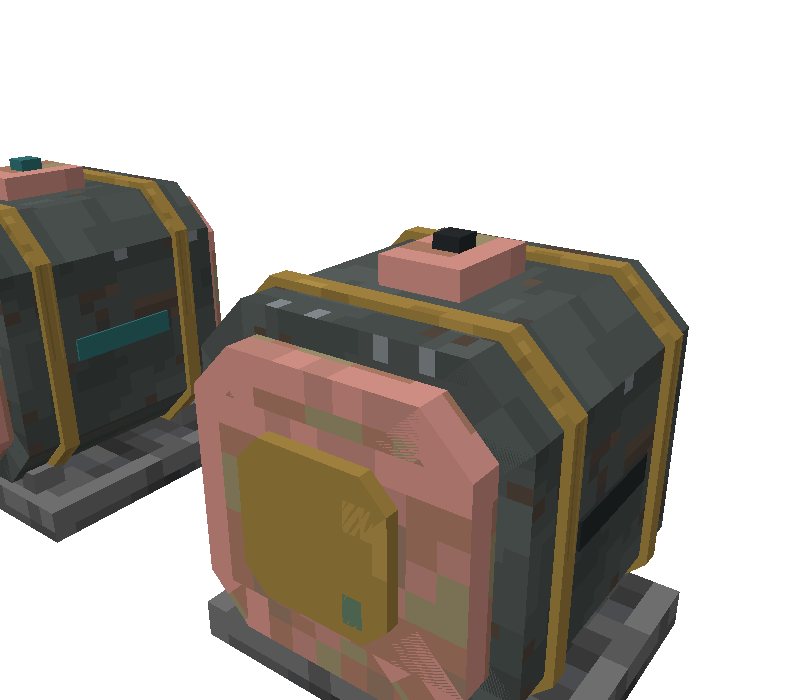
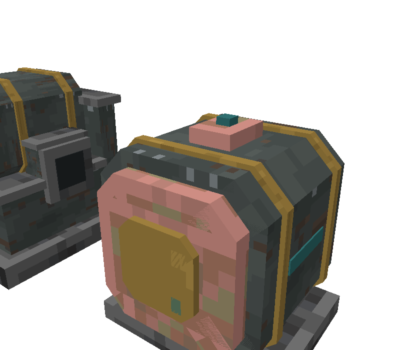

# Code Dossier: Electric Motor

Path shorthands used in citations:
`J/` = `src/main/java/com/comedymonkey/createaddons/` ·
`A/` = `src/main/resources/assets/comedymonkeysaddons/` ·
`D/` = `src/main/resources/data/comedymonkeysaddons/` ·
`BE` = `J/content/electric/ElectricMotorBlockEntity.java` ·
`Blk` = `J/content/electric/ElectricMotorBlock.java` ·
`ER` = `J/client/ElectricRenderers.java` ·
`Scr` = `J/client/ElectricMotorScreen.java` ·
`M.json` = `A/models/block/electric_motor.json` (unpowered), `P.json` = `A/models/block/electric_motor_powered.json` ·
`Create/` = Create 6.0.10 sources (`create-1.21.1-6.0.10-281-sources.jar`, `com/simibubi/create/`).
Line numbers in model JSON point at the element's `"from"` line. The two models have identical geometry and line numbers up to `:3329`; after that `P.json` is shifted by the added `neoforge_data` blocks.

**Coordinate frame.** Pixel coordinates are in the model's own frame: the motor is modelled **facing north**, so the **shaft comes out of the north face (z = 0)** and the back is z = 16. x runs west → east, y bottom → top. A player looking at the shaft end faces south, so **−x (west) is on their right**. The blockstate turns this frame for the other five facings (see Code Contract).

## Identity

- Registry id: `electric_motor`. Block `J/registry/ModBlocks.java:231-232`; block entity `J/registry/ModBlockEntities.java:107-109`; block item `J/registry/ModItems.java:73`; creative tab `J/registry/ModCreativeTabs.java:63`.
- Type: a single block, 1 × 1 × 1. A kinetic **source** (Create's `kinetic_sources` ponder tag, `J/client/ponder/CMPonderPlugin.java:115-118`).
- Classes:
  - `ElectricMotorBlock extends DirectionalKineticBlock implements IBE` (`Blk:28`).
  - `ElectricMotorBlockEntity extends GeneratingKineticBlockEntity` (`BE:27`), holding an `EnergyBuffer` (`J/content/electric/EnergyBuffer.java`, shared with the Lava Generator and the Geothermal Turbine).
  - Renderer `ElectricRenderers.Motor` (`ER:71-94`), registered at `J/client/ComedyMonkeysCreateAddonsClient.java:92`. It's a plain `SafeBlockEntityRenderer`: no Flywheel visual, no `PartialModel`, no contraption renderer.
  - Settings screen `ElectricMotorScreen extends AbstractSimiScreen` (`Scr:32`), a client-only screen with **no menu** (no `ModMenus` entry). It sends `MotorSettingsPayload` (`J/network/MotorSettingsPayload.java:15`), registered at `J/ComedyMonkeysCreateAddons.java:202`.
- Ponder: `J/client/ponder/ElectricScenes.java:91-157` ("Plugging In"), registered at `CMPonderPlugin.java:76-77` with structure `A/ponder/electric_power.nbt` (shared with the Lava Generator's scene, `:74-75`). The motor also appears in the hands-off turbine scene (`ElectricScenes.java:254-257`).

## What It Does

1. **Place it.** Facing comes from Create's `DirectionalKineticBlock.getStateForPlacement` (`Create/content/kinetics/base/DirectionalKineticBlock.java:49-58`); the motor doesn't override it.
   - No neighbouring shaft pointing at it: the shaft faces **back at the player** (`nearestLookingDirection.getOpposite()`), and sneaking faces it away (`:51-55`). All six directions are possible, including up and down.
   - Next to exactly one kinetic block whose shaft points at it, it faces **away from that block** (`FACING = preferred.getOpposite()`, `:57`). Create's own Creative Motor overrides this to face the neighbour (`Create/content/kinetics/motor/CreativeMotorBlock.java:32-38`); ours doesn't.
   - A wrench **doesn't rotate it**: `onWrenched` opens the settings instead (`Blk:53-59`). Sneak-wrenching still picks it up (`Blk:53` comment, Create's `IWrenchable`). After placing, the facing changes only through structure `rotate`/`mirror` (`DirectionalKineticBlock.java:60-69`).
2. **Feed it power.** Forge Energy goes in through **any of the six faces** and the null side (`J/ComedyMonkeysCreateAddons.java:165-168`), the shaft face included.
   - The buffer is `EnergyBuffer(cap, cap, 0)` (`BE:46`): any amount up to the room left goes in per tick, and **nothing can pull energy out** (test `ElectricMotorBlockEntityTest.java:104-111`).
   - Capacity is one second at full stress: max(100,000, 294,912 SU × 0.0625 × 20) = **368,640 FE** with default config (`BE:44-45`; `J/config/CMConfig.java:337-344`; test `:85-88`).
   - The motor never pulls. Something has to **push** into it: the Lava Generator pushes out of its two side terminals (`LavaGeneratorBlockEntity.java:96-97`), the turbine pushes down out of its base ports (`GeothermalControllerBlockEntity.java:168, 266`), or a Pipez energy pipe does.
3. **Set it with a wrench** (`Blk:54-59` → `Scr:54-58`). The screen (224 × 132, `Scr:34`) has:
   - **Speed**: 1, 2, 4, 8, 16, 32, 64, 128 or 256 RPM (`Scr:35, 105-112`).
   - **Stress**: steps of what the generators make: ¼, ½, 1, 2, 3, 4, 6, 8 and 12 Lava Generators, one turbine, and the motor's max, kept only if ≤ max (`Scr:69-78`). With default config one generator = 1,024 / 0.0625 = 16,384 SU and the turbine = 737,280 SU, which is **over the 294,912 cap and is dropped**, so the list is 4,096 · 8,192 · 16,384 · 32,768 · 49,152 · 65,536 · 98,304 · 131,072 · 196,608 · 294,912 SU (derived).
   - **Direction**: an icon button toggling "Clockwise" / "Counter-clockwise" (`Scr:123-129, 137-143`).
   - A read-out "Draws N FE a tick" in teal `#8FD6CC` and what supply that needs ("Half a Lava Generator", "18 Lava Generators (40% of a turbine)"…) (`Scr:154-176`).
   - The settings are sent **when the screen closes**, by the tick button or Esc (`Scr:131-132, 178-182`). The server ignores them unless the player is within 8 blocks and may build (`MotorSettingsPayload.java:33`), then clamps speed to 1–256 and stress to multiples of 256 between 256 and the max (`BE:83-90`).
   - Defaults: 64 RPM, 16,384 SU, not reversed (`BE:34-36`).
4. **Start.** Each server tick it needs `stress × 0.0625` FE (`BE:70-76`; `CMConfig.java:341-344`): 256 FE/t at 4,096 SU, 1,024 FE/t at the default 16,384 SU (one Lava Generator), **18,432 FE/t** at 294,912 SU. Stopped, it starts only once it holds **10 ticks' worth** (half a second) (`BE:98`).
5. **Run.** While running it takes the FE every tick, carrying fractions over in `owed` (`BE:99-102`).
   - It turns at the set speed, sign-flipped by `reversed` and by the facing's axis direction (`BE:122-127`; `Create/content/kinetics/base/KineticBlockEntity.java:508-510`; test `ElectricMotorBlockEntityTest.java:187-199`).
   - It gives `stress / speed` capacity per RPM, so the **set stress at any speed** (`BE:129-135`; test `:201-208`).
   - The draw follows the **setting, not the load**: it pays the same FE with nothing attached to the shaft as at full load (`BE:97-102`).
6. **Running flips.** When `running` changes (`BE:106-114`):
   - it updates its rotation (and Create syncs it, `Create/content/kinetics/base/GeneratingKineticBlockEntity.java:89-115`),
   - sets the `powered` blockstate, which swaps the model to the glowing one and gives **light 6** (`ModBlocks.java:232`),
   - and, if it starts at the full 294,912 SU, awards "Unlimited Power" to nearby players (`BE:109-110`; `J/advancement/ModAdvancements.java:34`).
7. **Short of power.** If the store can't cover what's owed plus this tick, it stops and clears `owed` (`BE:98, 103-105`). It restarts at 10 ticks' worth again. So a supply weaker than the draw makes it **cycle**: charge to half a second, run until empty, stop, and so on (derived from `BE:98`).
8. **Overstressed.** If the network asks for more than it has, Create zeroes the speed (`KineticBlockEntity.java:289-293`) and the shaft stops. `running` stays true, so the motor **keeps drawing FE, keeps glowing and keeps sparking** (`BE:97-114` doesn't check overstress).
9. **Sparks.** While `powered`, in 1 of 5 client `animateTick` calls it puts a cyan dust particle (RGB 0.45, 0.85, 0.95 ≈ `#73d9f2`, size 0.6) at a random point within ±0.45 blocks of the centre (`Blk:31, 61-69`).
10. **Breaking.** It drops itself (explosion-checked, `D/loot_table/blocks/electric_motor.json`). Nothing is copied, so the **stored energy and the settings are lost**. Pickaxe-mineable (`src/main/resources/data/minecraft/tags/block/mineable/pickaxe.json:36`). Strength 3.5 / 8, needs the right tool, NETHERITE_BLOCK sound (`ModBlocks.java:253-260`).

## What the Player Is Told

- **Name**: "Electric Motor" (`A/lang/en_us.json:693`).
- **Tooltip** (Create-style, `J/ComedyMonkeysCreateAddons.java:256`):
  - "Turns _Forge Energy_ into rotation: fast, and strong enough to rival a _full steam boiler_." (`:694`)
  - When Powered: "Turns its _shaft_ at the set _speed_ with the set _stress capacity_, up to _294,912 SU_. The more stress it's set to give, the more _FE_ it draws." (`:695-696`)
  - R-Click with a Wrench: "Opens its settings: _speed_ (Create's standard speeds), _stress_ (in steps of what the generators make) and _direction_." (`:697-698`)
- **Goggles** (`BE:137-150`; text `en_us.json:714-716`):
  - "Electric Motor:", then `N / 368,640 FE` in gold.
  - Running: aqua "Drawing N FE a tick". Not running: red "Not enough power (needs N FE a tick)". The same red line shows whether it's starved, charging up, or has nothing connected.
  - Then Create's generator stats ("Stress capacity provided: N su at current speed"), only while its capacity isn't 0, i.e. while running (`GeneratingKineticBlockEntity.java:55-86`).
- **Screen**: title "Electric Motor"; labels Speed / Stress / Direction; scroll titles "Rotation Speed", "Stress Capacity", "Scroll to change" (`en_us.json:711-713, 735-746, 758`). The GUI sheet is `A/textures/gui/electric_motor.png` (brass header band `#b18d45`, dark brown body, GuiKit title colour `0x2B2724`, `J/client/GuiKit.java:25`).
- **Ponder** "Plugging In" (`ElectricScenes.java:91-157`; `en_us.json:756, 764-769`). Structure: motor at (3,1,2) **facing east** with a Create shaft at (4,1,2), Lava Generator at (2,1,2) facing north, fed by a lava Wellspring (`electric_power.nbt`). Power goes into the motor's **back (west) face** from the generator's side terminal.
  1. "The Electric Motor turns Forge Energy into rotation, with up to 294,912 stress units: a full steam boiler's worth", pointing at its top (`:101-108`).
  2. Generator lit, motor `powered=true`, shaft at 64 RPM: "Feed it power on any side: here, straight from a Lava Generator", pointing at the west face (`:110-120`).
  3. Wrench right-click on the top: "Right-click it with a Wrench to set its speed, its stress and which way it turns" (`:122-130`).
  4. Speed to 128: "Speed snaps to Create's standard speeds. Stress snaps to what the generators make…" (`:132-138`).
  5. "The more stress it's set to give, the more power it draws: 1 FE a tick for every 16 SU", pointing at the east (shaft) face (`:140-145`).
  6. Generator out, `powered=false`, speed 0: "Short of power, it stops, and starts again once it has half a second's worth stored" (`:147-155`).
- **In the turbine's ponder** (hands-off scene): "A motor set into the floor under the base, its shaft running out to the east", at (4,0,3), facing east, powered, 128 RPM, with two Create shafts (`ElectricScenes.java:254-261`). Text: "It powers anything under its base… enough for two and a half Electric Motors flat out" (`en_us.json:777`). Here the power goes into the motor's **top**.
- **Lava Generator's ponder**: the generator powers a motor at (3,1,2) at 64 RPM (`ElectricScenes.java:70-80`): "…enough for an Electric Motor at 16,384 SU" (`en_us.json:762`).
- **Recipe** (`D/recipe/electric_motor.json`): `PEP / CMC / IBI`. Brass plates (P), an **electron tube** (E), **copper ingots** (C), a **precision mechanism** (M), **Industrial Iron blocks** (I) and a **Brass Casing** (B). The material language: an iron-footed brass-and-copper machine with electronics and precision gearing inside.
- **Advancements**:
  - "Live Wire: Make an Electric Motor, and turn all that power back into rotation", a task under the Lava Generator, on crafting (`D/advancement/electric_motor.json`; `en_us.json:749-750`).
  - "Unlimited Power: Run an Electric Motor at its full 294,912 stress units. A whole steam boiler, from one block", a **challenge** under the Geothermal Turbine (`D/advancement/motor_full_power.json`; `en_us.json:753-754`).
- **README**: "the **Electric Motor** turns it back into rotation" (`README.md:16`); rates "1 FE/t for every 16 SU it's set to give, up to 294,912 SU (a full superheated boiler)" (`:268`); settings, snapping and restart (`:272`); recipe (`:273`); config (`:317`).
- **Doc mismatch** (not a look issue): the README and the screen's own Javadoc say the stress steps go "up to one Geothermal Turbine" (`README.md:272`; `Scr:28-29`). With default config the turbine's 737,280 SU is above the 294,912 cap and the step is filtered out (`Scr:75-77`).
- **Sounds**: no custom sound events. Only the NETHERITE_BLOCK block sounds (`ModBlocks.java:257`). There's no running hum.
- **The fantasy promised**: a compact, very strong industrial electric motor ("rival a full steam boiler") that's the **consumer end** of the electric family. The Lava Generator and turbine make FE, the motor turns it back into rotation. The javadoc on `POWERED` says "Running: **the coil** glows" (`Blk:29`).

## States

| State | Source | How the player can tell today |
|---|---|---|
| `facing` = north / east / south / west | blockstate, `DirectionalKineticBlock.java:16`; y 0/90/180/270 (`A/blockstates/electric_motor.json:3-32`) | Which end has the copper bell + brass plate + the spinning shaft stub; feet stay on the floor |
| `facing` = up | same; **x 270** (`electric_motor.json:33-40`) | Shaft on top. The whole model is tipped back: the deepslate base slab and feet end up on the **north** side, the top terminal box on the **south** side, the back glow dot underneath |
| `facing` = down | same; **x 90** (`:41-48`) | Shaft underneath. Base slab on the **south** side, top box on the **north** side |
| `powered=false` | blockstate, `Blk:30, 35`; model `electric_motor` | Glow parts dark `#25292c`, light 0, no sparks, shaft still |
| `powered=true` | blockstate, set from `running` (`BE:111-113`); model `electric_motor_powered` | The four glow parts turn flat teal `#2f6f70` and full-bright (`P.json:3329, 3402, 3475, 3616`), light 6 (`ModBlocks.java:232`), cyan sparks (`Blk:61-69`), shaft turning |
| `Running` | synced, `BE:163, 177` | Same as `powered` |
| `SpeedSetting` 1–256 RPM | synced, `BE:160, 173` | Only the **spin rate** of the 4 × 4 shaft stub (and whatever is attached). The body doesn't change |
| `Reversed` | synced, `BE:162, 176` | Only the stub's **spin direction** |
| `StressSetting` 256–294,912 SU (screen: 4,096–294,912) | synced, `BE:161, 174` | **Not shown.** Goggles ("capacity provided") and the screen only |
| `Energy` 0–368,640 FE | synced, `BE:159, 169`; resent every 10 ticks when it moves by >1% (3,686 FE) (`BE:116-119`) | **Not shown.** Goggles only |
| Charging (stopped, building to 10 ticks' worth) | derived, `BE:98` | Looks exactly like "no power" and "nothing connected": dark, still |
| Short of power / cycling on a weak supply | derived, `BE:98, 103-107` | The glow and shaft blink on and off every second or so (whole-model swap) |
| Overstressed network | Create, synced `Stress`/`Capacity` (`KineticBlockEntity.java:224-225, 264-269`) | Shaft stops, but the motor **still glows, sparks and gives light 6** because `running` stays true |
| Network speed set by another, faster source | Create | Stub turns at the network speed, not the setting |

Sync cadence: `sendData()` on every settings change (`BE:89`), on every running flip (via `updateGeneratedRotation`, `GeneratingKineticBlockEntity.java:115`), and on energy moves as above. `write` sends every field on every packet; there's no `clientPacket` filter (`BE:156-164`). **Everything the motor knows is already on the client**: speed, stress, reversed, running, energy, and Create's stress and capacity.

## Moving and Changing Parts

The renderer (`ER:71-94`) draws **one thing**: the shaft stub.

| Part | Model file | Driven by | Axis / pivot / range | Source |
|---|---|---|---|---|
| Shaft stub (frozen, shared) | `block/cobble_generator_shaft`: one 4 × 4 × 3.52 px cube, x6–10, y6–10, z−0.02–3.5, Create `axis` sides and `axis_top` ends (`A/models/block/cobble_generator_shaft.json:9-17`) | Kinetic speed: `KineticBlockEntityRenderer.getAngleForBe` = (render time × speed × 0.3 + position offset) mod 360°, i.e. 0.3°/tick per RPM, continuous, no easing (`Create/content/kinetics/base/KineticBlockEntityRenderer.java:87-92`) | Turns about the **facing's world axis through the block centre (8, 8, 8)**, unbounded. Exact stack: `translate(0.5,0.5,0.5)`, `rotate(XP/YP/ZP, angle)` on the facing's axis, `translate(−0.5)`, then `face(facing)` = `translate(0.5)`, UP → `XP +90°`, DOWN → `XP −90°`, else `YP −(facing.toYRot()+180)°`, `translate(−0.5)` (`ER:59-69, 81-90`). Drawn into the **cutout** buffer at the block's own packed light (`ER:53-57, 91`). Default BER view distance (no override) | `ER:79-92` |
| Glow parts (back dot, two side strips, top nub) | in both blockstate models; `#glow_off` in `M.json`, `#5` (`electric_glow`) + `neoforge_data {block_light 15, sky_light 15}` + `shade:false` in `P.json` | `powered` blockstate | Static. A whole-model swap, not a renderer part | `electric_motor.json` blockstate; `P.json:3329-3399, 3402-3472, 3475-3545, 3616-3686` |
| Block light 6 | Java | `powered` | from the block's cell | `ModBlocks.java:232` |
| Sparks | particle, not a model | `powered`, client random | 1 in 5 `animateTick`s, a random point in a 14.4-px cube round the centre, so they're not tied to any geometry | `Blk:61-69` |

**Nothing on the body moves.** No rotor, fan, coil or cooling-fin part model, no angle field, no lerp. The only motion is Create's standard shaft-angle formula applied to a shared stub. Anything else that moves needs new part models and new renderer code.

## Code Contract

**Model files the code loads by name.**
- Blockstate models (`A/blockstates/electric_motor.json`): `comedymonkeysaddons:block/electric_motor` for the six `powered=false` variants and `block/electric_motor_powered` for the six `powered=true` variants. Rotations: north none, east y90, south y180, west y270, **up x270, down x90** (`:3-48`).
  - The blockstate JSON is data, not Java. It could point vertical facings at their own models (for example a version whose feet make sense standing up) with no code change, as long as the six `facing × powered` keys stay.
- Item model: `A/models/item/electric_motor.json:2` parents `block/electric_motor`. The inventory icon is the **unpowered, north-facing model** in `block/block`'s default display (no `display` block in `M.json`). The shaft stub isn't in it, because it's renderer-only.
- Renderer: only `block/cobble_generator_shaft` (`CobbleGeneratorRenderer.java:36-37`, registered `ComedyMonkeysCreateAddonsClient.java:111`). The motor has **no part models of its own**. `ER:30-39` / `:47-51` register only the generator's and the turbine's.

**Two models, one geometry.** `M.json` and `P.json` differ only in the four glow elements' texture (`#glow_off` → `#5`) and their `neoforge_data`/`shade` (diff of the two files). A redesign must keep the two geometries identical, or the block will jump when it powers up. The powered look is carried **only** by the model swap: whatever should light up must sit in `electric_motor_powered` as full-bright faces (`neoforge_data` light 15 + `shade: false`), with an unlit counterpart in `electric_motor`. This is unlike the turbine, whose glow is a separate renderer model.

**The shaft socket** (the hardest constraint).
- The shaft comes out of **`facing` only**: `hasShaftTowards = face == FACING` (`Blk:43-46`; test `ElectricMotorBlockTest.java:25-34`). The rotation axis is the facing's axis (`Blk:48-51`; test `:36-41`). There is **no shaft on the back** and none on the sides.
- In the model frame, that's the **north face, centred on (8, 8)**. The stub occupies x6–10, y6–10, z−0.02 to 3.5 and turns about the z-axis through (8, 8).
- The stub model is **frozen**. It's drawn by the Cobble/Basalt/Blackstone/Tuff Generators, the String Tangler and Stone Infuser (`J/client/MachineRenderers.java:60`), the Magma Engines (`J/client/MagmaEngineRenderer.java:60`), the Torque Rotor (`J/compat/sable/client/AeronauticsRenderers.java:129`), and through `CobbleGeneratorRenderer.renderShaft` by the hands-off **Cuckoo Clock** (`J/client/CuckooClockRenderer.java:88`), **Auto Harvester** (`J/client/AutoHarvesterRenderer.java:71`) and **Animal Pens** (`J/client/AnimalPenRenderer.java:57`). A different shaft look for the motor needs its own model and a change to `ER:91`.
- **How much shaft shows is up to the body.** Geometry in front of the stub hides it. Today the brass plate's front is at z0.75 (`M.json:2441`), so only **0.77 px** of the stub sticks out (z−0.02 to 0.75). To show more turning shaft, recess the front up to 3.5 px deep. The square stub's corners sweep a circle of radius 2√2 ≈ **2.83 px**, so a socket that exposes it needs a round-ish opening at least **5.7 px across** centred on (8, 8), or the corners will cut through the rim as it turns.
- Whatever is drawn round the socket turns with the block's facing (blockstate) but **doesn't spin**. Only the stub spins.

**Facing rules.**
- All six facings are reachable (`DirectionalKineticBlock.java:49-58`), so the design has to read **on its side, upright and upside down**.
- Up and down are whole-model X rotations: for **up** (x270) the model's bottom (y = 0) goes to the **north** side and its top to the south. For **down** (x90) the bottom goes **south**. Today's feet, base slab and top terminal box (`M.json:17, 85, 153, 3533`) end up sticking out sideways in those two states.
- The renderer's `face()` uses the same mapping (`ER:59-69`), so the stub always comes out of the shaft face.

**FE input faces.** All six faces, plus null (`ComedyMonkeysCreateAddons.java:167-168`). There's no preferred terminal, and the shaft face takes power too. Receive is effectively unlimited (`maxReceive` = capacity, `BE:46`); extract is 0. In the ponders power arrives at the **back** (`electric_power.nbt`, generator to the west of an east-facing motor) and at the **top** (turbine scene, `ElectricScenes.java:254-257`).

**Voxel shape.** No `getShape` or `getCollisionShape` in `Blk` or Create's `KineticBlock`/`DirectionalKineticBlock` (`Create/content/kinetics/base/KineticBlock.java`, only `updateIndirectNeighbourShapes` at `:62`), so it's a **full cube 0–16** for collision and outline. Create's own motor uses a smaller `MOTOR_BLOCK` shape (`CreativeMotorBlock.java:27-29`); ours doesn't. `noOcclusion()` (`ModBlocks.java:259`).
- The current model spans x1–15, y0–15.5, z0.75–15.35 (from the element bounds of `M.json`). The body can is x2–14, y2–14, so there's a **2 px air gap** on the east and west faces, 0.5 px on top (the top box reaches 15, the nub 15.5), and 0.65 px at the back, where cables and pipes meet the full-cube face.

**Light.** Block light **6 while powered**, 0 otherwise (`ModBlocks.java:232`); the value is in Java. The powered model's glow faces are full-bright by `neoforge_data` (`P.json:3395-3399` etc.). The renderer's stub uses the block's packed light, which includes the motor's own 6.

**Render type.** Both models say `"render_type": "minecraft:cutout"` (`M.json:3`, `P.json:3`). The stub is forced to cutout (`ER:53-57, 91`). No translucency: glass or glints have to be fully opaque or fully clear pixels. AO is the vanilla default (on). Break particles use `machine_paint` (`M.json:12`).

**Things in Java that a pure model swap can't change:** light level 6, the cyan spark colour and its random spawn box (`Blk:31, 61-69`), the stub model and its transforms (`ER:71-94`), the single shaft face, and the full-cube shape.

**Not there (so nothing to keep):** no filter slots or value boxes (no `addBehaviours` in `BE`), no scroll values on the block (settings are in the screen), no connected textures, no comparator output, no particle anchors tied to geometry, no custom sounds.

**Textures the motor uses** (the same key map in both models, `M.json:4-14`; face counts from the 50 elements, 300 faces):

| Asset | Motor uses it for | Also used by (editing the PNG changes these) |
|---|---|---|
| `A/textures/block/machine_paint.png` (16², `#9`) | south, west and down faces of the octagonal can (18 faces, `M.json:221-588`); break particle | **Lava Generator**: `lava_generator.json` and `lava_generator_lit.json` (24 faces each, also their particle); declared but unused in `lava_generator_rotor.json` |
| `A/textures/block/machine_paint_b.png` (16², `#10`) | north, east and up faces of the can (18 faces) | **Lava Generator**: `lava_generator.json`, `_lit` (60 faces each); declared in `_rotor` |
| `A/textures/block/brass_weathered.png` (16², `#11`) | the two bands (`M.json:665-1476`) and the front plate (`:2441-2808`), 108 faces | **Lava Generator**: `lava_generator.json`, `_lit` (120 faces each), `_rotor` (6 faces) |
| `A/textures/block/electric_glow.png` (`#5`) | powered glow parts (24 faces, `P.json` only); declared but unused in `M.json` | **Lava Generator** lit (`lava_generator_lit.json`, 18 faces); declared but unused in `lava_generator.json` and `_rotor` |
| `A/textures/block/electric_glow_off.png` (`#glow_off`) | unpowered glow parts (24 faces, `M.json` only); declared but unused in `P.json` | **Lava Generator** unlit (`lava_generator.json`, 18 faces); declared in `_lit` |
| Vanilla `polished_deepslate` (`#7`) | base slab, feet, back end octagon (54 faces) | Can't be edited. The Lava Generator uses it too (48 faces) |
| Vanilla `exposed_copper` (`#12`) | front and back end bells, top box (72 faces) | Can't be edited. Lava Generator (6 faces) and its rotor (24) |
| Vanilla `weathered_copper` (`#13`) | the **underside** of the back end bell only (6 faces, `M.json:1997-2364`) | Can't be edited. No other model of ours |
| Create `axis`, `axis_top` | the shaft stub (via `cobble_generator_shaft`) | every block listed under the shaft socket above |
| `A/textures/gui/electric_motor.png` (256² sheet, 224 × 132 used) | the settings screen (`Scr:33`) | motor only. Its colours are copied by the hands-off Trade Bot GUI script (`design/gui/trade-bot-station.gui.js:2`), not shared at runtime |

So the motor shares **every one** of its own textures with the Lava Generator. New textures should go under new names (for example `electric_motor_*`) unless the generator is redesigned at the same time.

**What's shared with the Geothermal Turbine** (on `design/hands-off.md`):
- **Textures: nothing any more.** Since `3f5d022` the turbine's 13 models reference only `geothermal_turbine_*` textures (their `textures` maps), so `brass_weathered`, `electric_glow`, `electric_glow_off` and `machine_paint*` are now the motor's and generator's alone. `design/hands-off.md` (Geothermal Turbine section, as edited in the working tree) now says the same: the motor and generator share `ElectricRenderers.java` (`face`, `drawModel`, `registerModels`) and `EnergyBuffer` with the turbine, and "the turbine uses only its own `geothermal_turbine_*` textures". Everything with `geothermal` in its path is hands-off. The motor may **reference** turbine textures for a family match (for example `geothermal_turbine_coil`, `_lamp_cyan`), but **none of them may be edited**, and doing so would tie the motor's look to frozen files.
- **`J/client/ElectricRenderers.java`**: `Motor` (`:71-94`) lives beside the hands-off `Turbine` (`:119-193`) and shares its helpers `drawModel` (`:53-57`) and `face` (`:59-69`) and the `registerModels` list (`:47-51`). Adding motor part models means adding entries; changing `drawModel`, `face`, or the existing entries changes the turbine.
- **`J/content/electric/EnergyBuffer.java`**: the turbine's and the generator's FE store too. Don't touch it for a look change.
- **`J/client/ponder/ElectricScenes.java`**: the turbine scene (hands-off) places a powered, east-facing motor in the floor under the turbine (`:254-257`), so the motor's new look appears there unchanged in code. The motor's own scene (`:91-157`) and `electric_power.nbt` are shared with the Lava Generator's scene (`:36-89`).
- **`J/ComedyMonkeysCreateAddons.java:165-182`**: one capability block for the motor, generator and turbine; the turbine lines are hands-off.
- **Advancement** `motor_full_power` has the turbine's advancement as parent (`D/advancement/motor_full_power.json:2`).
- **Config**: the screen's stress steps use `turbineFePerTick` (`Scr:65-67`).

## Current Look

Screenshots, from `electric-motor/before.bbmodel` (built from the game's model files by `tools/gen-before.js`, scene `tools/scene-electric.json`):

| | |
|---|---|
|  |  |
| Off: the octagonal can lying on its feet, pink exposed-copper end caps, brass bands, the copper box on top. | Powered: the same, its teal strips lit. |
|  | |
| With the Lava Generator, the same green-grey kit. | |

Geometry, from `M.json` (50 elements, all cutout, in the north-facing frame):
- **Base** (`:17-153`): a polished-deepslate slab 14 × 1.5 × 11 (x1–15, y0–1.5, z2.5–13.5) with two deepslate feet 10 × 1 × 1.5 under the can (y1.5–2.5, at z3–4.5 and z11.5–13).
- **Can** (`:221-588`): an **octagonal** prism along the shaft axis, 12 px across flats (x2–14, y2–14) and 11 px long (z2.5–13.5): two crossed boxes plus four 45° corner boxes. North/east/up faces in `machine_paint_b`, south/west/down in `machine_paint`, each face showing the full 16² texture.
- **Two brass bands** (`:665-1476`): octagonal rings 0.75 px wide at z4–4.75 and z11.25–12, 0.3 px proud (1.7–14.3), each face sampling a 8 × 2 strip of `brass_weathered` (uv 4,6–12,8).
- **End bells** (`:1553-2364`): exposed-copper octagons 10 px across (3–13), 1.25 px deep, on both ends (z1.25–2.5 front, z13.5–14.75 back). The back one's underside is weathered copper.
- **Front plate** (`:2441-2808`): a brass octagon 5.5 px across (5.25–10.75), 0.5 px thick at z0.75–1.25, round the shaft. The shaft stub sticks 0.77 px out of it.
- **Back** (`:2885-3329`): a deepslate octagon 6 px across, 0.5 px thick (z14.75–15.25), with a 2 × 2 glow dot on it (z15.25–15.35).
- **Sides** (`:3397, 3465`): one glow strip 5 × 1 px on each of east and west (y7.5–8.5, z5.5–10.5), only **0.1 px proud**.
- **Top** (`:3533, 3601`): an exposed-copper box 3 × 1 × 4 (x6.5–9.5, y14–15, z6–10), like a terminal box, with a 1 × 0.5 × 1 glow nub on it.
- Overall: a horizontal octagonal can on a slab, about 12 × 12 × 14.5 px plus base. The silhouette is "rounded box with rings". It reads as a motor, but as a small one floating inside a full-cube hitbox.

Textures (16², opened and counted):
- `machine_paint` / `machine_paint_b` (8 colours each): green-grey steel `#3e4442`, `#454c4a`, `#4c5351`, `#545b58` (G > R ≈ B) in soft blotches, brown rust patches `#51443a`, `#5f5044`, `#474542`, and two `#80878a` rivet pixels along the top edge. No panel lines, seams or bevels; one texture stretched over every face of the can.
- `brass_weathered` (7 colours): body `#9e7f3d` / `#ae8d46`, dark `#786131` / `#846c37` / `#8d7136`, near-white highlights `#cfb164`, verdigris flecks `#5d7a62`. The 8 × 2 band UV mostly lands on `#9e7f3d`. The front plate's tiny UVs (`0,0–5.5,3.7`) land on the top-left corner, so it shows mostly `#9e7f3d` with a `#cfb164` and a `#5d7a62` fleck (the green speck seen on the plate).
- `electric_glow` (3 colours): teal `#2f6f70` field, `#4a9a96` square, `#78c4bb` centre, in concentric squares. **Every glow face's UV starts at 0,0 and is at most 5 × 2 px** (`P.json:3329-3616`), and the pattern's first three rows are all `#2f6f70`, so in game every glow part is **flat `#2f6f70`**, full-bright. The lighter tones never show.
- `electric_glow_off` (2 colours): `#25292c` / `#30353a`; in game flat `#25292c`.
- Vanilla `exposed_copper`: pink-tan `#796454`–`#ce8d83`; `weathered_copper` verdigris `#497164`–`#7ab799`; `polished_deepslate` neutral grey `#242424`–`#6e6e6e` (values as measured in `design/dossiers/geothermal-turbine.md:221, 237, 240`).

**Against the house style** (dark blue-grey steel `#2f343b–#4a5059`, andesite no lighter than `#8a8c86`, muted brass `#8f7638–#b08f45`, copper `#7a4a2e–#b87a4e`, muted glows, crisp bevelled panels, accents as trims only) and the redesigned turbine (steel `#2f343b` / `#3c424a` / `#4a5059` in `geothermal_turbine_steel.png`, panel bevels `#2a2f35`/`#555b63`, andesite trim `#6b6e6a`–`#7c7f79`, copper coil `#5e3a24`–`#9c5f3a`, brass bezel `#8f7638`/`#b08f45`, one cyan lamp `#6fb7c4`/`#4f8f99`, amber `#c76a2a`–`#d99a4a`):
- *Works*:
  - The shape idea: an octagonal can along the shaft axis is the right "motor" read, and it echoes the turbine's round-over-square language.
  - Dark overall value. The brass body tones `#9e7f3d` / `#ae8d46` sit inside the muted brass range.
  - The glow is small and only on in the powered state, and it's swapped out (dark) when off, unlike the old turbine's always-hot strips.
  - The deepslate foot gives it a floor to sit on when horizontal.
- *Doesn't*:
  - **Steel hue and finish.** Green-grey mottle with rust, not the family's blue-grey crisp panels. Now that the turbine has moved to `geothermal_turbine_*`, the motor and generator are the last users of this old kit, so they now look like a different family from the turbine.
  - **Copper is the loudest thing.** The front of the block is mostly vanilla **exposed copper**, pink and light (up to `#ce8d83`, above the house `#b87a4e`), with a weathered-copper underside adding a third hue. There are **no copper windings** anywhere, which is what the family uses copper for ("copper for windings", `design/briefs/geothermal-turbine.md:34`).
  - **Brass too much and too big.** Two full bands plus a front plate. The survey puts it at about 28% brass (`design/dossiers/survey.md:10`). The plate reads as a hatch, not a bezel, and `#cfb164` highlights are above the brass range.
  - **Glow.** Flat dark teal `#2f6f70`, which is neither the family's cyan `#6fb7c4` nor amber. Four tiny lights (dot, two 0.1 px strips, nub) scattered on three faces rather than one readable lamp. The sparks are a much brighter cyan (`#73d9f2`) than the glow they come off.
  - **No bevels or panel structure**, and one 16² texture is stretched across every can face, so the long faces have no seams, fins or detail.
  - **Small in its cube.** A 2 px gap on both sides and the shaft barely showing: the most important part, the turning output, is 0.77 px of a 4 × 4 stub.
  - **Vertical placement.** On end (up/down) the foot slab and top box stick out of the sides.

## Function the Look Doesn't Show

1. **Stress setting.** A 72× range (4,096 to 294,912 SU) and 256 to 18,432 FE/t, from ¼ of a Lava Generator to "a whole steam boiler". It's synced (`BE:161`) and never drawn. A motor at 4,096 SU looks the same as one at 294,912.
2. **Energy stored** (0–368,640 FE, synced `BE:159`). Goggles only. The buffer matters, since it decides how long the motor rides out a gap in supply.
3. **Why it isn't running.** Starved, charging to its half-second start (`BE:98`), and "nothing connected" all look identical (dark, still). Only the goggles' red line says so.
4. **Overstressed.** The shaft stops but the motor glows, sparks and drains FE as if all were fine (`BE:97-114`; `KineticBlockEntity.java:289-293`). The model gives the opposite message.
5. **Speed and direction.** Shown only by a 4 × 4 stub turning 0.77 px proud of the face. At 1–4 RPM it's hard to see at all.
6. **Power goes in on every face** (`ComedyMonkeysCreateAddons.java:167-168`). Nothing reads as an input terminal except perhaps the top box, which moves to a side when the motor stands upright.
7. **It's configurable.** The wrench opens a speed / stress / direction screen (`Blk:54-59`). There's no dial, selector, plate or readout on the block to hint that it has settings.
8. **Draw by setting, not load.** It pays its full setting in FE even idling with nothing on the shaft (`BE:97-102`). Nothing shows how much it's drawing.
9. **The weak-supply cycle.** On a supply below its draw it blinks on and off. The whole-model swap shows that, but nothing distinguishes it from a healthy start.
10. **Settings and charge are lost on breaking** (loot table copies nothing).

## Look the Code Doesn't Back Up

1. **The base and feet** suggest a floor-standing machine. All six facings are allowed, and for up/down the blockstate tips the whole model, so the slab and feet stick out of the north or south side (`electric_motor.json:33-48`).
2. **The top copper box with a glow nub** reads as a power terminal or junction box. Power goes in through any face (`ComedyMonkeysCreateAddons.java:167-168`), and the box isn't on top when the motor is vertical.
3. **"The coil glows"** (`Blk:29`). There is no coil. The lights are a 2 × 2 dot, two 0.1 px side strips and a nub, with no windings behind them.
4. **The concentric glow texture** promises a lamp with a bright centre (`#78c4bb`). The UVs only sample its flat `#2f6f70` corner, so the lamp detail never appears.
5. **The front brass plate** looks like a cover or hatch over the output; the shaft is hidden behind it except for its last 0.77 px.
6. **The back deepslate disc with a light** looks like a rear bearing or second output; there's no shaft at the back (`Blk:43-46`).
7. **Sparks and glow while overstressed or idle** say "working" when the shaft is stopped or nothing is attached.
8. **The brass bands** read as structural clamps or slip rings; they have no function and make up much of the surface.

## History

- All the motor's models, textures, its blockstate, block, block entity, screen and renderer come from `bfb73f2` "Release 1.8.0: Auto Harvester, electricity". `git log --follow` on `electric_motor.json` shows no other commit, so **the block's look has never been revised**.
- `26adbd3` "Code review fixes, unit tests, Create-style GUIs and quick moves": "Electric Motor settings clamped on load and need build permission" (`BE:170-175`; `MotorSettingsPayload.java:32-34`), the screen restyled to the Create-style GUI kit (`A/textures/gui/electric_motor.png` 2,502 → 11,244 bytes). It added `ElectricMotorBlockEntityTest`, `ElectricMotorBlockTest` and `MotorSettingsPayloadTest`. These pin the buffer size, defaults, direction, capacity, the shaft-on-facing rule and the axis; **no test pins model names or renderer constants**.
- `3f5d022` "Redesign the Geothermal Turbine" moved the turbine onto its own `geothermal_turbine_*` textures and a new renderer in the same `ElectricRenderers.java`. It changed the turbine's ponder so a motor sits in the floor under its base and takes power from the base ports. Since then the motor and the Lava Generator are the only users of the old electric kit.
- No brief, spec or plan exists for the motor (nothing under `design/briefs`, `design/specs`, `design/plans` or `design/models` mentions it). A before-model scene for the motor and generator is at `design/dossiers/tools/scene-electric.json` (motor, motor powered, generator, generator lit), with output in `design/dossiers/electric-motor/`.
- Survey (`design/dossiers/survey.md:10, 37`):
  - Ranks it **#4** in the table (11 points: gap 3, presence 4, fit 4; effort medium): "Octagonal can, about 28% brass bands, teal glow strips. Only a stock shaft moves"; hidden states "Stress setting, energy, reverse and short of power. Only `powered` shows".
  - Families: "Lava Generator → Electric Motor → Geothermal Turbine share one texture kit (green-leaning steel, weathered brass, teal glows) and the octagonal-can motif. Restyle the kit once." The turbine has now left that kit; its brief names the target language for the other two: crisp blue-grey steel, copper for windings, brass for bezels only, one cyan "making power" light (`design/briefs/geothermal-turbine.md:34`).

## Changed by the redesign (2026-10-24)

- **Look**: new models `electric_motor` and `electric_motor_powered` (same file names), item model with the shaft, `electric_motor_*` textures. Generated by `design/models/electric.gen.js`, exported by `electric.export.js`.
- **Power in through the base only**: `ElectricMotorBlock.isInput(state, side)` (the side opposite `facing`), used by the energy capability in `ComedyMonkeysCreateAddons`; pinned by `ElectricMotorBlockTest.takesPowerOnlyThroughItsBase`. Ponder text, tooltip and README say so.
- **Sounds**: `ElectricSounds.tickMotor` (from `clientTicker`): hum loop (quiet, 8 blocks, pitch from the speed setting), start and stop with the contactor; a faint spark crackle on about one spark in ten (`animateTick`); the settings click from `applySettings` on the server.
