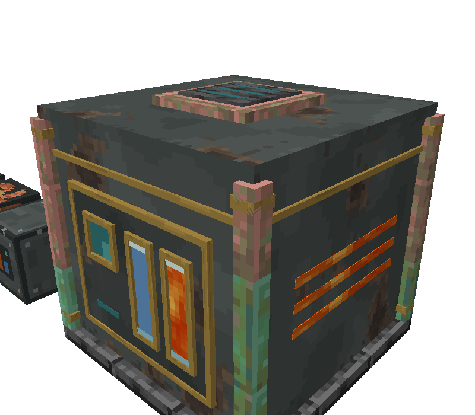
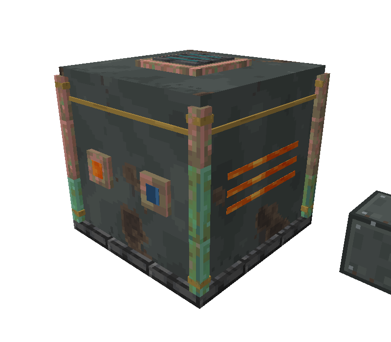
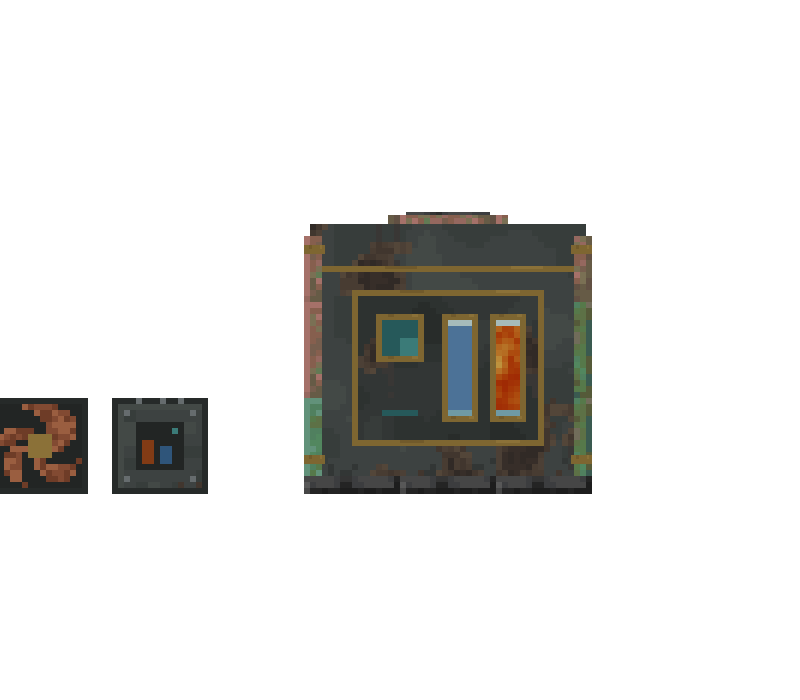
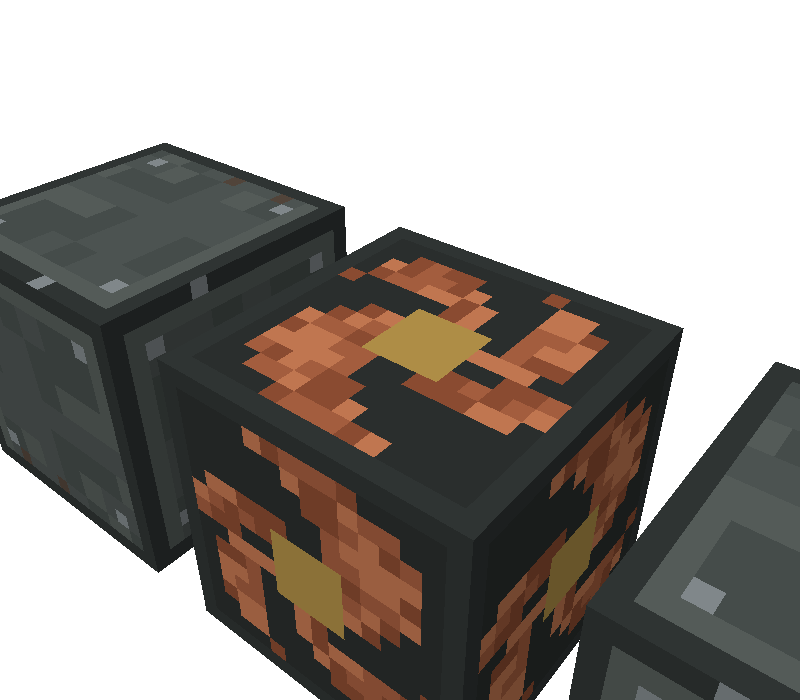

# Code Dossier: Geothermal Turbine

Path shorthands used in citations:
`J/` = `src/main/java/com/comedymonkey/createaddons/` ·
`A/` = `src/main/resources/assets/comedymonkeysaddons/` ·
`D/` = `src/main/resources/data/comedymonkeysaddons/` ·
`T.json` = `A/models/block/geothermal_turbine.json`, `G.json` = `A/models/block/geothermal_turbine_glow.json`.
Line numbers in model JSON point at the element's `"from"` line.

**Coordinate frame.** All pixel coordinates are in the formed model's frame. The machine is modelled **facing north** around its **middle block** (the Turbine Core): the core is x0–16, y0–16, z0–16; the 3x3x3 runs from −16 to 32 on every axis. x runs west → east, y bottom → top, z front (north) → back (south). The controller is the front-middle cell, **x0–16, y0–16, z−16–0** (`J/client/ElectricRenderers.java:133-135`; `J/content/electric/GeothermalControllerBlock.java:125-135`). A player looking at the front is facing south, so **−x (west) is on their right**.

## Identity

- Registry ids: `geothermal_casing`, `geothermal_core`, `geothermal_controller` (blocks `J/registry/ModBlocks.java:235-240`; block entities `geothermal_casing` and `geothermal_controller`, `J/registry/ModBlockEntities.java:117-124`; block items `J/registry/ModItems.java:75-78`; creative tab `J/registry/ModCreativeTabs.java:65-67`). The core has **no** block entity (`J/content/electric/GeothermalPartBlock.java:48-50`).
- Type: a 3 × 3 × 3 multiblock. One controller, one core, 25 casings.
- Classes (`J/content/electric/`):
  - `GeothermalControllerBlock` (a plain `Block` + `IBE` + `IWrenchable`, `:41`) and `GeothermalControllerBlockEntity` (`SmartBlockEntity`, `IHaveGoggleInformation`, `:36`).
  - `GeothermalPartBlock`, shared by casing and core through a `casing` flag (`:22-30`; `ModBlocks.java:235-238`).
  - `GeothermalCasingBlockEntity` (only remembers its controller, `:13-37`).
  - `EnergyBuffer` (shared FE store, also used by the Lava Generator and Electric Motor).
- Renderer: `ElectricRenderers.Turbine` (`J/client/ElectricRenderers.java:108-154`). It's registered for the controller block entity (`J/client/ComedyMonkeysCreateAddonsClient.java:92`), and its standalone models are registered at `:115` → `ElectricRenderers.java:42-45`. There's no menu or screen, no Flywheel visual and no contraption renderer.
- Ponder: `J/client/ponder/ElectricScenes.java:154-259`, registered for all three ids (`J/client/ponder/CMPonderPlugin.java:78-80`), with structure `A/ponder/geothermal_turbine.nbt`.

## What It Does

1. **Build.** Lay a 3x3x3: the **Turbine Core** goes in the exact middle, the **Controller** in the middle of the front face (middle column, middle layer), and **Geothermal Casings** in the other 25 cells (`GeothermalControllerBlockEntity.java:162-177`; tooltip `A/lang/en_us.json:704`). The controller faces the player who places it (`GeothermalControllerBlock.java:57-59`). The middle block is the cell **directly behind** the controller (`GeothermalControllerBlockEntity.java:102-105`), so the controller must face **out** of the structure. Placed from the side, it looks for its structure in the wrong place and never forms.
2. **Forming.** The controller checks the structure **once a second** (`gameTime % 20 == 0`), and also on the next tick after a check is queued (`:117-120`).
   - A check is queued when it's created or loaded (`:47`, `:294`), and when a formed casing is removed (`GeothermalPartBlock.java:54-57`).
   - Placing the last block doesn't queue a check, so forming takes up to 1 s. Ponder: "Within a second it forms" (`en_us.json:774`).
   - The check walks the 27 cells around the middle block, skipping the controller's own cell. The middle cell must be a core and every other cell a casing (`:163-170`; `GeothermalPartBlock.java:62-64`).
3. **On forming** (`setFormed(true)`, `:190-219`):
   - Every block in the 3x3x3 that has the `formed` property, **including the controller**, which uses the same property object (`GeothermalControllerBlock.java:43`), is set to `formed=true` (`:201-202`). That makes it `RenderShape.INVISIBLE` (`GeothermalPartBlock.java:42-43`; `GeothermalControllerBlock.java:61-64`).
   - Each casing stores the controller's position (`:203-204`).
   - The controller records all **54** outward faces of the cube as energy outlets (`:205-213`).
   - Capabilities on all 27 cells are invalidated so pipes and cables look again (`:184-188`).
   - Nearby players get the "Full Steam Ahead" advancement (`:217-218`; `ModAdvancements.java:33`; `D/advancement/geothermal_turbine.json`).
   - From then on, the controller's renderer draws the whole machine.
4. **Fill it.**
   - **Lava and water** go in through **any face of any casing or of the controller**. Both fill handlers ignore the side (`J/ComedyMonkeysCreateAddons.java:173-180`), and the inlet routes by fluid (`GeothermalControllerBlockEntity.java:320-329`).
   - Each fluid has its own **16,000 mB** tank (`TANK`, `:37`, `:40-41`). Flowing lava counts as lava (test `GeothermalControllerBlockEntityTest.java:96`).
   - Nothing can be drained back out (`:331-339`).
   - A bucket or other fluid container works **only on the controller** (`GeothermalControllerBlock.java:76-85`); casings have no `useItemOn`.
   - An unformed turbine takes no fluid. Its capabilities are null (`ComedyMonkeysCreateAddons.java:173-176`), and the inlet refuses too (`:322-323`).
5. **Burn.** While formed and **both tanks are non-empty** (`:126-128`), it makes up to **46,080 FE a tick**, limited by the room left in the buffer (`CMConfig.java:353-356`).
   - Fuel use is proportional to what's made: **90 mB/s lava** and **250 mB/s water** at full output, which is 4.5 and 12.5 mB a tick (`:129-137`; `CMConfig.java:357-364`).
   - That's 10,240 FE per mB of lava, ten times the Lava Generator's 1,024 FE/t at 20 mB/s (`CMConfig.java:345-352, 358`).
   - Full tanks last about **178 s** of lava and **64 s** of water at full output (derived: 16,000 / 90 and 16,000 / 250).
6. **Output.** Every tick it first pushes stored FE into anything that accepts energy on any of the 54 outward faces (`:123-125`; `EnergyBuffer.java:64-72`).
   - Anything can also **pull** from any face of the controller or any casing. The extract-only view has no rate limit: the buffer is `EnergyBuffer(4,000,000, 0, 4,000,000)` (`:38, 42, 44`; `ComedyMonkeysCreateAddons.java:175-180`; `EnergyBuffer.java:75-107`).
   - The buffer holds **4,000,000 FE**, about 87 ticks (4.3 s) of full output.
   - One turbine supports **737,280 SU** of Electric Motors, "two and a half motors flat out" (`CMConfig.java:334-336`; `ElectricMotorScreen.java:65-66`).
7. **Running flag.** Each tick it makes power, `activeTicks` is set to 40. It counts down otherwise, and is 0 while unformed (`:139, 142-145`). `running = activeTicks > 0` drives the controller's `lit` blockstate (`:147-153`), which:
   - gives **light level 12** (`ModBlocks.java:240`),
   - turns the glow model full-bright (`ElectricRenderers.java:137`),
   - starts the steam, flame, lava-pop and sound effects (`GeothermalControllerBlock.java:98-123`).
8. **Stop conditions.** These are the goggle status keys, checked in this order (`:251`):
   - `running`.
   - `no_lava`: the lava tank is empty.
   - `no_water`: the water tank is empty.
   - `full`: both tanks have fluid, but the buffer is full because nothing is taking power, so `make = 0` (`:127-128`).
   - Each stop shows up only after the 40-tick (2 s) hang time.
9. **Breaking.**
   - **A casing** queues a check, and the turbine unforms on the next tick (`GeothermalPartBlock.java:54-57`).
   - **The core** has no block entity, so its loss is only seen on the next 1-second check (`GeothermalPartBlock.java:61`).
   - **The controller** calls `unform()` directly (`GeothermalControllerBlock.java:87-92`; `GeothermalControllerBlockEntity.java:222-238`).
   - Unforming sets every remaining part back to `formed=false`, so they reappear as plain cubes. It also clears the casings' controller and invalidates capabilities (`:190-216, 222-238`).
   - The controller's loot table drops only the block, so tanks and buffer are lost (`D/loot_table/blocks/geothermal_controller.json`).
10. **Overlapping turbines.** A casing already claimed by **another formed** controller fails the check (`:171-174`, with `GeothermalCasingBlockEntity.java:33-37` returning null unless that controller is loaded and formed). Whichever turbine formed first keeps the shared casings, and the second stays unformed until the first breaks. A core can't be shared, because a cell that needs a casing rejects a core and vice versa (`GeothermalPartBlock.java:62-64`). Added in `26adbd3`.

## What the Player Is Told

- **Names**: "Geothermal Casing", "Turbine Core", "Geothermal Turbine Controller" (`en_us.json:703, 705, 707`).
- **Tooltips** (Create-style, `ComedyMonkeysCreateAddons.java:256-258`):
  - Casing: "The shell of a _Geothermal Turbine_: build a _3x3x3_ of it round a _Turbine Core_, with the _Controller_ in the middle of the front" (`:704`).
  - Core: "The heart of a _Geothermal Turbine_" (`:706`).
  - Controller: "_lava_ boils _water_ to steam that **turns the turbine**, for _46,080 FE_ a tick". When formed it "Takes lava and water through any casing (90 and 250 mB a second) and gives power through any casing, or to anything touching the turbine" (`:708-710`).
- **Goggles** (controller only; casings and core have none). Logic is at `GeothermalControllerBlockEntity.java:240-260`, text at `en_us.json:721-726`.
  - "Geothermal Turbine:".
  - Unformed: a red "Not formed: needs a 3x3x3 of casings round a core".
  - Formed: "N / 16,000 mB Lava", "N / 16,000 mB Water", "N / 4,000,000 FE", then a status line: green "Making N FE a tick" (smoothed, `:146`), or red "Out of lava", "Out of water" or "Full: nothing is taking the power".
- **Ponder** "Full Steam Ahead" (`ElectricScenes.java:154-259`; `en_us.json:757, 770-778`). The structure has the controller at (3,2,2) facing north and the core at (3,2,3) (`:162-163`).
  1. The bottom layer of casings goes down (`:167-174`).
  2. The core goes in the very middle (`:176-183`).
  3. Casings go all round it (`:185-194`).
  4. "The Controller goes in the middle of the front, facing you" (`:196-203`).
  5. "Within a second it forms into one big machine": every part is set to `formed=true` and the casings vanish into the drawn model (`:205-213`).
  6. Pipes from a **lava Wellspring** (3 upgrades, at (0,1,3)) go into the **west** face, bottom-middle casing, and from a **water Wellspring** (at (3,1,6)) into the **back** face, bottom-middle casing (structure NBT; `:215-216`). The tanks are set to 12,000 / 14,000 mB: "The gauges on the front show how much it has of each" (`:218-227`).
  7. `lit` is turned on, with cloud particles at the top and flame at the west side: "Lava boils the water to steam that turns the turbine…" (`:229-239`).
  8. An Electric Motor touching the **east** face runs at 128 RPM: "It powers anything touching it…" (`:241-251`).
  9. "two fully upgraded Lava Wellsprings keep it going" (`:253-258`).
- **Recipes**:
  - Casing ×4: iron plates, **Industrial Iron** blocks and a **Copper Casing** (`D/recipe/geothermal_casing.json`).
  - Controller: brass plates, **electron tubes**, **precision mechanisms** and a casing (`D/recipe/geothermal_controller.json`).
  - Core: 4 precision mechanisms, 4 **Propellers** and a **Flywheel** (`D/recipe/geothermal_core.json`).
  - The material language is dark industrial iron with a copper heart, a brass-and-valve control panel, and a **spinning rotor** inside.
- **Advancement** "Full Steam Ahead: Form a Geothermal Turbine", a goal under the Electric Motor (`en_us.json:751-752`; `D/advancement/geothermal_turbine.json`). It's the parent of `motor_full_power` (`D/advancement/motor_full_power.json:2`).
- **README**: "Lava heats water to steam that turns the turbine… Its gauges show the lava and water, and while it runs it steams and its vents flicker with flame" (`README.md:271`). Recipes are summarised at `:273`, rates at `:267`.
- **Sounds**:
  - Block sound NETHERITE_BLOCK (`ModBlocks.java:257`).
  - While lit, a client-side vanilla `LAVA_AMBIENT` (1 in 30 animate calls, volume 0.5, pitch 0.6) at the middle block, and a `FIRE_EXTINGUISH` hiss (1 in 60, volume 0.12, pitch 0.5–0.8) 1.9 blocks up (`GeothermalControllerBlock.java:117-122`).
  - No custom sound events.
- **The Wellspring link.** The Dripstone (lava) Upgrade is described as "A _geothermal module_ for the _Fluid Wellspring_" (`en_us.json:20`). A Wellspring with 3 lava upgrades makes 50 mB/s (`CMConfig.java:152-156`), so two cover the turbine's 90 mB/s, which is what the ponder and README say (`ElectricScenes.java:254`; `README.md:271`). The lava Wellspring glows at light 9 (`ModBlocks.java:47`). The two are meant to sit side by side, so they should share a heat and lava language.

## States

| State | Source | How the player can tell today |
|---|---|---|
| Casing/core `formed=false` | blockstate, `GeothermalPartBlock.java:23, 37-39`; both variants map to the same cube model (`A/blockstates/geothermal_casing.json`, `geothermal_core.json`) | A plain textured cube |
| Casing/core `formed=true` | same | Invisible (`GeothermalPartBlock.java:42-43`), covered by the controller's drawn machine |
| Controller `facing` N/E/S/W | blockstate, `GeothermalControllerBlock.java:42, 57-59`; y-rotation 0/90/180/270 (`A/blockstates/geothermal_controller.json`) | Unformed: the screen face points that way. Formed: the whole machine's front |
| Controller `formed=false` | `GeothermalControllerBlock.java:43, 48` | Plain cube with the controller face. The 16 blockstate variants all use one model, so `lit` and `formed` change nothing on the unformed cube |
| Controller `formed=true` | same; `ElectricRenderers.java:126-127` | Its own model goes invisible (`GeothermalControllerBlock.java:61-64`) and the renderer draws the whole 3x3x3 machine |
| Controller `lit=true` (running, 40-tick hang) | `GeothermalControllerBlock.java:44`; `GeothermalControllerBlockEntity.java:147-153` | Glow model full-bright, light 12, steam over the roof, flames and lava pops at the side vents, rumble and hiss |
| Controller `lit=false` (formed) | same | Glow parts at world light. Same textures (lava strips, teal slats), just not lit up. No particles |
| `Lava` amount (0–16,000) | synced, `:269, 284`; sync rule `:154-159` | Lava gauge fill height (`ElectricRenderers.java:138`). Not drawn at all below 0.5% (`:145-146`) |
| `Water` amount (0–16,000) | synced, `:270, 286` | Water gauge fill height (`:139`) |
| `Energy` (0–4,000,000 FE) | synced, `:271`; sent when it moves by >1% (`:155`) | **Not drawn.** Goggles only |
| `Output` (smoothed FE/t) | synced, `:277` | **Not drawn.** Goggles only. `lit` is binary |
| `Running` | synced, `:273` | Only through `lit` above |
| `Formed` (BE field) | synced, `:272` | Same as the `formed` blockstate |
| Stop reason: no lava / no water / full | derived, `:251` | No lava or no water: that gauge is empty and the machine goes dark. **Full** looks exactly like an idle machine with fuel (both gauges filled, dark) |
| Claimed by another turbine (overlap) | `:171-174` | Not shown. It just stays as unformed cubes |

Sync cadence: at most every 10 ticks. It sends on a fluid change, every 40 ticks while running, or when the energy moves by more than 40,000 FE (`:154-159`). The gauges step to new levels with no lerp.

## Moving and Changing Parts

The renderer (`ElectricRenderers.java:122-141`) does nothing unless the controller is `formed` (`:126-127`). Then it:
1. Takes `front` = the packed light of the air block **in front of the controller** (`:129-130`, "so the big model isn't dark from sampling its own inside"). The whole machine is lit by that one light value.
2. Translates one block **backwards** (opposite the facing) to the middle block (`:133-134`), then turns the north-facing model to face `facing` about that block's centre, `rotate Y by −(facing.toYRot()+180)` about (8, 8, 8) (`face()`, `:53-63`).
3. Draws four models into the **cutout** buffer (`:131`; `drawModel` forces `RenderType.cutout()`, `:47-51`).

`shouldRenderOffScreen` is true, the view distance is 96 blocks (`:112-120`), and the render box is the middle block inflated by 1.6 (`GeothermalControllerBlockEntity.java:107-110`).

| Part | Model file | Driven by | Axis / pivot / range | Source |
|---|---|---|---|---|
| Whole machine (shell, panel, glass, frames, posts, roof) | `block/geothermal_turbine` (109 elements, `T.json`) | `formed` | Static, no animation. Lit at `front` | `ElectricRenderers.java:31, 136` |
| Glow parts: status lamp, side vent strips, back port windows, roof slats | `block/geothermal_turbine_glow` (13 elements, `G.json`) | `lit` blockstate | Static. **Full-bright when lit**, `front` light otherwise. No texture swap, only light | `:32, 137` |
| Lava gauge fill | `block/geothermal_turbine_gauge_lava` (one 4 × 16 × 0.1 px cube, x−4–0, y−3–13, z−15.1–−15, `lava_still` uv 6–10 × 0–16; `geothermal_turbine_gauge_lava.json:23`) | `lavaFill()` = lava / 16,000 | **Scale Y only** by `min(1, fill)` about **y = −3**: `translate(0,−3/16,0)`, `scale(1,fill,1)`, `translate(0,+3/16,0)`. The fill spans y−3 → y(−3 + 16·fill). The texture is squashed, not cropped. Not drawn at fill ≤ 0.005. **Always full-bright**, even when off | `:33, 138, 143-153`; `GeothermalControllerBlockEntity.java:90-92` |
| Water gauge fill | `block/geothermal_turbine_gauge_water` (same cube at **x4–8**, `water_glow` texture; `…gauge_water.json:23`) | `waterFill()` | Same as lava | `:34, 139` |
| Steam | particles, not a model | `lit`, client random | 2 per animate call at model (3–13, **31.2**, 3–13), rising 0.06–0.11; CLOUD 1 in 3, otherwise WHITE_SMOKE | `GeothermalControllerBlock.java:104-108` |
| Vent flame and lava pops | particles | `lit` | One random side (east or west). Point x = **30.8** (east) or **−14.8** (west), y = **2.75 / 6.75 / 10.75**, z = −6 to 22. FLAME (1 in 2) drifts outward 0.015; LAVA particle 1 in 14 | `:109-116` |
| Rumble and hiss | sounds | `lit` | Middle block centre, and 1.9 blocks up | `:117-122` |

**Nothing rotates or translates.** There is no rotor or fan model, no angle field on the turbine's block entity (compare the Lava Generator's `getRotorAngle`, `LavaGeneratorBlockEntity.java:130-135`, `ElectricRenderers.java:100-102`), and nothing tracks output. The tooltip, ponder and README all say the steam "turns the turbine" (`en_us.json:708, 776`; `README.md:271`), and the core's recipe is propellers and a flywheel. A spinning wheel needs a new part model and new renderer code.

## Code Contract

**Model files the code loads by name** (renaming any of them breaks the renderer or a blockstate):
- Blockstate models (unformed look; also the item models, which use them as parent):
  - `block/geothermal_casing` (`A/blockstates/geothermal_casing.json`, both variants).
  - `block/geothermal_core` (`geothermal_core.json`, both variants).
  - `block/geothermal_controller`: all 16 variants, y 0/90/180/270 by facing (`geothermal_controller.json`).
  - Items: `A/models/item/geothermal_{casing,core,controller}.json:2`.
- Standalone renderer models (`ElectricRenderers.java:31-34`, registered `:42-45`): `block/geothermal_turbine`, `block/geothermal_turbine_glow`, `block/geothermal_turbine_gauge_lava` and `block/geothermal_turbine_gauge_water`. None of them is referenced by a blockstate.

**The formed look is drawn by the controller, from the middle block's origin.**
- The machine is **one** vanilla block model, modelled facing north with the core at 0–16. It spans **−16 to 32 in X and Z and −16 to 31.05 in Y** (`T.json` min/max; `G.json` top 31.05 at `:713`).
- Vanilla JSON models reject coordinates outside −16..32. So the 3x3x3 envelope is **exactly the limit**: nothing (a chimney, an exhaust stack, pipework) can poke out past the cube unless it becomes another model with its own `translate` in `ElectricRenderers`.
- The controller cell is x0–16, y0–16, z−16–0. The front face is z = −16.
- The only rotations are Y turns about the middle block's centre (`ElectricRenderers.java:53-63`). The design has to work from all four directions, and the machine itself is never mirrored.

**Part split.**
- **Static:** everything that never changes goes in `geothermal_turbine`.
- **Lit:** anything that should light up when running goes in `geothermal_turbine_glow`. That's the only state switch. There is **no off texture or off model** for the turbine (unlike the motor and generator, which swap `electric_glow_off` ↔ `electric_glow` by blockstate: `electric_motor.json` vs `electric_motor_powered.json`). Glow parts have to look right at world light **and** full-bright with the same texture.
- **Gauge fills:** in the two gauge models only. Each is scaled as a whole. Any extra element put in a gauge model gets squashed with the fill.

**Gauge contract** (`ElectricRenderers.java:143-153`):
- The fill element's **bottom must be at y = −3**, and its **top marks 100%**. It's currently 16 px tall, y−3 to 13.
- Scaling is Y only, about y = −3. X and Z are free.
- The fill is drawn full-bright at all times. The fill texture is squashed vertically at low levels, because the UV is fixed. Use a texture that reads when squashed (flat bands, no vertical detail), or change the code to crop.
- The static model owns the glass in front of each fill and the window frames (`T.json:6415, 6483` glass, `:6619-7095` frames). They have to line up with the fill's X range and the −3…13 window.
- Moving the windows anywhere other than a bottom at y = −3 means changing the constant in `ElectricRenderers.java:148, 150`.

**Particle anchors are hard-coded in Java** (`GeothermalControllerBlock.java:104-116`; the same frame as the model, `:125-135`). Move the geometry and these stay where they are.
- **Roof exhaust:** steam spawns at y = 31.2 over x3–13, z3–13. The model's top is at 31.05 (roof slats, `G.json:713-851`), so the steam comes off whatever sits there.
- **Side vents:** flame and lava spawn 0.2 px outside the lava strips: x = −14.8 / 30.8, y = 2.75 / 6.75 / 10.75 (the centres of the strips at y2–3.5, 6–7.5, 10–11.5), z −6 to 22 (`G.json:161-506`).
- A redesign that moves the vents or the exhaust needs these numbers changed, or particles will spawn inside geometry or in the air.

**Lighting**:
- Static model: one light value, sampled in front of the controller, for the whole machine (`ElectricRenderers.java:129-130`). The back of the turbine is as bright as its front, so baked shading in the textures matters more than usual.
- Glow model: full-bright only when `lit`.
- Gauges: always full-bright.
- The controller emits block light **12 when lit**, from the controller's cell (`ModBlocks.java:240`).

**Render type**: everything is cutout (`ElectricRenderers.java:50, 131`). The `render_type` in each JSON (`T.json:3`, etc.) is not what the renderer uses, since the buffer is chosen in code. So there is no translucency: glass and steam effects have to be fully opaque or fully clear pixels. `ambientocclusion` isn't set.

**Voxel shapes**:
- None of the three blocks overrides `getShape` or `getCollisionShape` (`GeothermalPartBlock.java`, `GeothermalControllerBlock.java`), so each is a **full cube 0,0,0–16,16,16**, formed or not.
- Formed, the turbine collides as a solid 48 × 48 × 48 cube, and each part keeps its own 1-block selection outline.
- All are `noOcclusion()` (`ModBlocks.java:259`).
- Formed parts are `RenderShape.INVISIBLE`. Vanilla only draws the mining crack on `MODEL`-shaped blocks, so mining a formed part shows **no crack** (vanilla `BlockRenderDispatcher.renderBreakingTexture`).
- Break particles use each block's own model particle texture: `geothermal_casing` for the casing and controller, `geothermal_core` for the core (`geothermal_casing.json:5`, `geothermal_controller.json:5`, `geothermal_core.json:5`), not the formed skin.
- The current formed body is inset 2 px inside the collision cube on all four sides (body x−14–30, z−14–30, `T.json:635-2403`), and its top is at y29–31 against a cube top of 32. Only the plinth and corner posts reach the cube's sides.

**Facing**: only the controller has a facing. It's horizontal, faces the placer, and has `rotate`/`mirror` (`GeothermalControllerBlock.java:42, 57-74`). Casings and the core are non-directional, so their unformed models look the same from every side.

**Ports**:
- **Fluids in (lava and water):** every face of every casing and the controller, once formed (`ComedyMonkeysCreateAddons.java:173-174, 177-178`). The core (inside) has none.
- **FE out:** the same faces, by pull (`:175-176, 179-180`), plus push to every block touching any of the 54 outer faces (`GeothermalControllerBlockEntity.java:205-213, 123-125`).
- **Buckets:** the controller only (`GeothermalControllerBlock.java:76-85`).
- Create pipes and energy pipes can attach to **any of the 9 cells on any face**, with their flange at the cell's face plane (±16 / 32). Today the 2-px body inset leaves a **2 px gap** between a pipe end and the skin, except at the corner posts and the plinth (derived from the inset above).
- No shafts, no kinetic faces, no filter slots or value boxes (`addBehaviours` is empty, `GeothermalControllerBlockEntity.java:75-76`). No comparator output.

**Connected textures**: none.

**Other properties**: strength 3.5 / 8.0, METAL map colour, requires the correct tool (`ModBlocks.java:253-260`), mineable with a pickaxe (`src/main/resources/data/minecraft/tags/block/mineable/pickaxe.json:38-40`).

**Textures the turbine models use.** All four JSONs declare the same 14-key texture map (`T.json:4-18`, the same in `G.json` and both gauge files). Not every key is used in every file.

| Asset | Turbine uses it for | Also used by (editing the PNG changes these) |
|---|---|---|
| `A/textures/block/turbine_skin_{north,south,east,west,up}.png` (48 × 48, each spread over one 3 × 3 face of the body and roof slab) | body and roof faces | turbine only |
| `A/textures/block/turbine_skin_panel.png` (48²) | front panel (north faces only) | turbine only |
| `A/textures/block/water_glow.png` | water gauge fill, back water window | turbine only |
| `A/textures/block/brass_weathered.png` | panel frame, gauge and lamp frames, belt rail, post collars (168 faces) | **Lava Generator** (`lava_generator.json`, `_lit`, `_rotor`), **Electric Motor** (`electric_motor.json`, `_powered`) |
| `A/textures/block/electric_glow.png` | status lamp, the dash under it, roof slats (glow model) | **Lava Generator** lit state (`lava_generator_lit.json`, 18 faces; also declared but unused in `lava_generator.json` and `lava_generator_rotor.json`), **Electric Motor** powered state (`electric_motor_powered.json`, 24 faces) |
| `A/textures/block/geothermal_casing.png` | unformed casing (all faces) and the unformed controller's sides, top, bottom and back | Casing + controller |
| `A/textures/block/geothermal_controller.png`, `geothermal_core.png` | unformed controller front, unformed core | own block only |
| `machine_paint.png`, `machine_paint_b.png`, `electric_glow_off.png` | **not used by the turbine** (declared nowhere in its four files) | Lava Generator and Electric Motor only. The survey treats them as one kit with the turbine (`design/dossiers/survey.md:37`), but the turbine's skins are separate PNGs in a similar palette |
| Vanilla `polished_deepslate`, `exposed_copper`, `weathered_copper`, `glass`, `lava_still` | plinth and roof grille; posts, roof plate, back ports; lower posts; gauge and lamp glass; vent strips, back lava window, lava gauge | Can't be edited. Pointing our JSON elsewhere affects only us. The motor and generator borrow the same set, and `lava_still` is also used by the Lava Generator and every cobble generator |

Nothing the turbine uses is on the hands-off list (`design/hands-off.md`).

## Current Look

Screenshots, from `geothermal-turbine/before.bbmodel`. It's built from the game's own model files by `tools/gen-before.js` (scene `tools/scene-turbine.json`): the formed machine with both gauges full, and the three unformed blocks beside it.

| | |
|---|---|
|  |  |
| Formed, front: one 3×3×3 box with weathered-copper corner posts, a brass belt, a front panel with three windows, lava stripes on the side and a teal vent on top. | Back: two small port windows, rust stains, the same stripes. |
|  |  |
| Straight on, with the unformed controller and core to the left for scale. | Unformed: a flat painted copper fan on the core, a flat steel casing. |

**Formed, from `T.json` + `G.json`** (in the model frame above):
- **Plinth** (`T.json:23-567`): 9 polished-deepslate tiles, 48 × 3 × 48 at y−16 to −13. Vanilla deepslate brick, neutral greys #242424–#6e6e6e.
- **Body** (`:635-2403`): 27 cubes making one plain box 44 × 40 × 44 (x−14–30, y−13–27, z−14–30). Each outer face carries one 48² skin spread across 3 × 3 cubes.
- **Roof slab** (`:2471-3015`): 46 × 2 × 46 at y27–29, a 1 px overhang.
- **Corner posts** (`:3083-4375`): four 3 × 3 px posts at the cube corners, full height. They're split into three segments of vanilla weathered copper (verdigris, #497164–#7ab799) and exposed copper (pink-tan, #796454–#ce8d83), mixed differently on each post, with 3.5-px brass collars at y−11 and y24.
- **Belt** (`:4443-4647`): a 1 × 1 brass rail at y21–22 round all four sides, 0.5 px proud.
- **Front** (`:4715-7367`):
  - A dark panel 30 × 24 px (x−7–23, y−7–17), 1 px proud, with a 1 px brass frame.
  - Inside it, from the viewer's left: a 6 × 6 teal **status lamp** (glass at x13–19, y7–13) with a teal dash below it (`G.json:23, 92`), a **water gauge** (x4–8) and a **lava gauge** (x−4–0). Each is a 4 × 16 window (y−3–13) behind vanilla glass, in a 1 px brass frame.
  - The panel is centred on the controller in X but sits low, centred at y5.
- **Sides** (`G.json:161-506`): three thin vanilla-lava strips 28 × 1.5 px on each of the east and west faces, at y2, 6 and 10, 0.5 px proud.
- **Back** (`T.json:5327, 5395`; `G.json:575, 644`): two 8 × 8 × 1.5 px exposed-copper ports at y2–10, with a 4 × 4 lava window (x−6–2, the viewer's right from behind) and a water window (x14–22).
- **Roof** (`T.json:5463-6075`; `G.json:713-851`): a 20 × 20 exposed-copper plate 1.5 px tall, a 14 × 14 deepslate grille on top, and three teal 10 × 1 px slats.

**Unformed** (16² full cubes, no geometry beyond the cube):
- `geothermal_casing.png`: 6 colours. Dark #2f3433 frame, mottled green-grey plates #454c4a–#545b58, four rivets #80878a, two rust pixels, a notch at the top.
- `geothermal_controller.png`: 10 colours. The casing frame round a dark screen #2a2e2d with a static orange bar #a24a1a, a blue bar #3b6a98 and a teal dot #4a9a96.
- `geothermal_core.png`: 6 colours. A copper fan or swirl (#8a4b31, #a35d3e, #c07650) with a brass hub #ae8d46 on near-black.
- All three read as flat icons, like inventory art painted on a cube.

**Textures**:
- `turbine_skin_*` (48², 13 colours each): green-leaning grey steel #454c4a / #4c5351 / #545b58 in soft blotches, with brown rust stains #3d3530–#685747 and a few #80878a rivet pixels along the edges. No panel lines, seams or bevels.
- `turbine_skin_panel` (11 colours): the same, darker, #323735–#454b49.
- `brass_weathered` (7 colours): #9e7f3d / #ae8d46 body, highlights #cfb164, dark #786131, verdigris flecks #5d7a62.
- `electric_glow`: teal #2f6f70 / #4a9a96 / #78c4bb, concentric squares.
- `water_glow`: blue stripes #274a6e / #3b6a98 / #5f8fbd.
- Vanilla `lava_still`: animated, #c73405–#faeb72.
- Vanilla `glass`: #7baeb7–#d0eae9, edges only.

**Against the house style**:
- *Works*:
  - Dark overall value.
  - Brass appears only as thin trims (frames, belt, collars), and its main tones #9e7f3d / #ae8d46 sit inside the muted brass range.
  - The core texture's copper #8a4b31–#c07650 is close to the house copper.
  - The front panel has a clear focal point (gauges and lamp), and the gauges really work.
- *Doesn't*:
  - **Silhouette.** A plain 44 × 40 × 44 box on a slab. Relief is at most 1.5 px (panel 1, belt 0.5, ports 1.5, roof plate 1.5). Nothing round, no turbine housing, no exhaust stack, no pipework. This is the "blocky" the user means.
  - **Steel hue and finish.** The skins are green-grey (#4c5351, G > R ≈ B), not the house blue-grey #2f343b–#4a5059, and lighter at the top end (#545b58). They're blotchy mottle with rust stains rather than crisp panels with bevels. Spreading one 48² texture over a 44-px face adds no panel structure.
  - **Glow colours.** Teal (`electric_glow`) on the lamp and roof slats, and blue on the water gauge, instead of muted amber. The vanilla lava strips are saturated orange with near-white-yellow highlights (#faeb72), full-bright when lit and at world light when not, so they look hot even when the machine is off.
  - **Copper.** Vanilla exposed copper is pink and light (up to #ce8d83, above the house copper #b87a4e). Weathered copper adds a third hue (green) on the posts.
  - **Near-white.** Brass highlights #cfb164 and vanilla glass edges #d0eae9 show as pale caps at the top and bottom of each gauge window, because the uv 0–16 includes the glass texture's border rows (`T.json:6415`).
  - **Unformed blocks** are flat icons that don't read as parts of one machine.

## Function the Look Doesn't Show

1. **The turbine turning.** Nothing spins. Output (`Output`, synced, `GeothermalControllerBlockEntity.java:277`) only drives the binary `lit`.
2. **How hard it's working.** The smoothed FE/t is synced but never drawn (`:146, 277`). Running at 1% load and at 100% look the same.
3. **Energy buffer level** (4,000,000 FE, synced `:271`). Goggles only.
4. **"Full: nothing is taking the power"** (`:251`). It looks exactly like a fuelled machine that's switched off. "No lava" and "No water" show only indirectly, through an empty gauge.
5. **Ports everywhere.** Lava, water and FE work on every face of every casing (`ComedyMonkeysCreateAddons.java:173-180`). Nothing on the sides, top or bottom reads as an inlet or terminal, and pipes attach 2 px short of the skin.
6. **Where the goggles and buckets work.** Only the controller cell (front middle) has goggle info and takes buckets (`GeothermalControllerBlock.java:76-85`). In the drawn model it's just the area round the panel.
7. **Formed vs unformed, and the build order.** The unformed cubes don't show which goes where. The controller's facing decides where the structure has to be (`:102-105`). A turbine refused because of an overlapping turbine (`:171-174`) or a backwards controller shows no hint.
8. **Steam and water use.** There's no visible water circuit or condenser. Steam exists only as particles while lit.
9. **The 2-second hang** (`activeTicks = 40`, `:139`). After the fuel runs out it stays lit for 2 s.
10. **Mining a formed part** shows no crack (`RenderShape.INVISIBLE`), and the 1-block outlines don't match the drawn body.
11. **The Wellspring supply.** Nothing on the model connects to or echoes the Wellspring that feeds it.

## Look the Code Doesn't Back Up

1. **"Turbine" with no turbine.** The name, tooltip ("steam that turns the turbine", `en_us.json:708`), ponder (`:776`), README (`:271`), the core's fan texture and the core recipe (propellers and a flywheel) all promise a rotor. Nothing rotates, and the core is never seen once formed.
2. **Two back ports**, copper rings with a lava window (west) and a water window (east) (`T.json:5327, 5395`; `G.json:575, 644`), suggest lava and water go in **there**. Both fluids go in through **any** face of **any** casing, and the ponder pipes lava into the west side (`ElectricScenes.java:215-216`).
3. **Side vents glowing with lava** (`G.json:161-506`) look like fireboxes that are always burning. Without `lit` they just stop being full-bright. They never go dark.
4. **The teal roof slats and teal status lamp** look electric or coolant-coloured. They don't change colour with state, only brightness. The teal dash under the lamp (`G.json:92`) means nothing.
5. **The unformed controller face** shows lava and water bars at fixed levels (`geothermal_controller.png`). They aren't live.
6. **The gauges glow at night when the machine is off.** They're drawn full-bright regardless of `lit` (`ElectricRenderers.java:151`).
7. **The copper corner posts and brass belt** read as structure or busbars. FE actually leaves through every face, and there are no terminals.
8. **The roof grille** suggests an exhaust. Steam does spawn there, but only as particles while lit, and the grille is a flat 0.5 px plate with no opening.
9. **`#missing` faces.** 72 faces reference an undefined texture variable `#missing`, which resolves to the missing-texture sprite:
   - all 27 body cubes' **down** faces (`T.json:635-2403`). They sit on the plinth top or inside the body, so they're hidden.
   - 5 of 6 faces (all but north) of all 9 front-panel cubes (`T.json:4715-5259`). The back faces lie flush on the body. The inner edges meet each other. The outer rim edges are covered by the brass frame (z−15.25 to −14.25) except a **0.25 px strip** at z−14.25 to −14, where a magenta seam can show at grazing angles. This is the "may show as seams" the survey reports (`survey.md:9`).

## History

- All the turbine's models, textures, the renderer and the block classes come from `bfb73f2` "Release 1.8.0: Auto Harvester, electricity", which "includes the 1.7.0 electricity content: Lava Generator, Geothermal Turbine and Electric Motor". `git log` on `geothermal*` models and textures, `turbine_skin*`, `brass_weathered`, `electric_glow`, `water_glow`, `ElectricRenderers.java`, `GeothermalControllerBlock.java` and `GeothermalPartBlock.java` shows no other commit, so the look has never been revised.
- `26adbd3` "Code review fixes…" changed only the controller block entity: capability invalidation on form and unform (`:179-188`), and "overlapping turbines can't share casings" (`:171-174`). It also added unit tests: `src/test/.../content/electric/GeothermalControllerBlockEntityTest.java` (tank sizes, fill routing, "centre is the block behind the controller") and `GeothermalPartBlockTest.java`. No test pins model names or renderer constants.
- No brief, spec, plan, GUI or Blockbench model existed for the turbine before this redesign (nothing in `design/briefs`, `design/specs`, `design/plans`, `design/gui` or `design/models` matches "geotherm" or "turbine"). A before-model generator scene was added for this dossier (`design/dossiers/tools/scene-turbine.json`).
- Survey (`design/dossiers/survey.md:9, 31, 37-38`):
  - Ranks it redesign **#3**: "it promises a steam turbine and nothing turns. A spinning turbine wheel and unformed parts that read as real machine parts would make the biggest machine in the mod feel like one".
  - Groups it with the Lava Generator and Electric Motor as one electric kit ("Restyle the kit once. The Wellspring feeds the turbine"), and with the other lava and Blaze machines under one muted-amber ember language.
