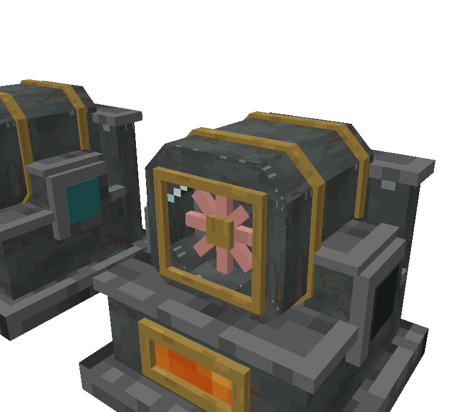
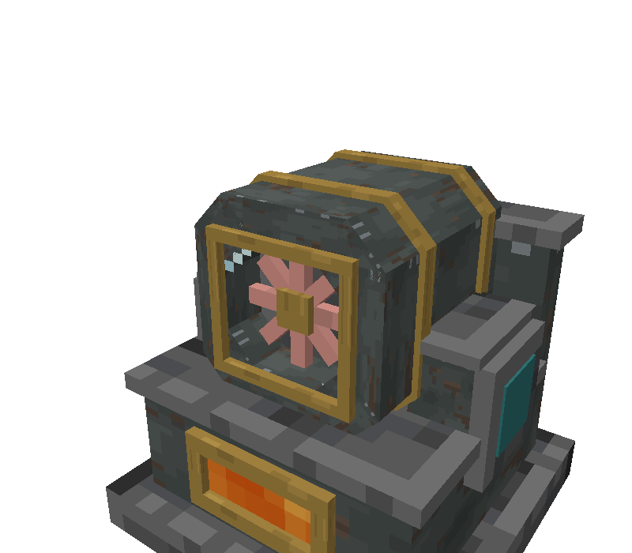
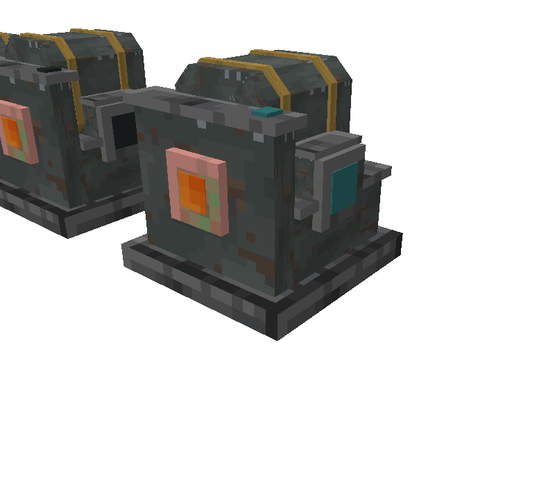
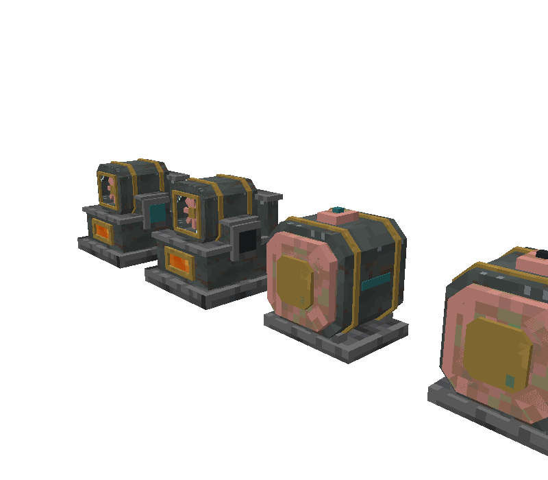

# Code Dossier: Lava Generator

Path shorthands used in citations:
`J/` = `src/main/java/com/comedymonkey/createaddons/` ·
`A/` = `src/main/resources/assets/comedymonkeysaddons/` ·
`D/` = `src/main/resources/data/comedymonkeysaddons/` ·
`G.json` = `A/models/block/lava_generator.json`, `GL.json` = `A/models/block/lava_generator_lit.json`, `R.json` = `A/models/block/lava_generator_rotor.json`.
Line numbers in model JSON point at the element's `"from"` line.

**Coordinate frame.** All pixel coordinates are in the model's own frame, which is **facing north** (the `facing=north` variants use rotation 0, `A/blockstates/lava_generator.json:3-8`). The **front is the north face, z = 0**; the back is z = 16; x runs west → east, y bottom → top. A player looking at the front faces south, so **+x (east) is on their left and −x (west) on their right**.

## Identity

- Registry id: `lava_generator` (block `J/registry/ModBlocks.java:233-234`; block entity `J/registry/ModBlockEntities.java:112-114`; block item `J/registry/ModItems.java:74`; creative tab `J/registry/ModCreativeTabs.java:62`).
- Type: a single 1 × 1 × 1 block.
- Classes (`J/content/electric/`):
  - `LavaGeneratorBlock`: a plain `Block` + `IBE` + `IWrenchable` (`:37`), with `FACING` (horizontal) and `LIT` (`:38-39`).
  - `LavaGeneratorBlockEntity`: `SmartBlockEntity` + `IHaveGoggleInformation` (`:30`), no Create behaviours (`addBehaviours` is empty, `:70-71`).
  - `EnergyBuffer`: the FE store, shared with the Electric Motor, the Geothermal Turbine and the Trade Bot station (`J/content/electric/ElectricMotorBlockEntity.java:46`, `GeothermalControllerBlockEntity.java:45`, `J/content/tradebot/TradeBotStationBlockEntity.java:76`).
- Renderer: `ElectricRenderers.Generator` (`J/client/ElectricRenderers.java:96-112`), registered at `J/client/ComedyMonkeysCreateAddonsClient.java:93`. Its one part model, `GENERATOR_ROTOR`, is declared at `ElectricRenderers.java:30` and registered through `registerModels` (`:47-51`, called from `ComedyMonkeysCreateAddonsClient.java:117`). No menu, no screen, no Flywheel visual, no item renderer.
- Ponder: `J/client/ponder/ElectricScenes.java:36-89`, storyboard `electric_power` (`J/client/ponder/CMPonderPlugin.java:74-75`), structure `A/ponder/electric_power.nbt`. The same structure and the generator also appear in the Electric Motor's scene (`ElectricScenes.java:91-153`).

## What It Does

1. **Place it.** It faces the player who places it (`LavaGeneratorBlock.java:52-54`). That fixes its three kinds of face:
   - **Back** (opposite the facing) = the **lava inlet** (`inlet()`, `:56-59`).
   - **The two sides** (the facing's clockwise axis) = the **FE terminals** (`isTerminal()`, `:61-64`).
   - **Front, top and bottom** connect to nothing.
   - A Create wrench turns it (`IWrenchable`, default handling, `:37`; `rotate`/`mirror` `:66-74`), which moves the inlet and terminals with it; the block entity then invalidates its capabilities so pipes and cables re-check (`LavaGeneratorBlockEntity.java:60-68`, added in `26adbd3`).
2. **Fill it.**
   - Pipes fill it **only through the back face** (`J/ComedyMonkeysCreateAddons.java:169-170`). The tank holds **8,000 mB** of lava only (`LavaGeneratorBlockEntity.java:31, 34`; `isSame(LAVA)`, which also matches flowing lava).
   - The handler exposed is the raw `FluidTank`, so a pipe can also **drain** lava back out of the back.
   - Buckets and other containers work **on any face**: `useItemOn` ignores the clicked face and always talks to the inlet side (`LavaGeneratorBlock.java:76-85`; Javadoc "Lava buckets pour in from any side"). `FluidUtil.interactWithFluidHandler` tries filling the held container first, so an **empty bucket takes 1,000 mB back out**.
3. **Push power first.** Each server tick, before making anything, it pushes **all** its stored FE into whatever accepts energy on the **clockwise side, then the counter-clockwise side** (`LavaGeneratorBlockEntity.java:93-97`; `EnergyBuffer.java:63-72`). For a north-facing generator that's east (the viewer's left) first, so the first side gets priority.
   - Anything can also **pull** from either side face. The view offered there is extract-only (`ComedyMonkeysCreateAddons.java:171-172`; `EnergyBuffer.java:74-107`); nothing can charge the generator from outside (`maxReceive` 0, `LavaGeneratorBlockEntity.java:41`).
4. **Burn.** If the tank isn't empty, it makes `min(1,024, room left in the buffer)` FE this tick (`:98-99`; `J/config/CMConfig.java:345-348`).
   - Lava burned is **in proportion to what's made**: 20 mB/s at full output, i.e. 1 mB a tick, tracked in twentieths of a mB (`:100-106`; `CMConfig.java:349-352`). That's 1,024 FE per mB. "It only burns what's taken, so a light load saves lava" (`ElectricScenes.java:83`).
   - A full tank lasts **400 s** (6 min 40 s) at full output; one bucket lasts 50 s (derived: 8,000 / 20, 1,000 / 20).
   - The buffer holds **100,000 FE** (`:32`), about 98 ticks (4.9 s) of full output. With nothing connected it fills the buffer once (burning about 98 mB) and then stops.
   - Defaults: one generator runs an Electric Motor at **16,384 SU** (`CMConfig.java:334-336`; test `src/test/.../config/CMConfigTest.java:188-189`). The Electric Motor's screen counts stress in "Lava Generators" (`J/client/ElectricMotorScreen.java:60-62, 159`).
5. **Running flag.** Any tick that makes power sets `activeTicks = 40`. Otherwise it counts down (`:107-111`). `running = activeTicks > 0` sets the `lit` blockstate (`:113-119`). So it stays lit for **2 s** after it last made power. **Any** load above zero keeps it lit: 1 FE/t and 1,024 FE/t look the same.
6. **While lit** (`lit` blockstate):
   - The block model swaps to `lava_generator_lit` (`A/blockstates/lava_generator.json`).
   - It gives **light level 9** (`ModBlocks.java:234`).
   - The rotor spins up (client, `LavaGeneratorBlockEntity.java:86-91`; see Moving Parts).
   - Particles and sound (`LavaGeneratorBlock.java:87-103`): on one random side face each call, a `LAVA` particle (1 in 8) and a `SMALL_FLAME` drifting outward (1 in 3), and a vanilla `LAVA_AMBIENT` (1 in 24, volume 0.3, pitch 0.8) at the block centre.
7. **Stop conditions** (goggle status, `:149-155`):
   - `lit` → green "Making N FE a tick" (`output`, smoothed 5% a tick, `:112`).
   - Not lit, tank empty → red "Out of lava".
   - Not lit, tank has lava → red "Full: nothing is taking the power" (the buffer is full).
   - The status reads the `lit` blockstate, so for 2 s after power stops it still says "Making…" with a falling number.
8. **Breaking.** Drops itself (survives-explosion condition only), so the tank and the buffer are lost (`D/loot_table/blocks/lava_generator.json`). Pickaxe, needs the right tool, strength 3.5 / 8.0, Netherite block sound (`ModBlocks.java:253-260`; `src/main/resources/data/minecraft/tags/block/mineable/pickaxe.json:37`).

## What the Player Is Told

- **Name**: "Lava Generator" (`A/lang/en_us.json:699`).
- **Tooltip** (Create-style, `ComedyMonkeysCreateAddons.java:257`):
  - Summary: "A small _lava-fired turbine_ that makes _Forge Energy_: enough for an _Electric Motor_ at _16,384 SU_" (`en_us.json:700`).
  - When Fuelled: "Burns _20 mB_ of _lava_ a second for _1,024 FE_ a tick, and pushes the power out of its _side terminals_. Pipes fill it at the _back_" (`:701-702`).
- **Goggles** (`LavaGeneratorBlockEntity.java:137-157`; `en_us.json:717-720`): "Lava Generator:", then "N / 8,000 mB Lava" (gold and grey), "N / 100,000 FE" (aqua), and the status line from step 7.
- **Ponder** "Lava In, Power Out" (`ElectricScenes.java:36-89`; `en_us.json:755, 759-763`). Structure (`A/ponder/electric_power.nbt`): the generator at (2,1,2) **facing north**, a Create fluid pipe behind it at (2,1,3), a 3-upgrade **lava Wellspring** at (2,1,4), an Electric Motor at (3,1,2) against its **east** terminal, and a shaft at (4,1,2).
  1. The generator appears: "a little lava-fired turbine that makes Forge Energy". The pointer is on the north (front) face (`:43-51`).
  2. The pipe and Wellspring appear behind it: "Lava goes in at the middle of its back, by pipe or by the bucket". The pointer is on the south face (`:53-60`).
  3. `lit` is set to true: "It burns 20 mB a second, and its turbine wheel spins behind the glass while it does". The pointer is at world (2.5, 1.72, 2.15), which is **model (8, 11.52, 2.4)**: just in front of today's rotor window (`:62-68`).
  4. The motor appears, powered, at 64 RPM: "Power comes out of the terminals in the middle of each side…". The pointer is on the east face (`:70-80`).
  5. "Pipez energy pipes take its power anywhere…". The pointer is on the west face (`:82-87`).
  - The motor's scene shows the generator lit (`:112`) feeding the motor "straight from a Lava Generator" (`:116`), then unlit when the motor runs short (`:147`).
- **Recipe** (`D/recipe/lava_generator.json`):
  - Brass plates ×2 and an **electron tube** across the top.
  - Two **Fluid Tanks** either side of a **Propeller** in the middle.
  - Two **Industrial Iron** blocks either side of a **Blaze Burner** at the bottom.
  - The material language: an industrial-iron base with a **fire under it**, **tanks**, a **propeller** turbine, and brass and an electron tube for the electrics.
- **Advancement** "Hot Wired: Make a Lava Generator. Lava in, sparks out" (`en_us.json:747-748`; `D/advancement/lava_generator.json`). Its parent is the Magma Engine (`:2`), and it's the parent of the Electric Motor advancement (`D/advancement/electric_motor.json:2`).
- **README**: "a small lava-fired turbine; its wheel spins behind the intake glass while it burns. It pushes its power into whatever is on its sides" (`README.md:270`). The rates table says "20 mB/s lava, in at the middle of the back" → "1,024 FE/t, out of the terminals in the middle of each side" (`:266`). Recipe summary at `:273`.
- **Block Javadoc**: "burns lava in a small turbine… Lava goes in at the middle of the back; power comes out of the terminals in the middle of each side. The front, with its window and turbine intake, faces you" (`LavaGeneratorBlock.java:33-36`).
- **Sounds**: Netherite block sound, the vanilla `LAVA_AMBIENT` above while lit, and no custom sound events (no `lava_generator` entry in `A/sounds.json`).
- **Family promises**: the turbine is "ten times as efficient with lava as the Lava Generator" (`README.md:271`; `ElectricScenes.java:248`). The survey groups the generator with the motor and the turbine as one electric kit, and with the lava machines under one ember language (`design/dossiers/survey.md:37-38`).

## States

| State | Source | How the player can tell today |
|---|---|---|
| `facing` N/E/S/W | blockstate, `LavaGeneratorBlock.java:38, 52-54`; y 0/90/180/270 (`A/blockstates/lava_generator.json`) | The housing window and the lava window face that way. Copper inlet ring on the back, terminal plates on both sides |
| `lit=false` | blockstate, `:39`; model `block/lava_generator` | Terminal pads and the top lamp are flat dark `#25292c`. Both lava windows still show animated vanilla lava, at world light. Rotor stopped or coasting. No particles, no light |
| `lit=true` (running + 2 s hang) | `LavaGeneratorBlockEntity.java:107-119`; model `block/lava_generator_lit` | Terminal pads and top lamp turn flat teal `#2f6f70` and full-bright. The two lava windows go full-bright. Light 9. Rotor spins up. Flames and lava pops at the sides, lava crackle |
| `Tank` (0–8,000 mB) | synced, `write` `:162` (written for both save and client packets) | **Not drawn.** The lava windows look full whether it's full or empty. Goggles only |
| `Energy` (0–100,000 FE) | synced, `:163`; also sent when it moves by more than 2,000 FE (`:120-122`) | **Not drawn.** Goggles only |
| `Output` (smoothed FE/t) | synced, `:166` | **Not drawn.** Rotor speed doesn't follow it. Goggles only |
| `Running` | synced, `:167` | Only through `lit` |
| `ActiveTicks`, `BurnProgress` | synced, `:164-165` | Internal |
| Rotor angle and speed | **client only**, never saved or synced (`:51-54, 86-91`) | The rotor, driven by `lit` |
| Stop: out of lava | derived, `:151` | Unlit. The lava windows still look full, so it **looks like** it has fuel |
| Stop: full (nothing taking power) | derived, `:151-152` | Unlit. **Looks identical** to "out of lava" and to a cold generator |

Sync cadence: at most every 10 ticks. It sends on a tank change, every 40 ticks while running, or when the energy moves by more than 2,000 FE (`:120-126`). The `lit` blockstate change reaches the client by the normal block update (`:118`, flag 3).

## Moving and Changing Parts

The renderer (`ElectricRenderers.java:100-111`) draws one part, every frame, in every state:
1. `face(ms, facing)`: translate to the block centre (0.5, 0.5, 0.5), rotate about Y by **−(facing.toYRot() + 180)**, translate back (`:59-69`, `:105`). North is the identity; east is −90°. This matches the blockstate's y rotations.
2. Translate to **(8, 11.5, 4) px**, rotate about **+Z** by `getRotorAngle(partialTicks)` degrees, translate back (`:106-108`).
3. Draw `block/lava_generator_rotor` with the block's own packed `light` into the **cutout** buffer (`:109`; `drawModel` forces `RenderType.cutout()`, `:53-57`).

No `shouldRenderOffScreen` or view-distance override, so it uses the defaults.

| Part | Model file | Driven by | Axis / pivot / range | Source |
|---|---|---|---|---|
| Rotor: brass hub 1.5 × 1.5 × 1 px (x7.25–8.75, y10.75–12.25, z3.6–4.6), and **8 copper blades** of 0.7 × 4.8 × 0.5 px at 0°, ±45° and 90° (x5.6–10.4 / y9.1–13.9, z3.9–4.4). **4.8 px across** | `block/lava_generator_rotor` (5 elements, `R.json:17, 85, 162, 239, 316`) | `lit` blockstate, through a client speed | Spins about the **front-to-back axis** (Z) through **x 8, y 11.5**, clockwise seen from the front. Continuous, no range. **Spin-up:** speed approaches **24°/tick (80 RPM)** by 0.6°/tick² when lit, about **2 s** from rest. **Run-down:** approaches 0 by 0.3°/tick², about **4 s**. Angle lerped between ticks (`getRotorAngle`, wraps at 360°). It doesn't follow load. World light, never full-bright | `ElectricRenderers.java:30, 106-109`; `LavaGeneratorBlockEntity.java:86-91, 129-135` |
| Glow pads (2 terminals, top lamp) and both lava windows | `block/lava_generator` ↔ `block/lava_generator_lit` (whole-model swap) | `lit` blockstate | Static. Terminals and lamp swap texture `electric_glow_off` → `electric_glow`. Those five elements become emissive (`neoforge_data` block and sky light 15, `shade: false`) | `A/blockstates/lava_generator.json`; `GL.json:494, 771, 912, 1053, 3138` (emissive data at `:560, 837, 978, 1119, 3204`) |
| Flames and lava pops | particles | `lit` | A random side (clockwise or counter-clockwise) each call, at model **x 0.48 or 15.52, y 4.48, z 8**: 1 px outside the body's side, just under the terminal plates. `SMALL_FLAME` drifts outward 0.01 and up 0.01 | `LavaGeneratorBlock.java:92-99` |
| Lava crackle | sound | `lit` | Block centre | `:100-102` |

Derived: at full speed the 8-blade star turns 24° a tick and repeats every 45°. With 20 frames a second or fewer it can look like it's turning backwards. Smoother at normal frame rates because the angle is lerped.

## Code Contract

**Model files the code loads by name** (renaming one breaks a blockstate or the renderer):
- `block/lava_generator`: the four `lit=false` variants (`A/blockstates/lava_generator.json:3-28`). It's also the item model's parent (`A/models/item/lava_generator.json:2`).
- `block/lava_generator_lit`: the four `lit=true` variants.
- `block/lava_generator_rotor`: the standalone renderer model (`ElectricRenderers.java:30, 43-45`; registered `:47-51`). No blockstate references it.
- A new renderer part needs a new `ModelResourceLocation` constant and an entry in the `registerModels` array (`:48-49`). That array also lists the turbine's seven models; add to it, never remove or rename an entry.

**Part split.**
- **Static vs lit are two complete copies of the block** (49 elements each). Today they differ only in five elements (`GL.json:494, 771, 912, 1053, 3138`). Every geometry change must be made in both, or the machine changes shape when it lights. The lit state can't hide or add a part without a different element list.
- Glow is **texture swap plus emissive data**, in the block model. It is not a renderer pass. A glow part has to look right as two separate textures: off at world light, and on at full-bright.
- The rotor is the only renderer-drawn part.

**Rotor contract** (`ElectricRenderers.java:105-109`):
- Modelled in the **block's own north-facing frame** (not round the origin), with its spin axis on the line **x = 8, y = 11.5, running front to back**. The z of the pivot (4) doesn't matter for a Z turn, so the rotor can sit at any depth.
- It can only spin **facing the front**, like a fan seen through a window. A rotor on another axis (a horizontal drum, a vertical wheel) needs the `Axis.ZP` and the translate changed.
- It must stay clear of the static model through a full turn. The radius from (8, 11.5) is free, but the housing has to leave the swept circle open.
- Drawn cutout, lit by world light. It isn't full-bright when lit, so the blades can't glow.
- The speed is fixed by `lit`, not by load (`LavaGeneratorBlockEntity.java:89`). A load-driven speed needs a code change.
- The rotor isn't drawn in the inventory. The item uses the static block model, and there's no item renderer (`ComedyMonkeysCreateAddonsClient.java:93` registers only the block entity renderer). The icon shows an **empty window**.

**Facing.** Horizontal only, faces the placer (`LavaGeneratorBlock.java:38, 52-54`), with `rotate` and `mirror` (`:66-74`). Up and down are never fronts. Mirroring turns it 180° and never flips the model (the test `LavaGeneratorBlockTest.java:62-68` pins this). The model must read the same from all four directions, and its left and right are not swapped by mirroring.

**Ports: which faces do what.** Pinned by unit tests (`src/test/java/com/comedymonkey/createaddons/content/electric/LavaGeneratorBlockTest.java:30-58`).
- **Lava in: the back face only** (south in the model, z = 16): `side == inlet(state)` or `side == null` (`ComedyMonkeysCreateAddons.java:169-170`; `LavaGeneratorBlock.java:56-59`).
  - Create fluid pipes on any other face won't connect.
  - The pipe centre meets the face at (x 8, y 8).
  - Today the face is marked by an **exposed-copper flange** 5 × 5 × 0.75 px at x5.5–10.5, y5.5–10.5, z14.5–15.25 (`G.json:698`), with a **2.5 × 2.5 px lava disc** in its middle at z15.25–15.35 (`G.json:766`), on a back wall that stands 1.5 px in from the face (`G.json:562`, z12.5–14.5). The flange stops **0.75 px short** of the block face, and the disc 0.65 px short.
  - Buckets work on every face (`LavaGeneratorBlock.java:76-85`). The back is the only *pipe* face.
- **FE out: the two side faces only** (east and west in the model, x = 16 and x = 0): `isTerminal`, true when the side is on the facing's clockwise axis (`:61-64`; `ComedyMonkeysCreateAddons.java:171-172`). Front, back, top and bottom offer no energy. It **pushes** to both sides every tick, clockwise (east) first, and lets anything **pull** from either (`LavaGeneratorBlockEntity.java:93-97`).
  - Today each side is marked by a **polished-deepslate plate** 5 × 5 × 0.75 px centred on (y 8, z 8): x14.5–15.25 east, x0.75–1.5 west (`G.json:834, 970`).
  - Each plate carries a **3 × 3 px glow pad** 0.1 px proud: x15.25–15.35 east, x0.65–0.75 west (`G.json:902, 1038`).
  - Behind each plate is a small paint block with a deepslate cap that ties it to the housing (`G.json:3186, 3254, 3322, 3390`).
  - Pads stop **0.65 px short** of the block face.
- **Electric Motor neighbour.** The motor takes FE on any face (`ComedyMonkeysCreateAddons.java:167-168`), so a motor touching either terminal is powered directly (the ponder puts it on the east side).

**Ponder pointer is hard-coded to today's window.** "…its turbine wheel spins behind the glass" points at **model (8, 11.52, 2.4)** (`ElectricScenes.java:65`). If the rotor window moves, this vector has to move with it. The other pointers use whole faces (north, south, east, west; `:48, 57, 77, 84`), so they still fit any design that keeps the port faces.

**Particle anchors are in Java** (`LavaGeneratorBlock.java:92-99`): side faces at x 0.48 / 15.52, **y 4.48**, z 8 (block centre ± 0.47, −0.22 down). Today that's 1 px outside the body's plain side wall, about 1 px below each terminal plate (plate bottom y 5.5). Any vent or grate the new model adds for the flames has to sit there, or the numbers change.

**Light and emissive.**
- Block light **9 when lit**, 0 otherwise (`ModBlocks.java:234`).
- Emissive elements in the lit model use `neoforge_data: {block_light: 15, sky_light: 15}` and `shade: false` (`GL.json:560-564` etc.). The unlit model has no emissive elements, so the lava windows are at world light.

**Render type.**
- Both blockstate models are `minecraft:cutout` (`G.json:3`, `GL.json:3`). The rotor is drawn cutout too (`ElectricRenderers.java:56, 109`).
- No translucency: glass has to be clear pixels plus opaque glints. Today it's vanilla `glass`, uv 2–14 (`G.json:3050`).
- `ambientocclusion` isn't set (default on). Parent `minecraft:block/block` (`G.json:2`), so default block display transforms. No custom item display.

**Voxel shape.** `LavaGeneratorBlock` doesn't override `getShape` or `getCollisionShape`, so it's a **full cube**. It's `noOcclusion()` (`ModBlocks.java:259`), render shape `MODEL`, so the mining crack shows.
- The model fills the full 16 × 16 only in the 2 px base slab (`G.json:18`).
- The body is inset 1.5 px at the front and sides (x1.5–14.5, z1.5–12.5, `G.json:86`).
- The housing peaks at y 16 (`G.json:1958, 2402`) and the back wall at y 13.75 (`G.json:630`).
- The upper corners of the selection box are empty air.

**Particle texture** (break and land particles): `machine_paint` (`G.json:13`, `GL.json:13`, `R.json:13`).

**Shared with the Electric Motor and the Geothermal Turbine.** The turbine is on `design/hands-off.md:23-28`.
- `J/client/ElectricRenderers.java`:
  - The Generator class (`:96-112`) and `GENERATOR_ROTOR` (`:30`) are the generator's own and can change.
  - `face()` (`:59-69`), `drawModel()` (`:53-57`) and `registerModels()` (`:47-51`) are used by the **turbine** (`:154-190`) and the **motor** (`:90-91`). Changing them changes both. Write new helpers inside `Generator` instead.
  - The `Turbine` class (`:114-193`) is hands-off.
- `J/ComedyMonkeysCreateAddons.java:165-182`: one capability block for all three. Generator lines `:169-172` only. The turbine's `:173-182` is hands-off.
- `J/content/electric/EnergyBuffer.java`: used by the turbine and the **Trade Bot station** (both hands-off) and the motor. Its behaviour must not change.
- `J/client/ponder/ElectricScenes.java`: generator scene `:36-89`. The motor scene (`:91-153`) also shows the generator. The turbine's scene in the same file is hands-off. `A/ponder/electric_power.nbt` is shared with the motor's scene.
- `ModBlocks.machine()` (`:253-260`): the shared strength, sound and occlusion properties for motor, generator and turbine parts.
- `J/config/CMConfig.java:334-364`: the shared electricity section. `ElectricMotorScreen.java:60-62` sizes motor stress in "Lava Generators" from `generatorFePerTick`, so the rates are part of the motor's UI.
- `design/models/process-box.lib.js` (the generator kit) is shared with the Auto Harvester, the pens and the turbine. If the new model is built with it, those must still generate the same output (`design/hands-off.md:30`).

**Textures the generator models use.**

| Asset | Generator uses it for | Also used by (editing the PNG changes these) |
|---|---|---|
| `A/textures/block/machine_paint.png` (16², 8 colours) | lower body, back wall, side pads; particle (24 faces) | **Electric Motor** (`electric_motor.json`, `_powered`) |
| `A/textures/block/machine_paint_b.png` (16², 8 colours) | turbine housing (60 faces) | **Electric Motor** |
| `A/textures/block/brass_weathered.png` (16²) | lava-window frame, housing bands, rotor window frame (120 faces), rotor hub (6) | **Electric Motor** |
| `A/textures/block/electric_glow.png` (16²) | lit terminal pads and top lamp (`GL.json`, 18 faces). Declared but unused in `G.json` and `R.json` | **Electric Motor** powered state |
| `A/textures/block/electric_glow_off.png` (16²) | unlit terminal pads and top lamp (18 faces) | **Electric Motor** unpowered state |
| Vanilla `polished_deepslate` | base slab, ledges, caps, terminal plates, the dark plate behind the rotor (48 faces) | Can't be edited. Also borrowed by the motor |
| Vanilla `exposed_copper` | inlet flange (6), rotor blades (24) | Can't be edited. Also the motor |
| Vanilla `lava_still` (animated) | front lava window, back lava disc (12) | Can't be edited. Also the cobble, basalt, blackstone and tuff generator **item** models |
| Vanilla `glass` | rotor window (6) | Can't be edited |

None of these is used by the turbine any more. Since `3f5d022` its twelve models reference only `geothermal_turbine_*` textures (checked by `grep` over `A/models`). So `design/hands-off.md:28` and the turbine dossier (`geothermal-turbine.md:216-217`), which say `brass_weathered` and `electric_glow` are shared with the turbine, are out of date on that point. The turbine's own `geothermal_turbine_*` PNGs are hands-off ("everything with `geothermal` in its path", `hands-off.md:26`). A generator model can **reference** them, but any later edit made for the generator would change the turbine. Copying them under generator names keeps the two independent.

**No** connected textures, filter slots, value boxes, shafts, kinetic faces or comparator output.

## Current Look

Screenshots, from `lava-generator/before.bbmodel` (built from the game's model files by `tools/gen-before.js`, scene `tools/scene-electric.json`; the rotor shown at rest):

| | |
|---|---|
|  |  |
| Unlit: the octagonal intake with its window, the lava slot below, the side terminal. | Lit: the same, its lamps and lava windows lit. The salmon rotor star is tiny in its window. |
|  |  |
| Back: the lava inlet flange. | With the Electric Motor, the same green-grey kit. |

**Geometry, from `G.json`** (49 elements, in the north-facing frame):
- **Base** (`:18`): a full 16 × 2 × 16 polished-deepslate slab.
- **Lower body** (`:86`): a 13 × 5 × 11 paint box (x1.5–14.5, y2–7, z1.5–12.5), with a 0.75 px deepslate ledge on top (`:154`, x1–15, z1–12.5).
- **Front lava window** (`:494`): 5.5 × 2 px of vanilla lava at x5.25–10.75, y3.5–5.5, recessed 0.1 px, in a 0.75 px brass frame (`:222-426`, x4.5–11.5, y2.75–6.25, z1–1.5). Low on the front, centred.
- **Turbine housing** (`:1106-1813`): an **octagonal drum on the front-to-back axis**, centred on (x 8, y 11.5), 8.5 px across (x3.75–12.25, y7.25–15.75), z3–12.5. It's built from 4 straight boxes, 2 cross boxes and 4 boxes turned 45° about Z. Its front ring (z3–5.5) leaves a **5.5 × 5 px opening** (x5.25–10.75, y9–14) in front of a deepslate back plate at z5 (`:1378`).
  - Two **brass bands** round the drum at z5.25–6 and z10.5–11.25, each an 8-part octagon 0.25 px proud (`:1890-2701`). The top band pieces reach y 16.
  - A **brass window frame** 0.4 px thick at z2.6–3 (`:2778-2982`, x4.75–11.25, y8.5–14.5) round a vanilla **glass** pane at z3–3.05 (`:3050`).
  - The **rotor** (`R.json`) sits 0.55 px behind the glass, in a window 2 px deep.
- **Back wall** (`:562`): x1.5–14.5, y2–13, z12.5–14.5, with a deepslate cap (`:630`, y13–13.75, z12–15) carrying a 1.25 × 0.25 × 1.5 px **lamp** at its east (viewer's left) back corner (`:3118`, x12.5–13.75, z12.75–14.25). From the front the lamp is hidden behind the housing.
- **Back inlet**: copper flange and lava disc, as in the Code Contract.
- **Side terminals**: a deepslate plate, a glow pad, and a paint block with a deepslate cap linking each to the drum, as in the Code Contract.
- Read as a whole: a squat stepped box (base, low body, back wall), with the round housing sitting across the top front. The rotor is a 4.8 px copper star in a 5.5 × 5 window. **30% of the block's width**, and the survey calls it "tiny" (`design/dossiers/survey.md:13`).

**Textures** (palettes from the PNGs):
- `machine_paint` / `machine_paint_b`:
  - Green-leaning grey steel `#3e4442` `#454c4a` `#4c5351` `#545b58` (G > R ≈ B), with rust blotches `#474542` `#51443a` `#5f5044` and two `#80878a` rivet pixels.
  - Soft mottle, no panel lines or bevels.
  - **Every face maps the whole 16² (uv 0–16)** whatever its size, so the texture is squashed onto small faces: 13 × 5 on the body front, 2.5 × 2.75 on the side pads, 0.75-px edges.
- `brass_weathered`:
  - The texture runs `#786131`–`#ae8d46`, with a `#cfb164` highlight and `#5d7a62` verdigris.
  - The generator only ever shows **uv 4–12 × 6–8**, which is almost flat `#9e7f3d` (one `#8d7136` and one `#ae8d46` pixel). So the trims read as flat mid brass, and the near-white highlight never shows.
- `electric_glow_off`: `#25292c` / `#30353a` concentric squares. The pads use **uv 0–3**, so they show only flat `#25292c`.
- `electric_glow`: teal `#2f6f70` / `#4a9a96` / `#78c4bb` concentric squares. With uv 0–3, the lit pads and lamp show only flat **`#2f6f70`**, full-bright.
- Vanilla `exposed_copper` (`#796454`–`#ce8d83`, verdigris `#7a9869`):
  - The blades use uv column 0, which is **solid `#ce8d83`**, the lightest pink in the texture.
  - The flange (uv 0–5) shows pink `#ce8d83` / `#a87762`, olive `#988c69` and a verdigris pixel.
- Vanilla `polished_deepslate`: neutral greys `#242424`–`#6e6e6e`. The base, ledges and caps read as the light grey frames in the render.
- Vanilla `lava_still`: animated, saturated `#c73405`–`#e8a03b`, with rare highlights up to `#faeb72`. The front window shows uv 0–5.5 × 0–2; the back disc shows uv 0–2.5.
- Vanilla `glass`, uv 2–14: clear, with four pale glint pixels (`#d0eae9`, `#a8d0d9`) near two corners.

**Against the house style and the redesigned turbine**:
- *Works*:
  - Dark overall value.
  - Brass used only as thin trims (frames, bands), in a muted mid tone `#9e7f3d`.
  - The octagonal housing and the window give it a focal point, and the rotor really does spin up and run down.
  - The ports are physically there: a flange on the back, plates on the sides, each centred where a pipe or cable meets the face.
- *Doesn't*:
  - **Steel hue and finish.** Green-grey mottle with rust stains, where the turbine is now crisp blue-grey `#2f343b` / `#3c424a` / `#4a5059` with andesite trim `#6b6e6a`–`#7c7f79` (`A/textures/block/geothermal_turbine_steel.png`, `_panel.png`). Full-UV squashing smears it further.
  - **Neutral deepslate** frames (up to `#6e6e6e`) are a different grey family from both the paint and the turbine's andesite.
  - **Copper.** The blades are solid `#ce8d83` salmon pink, above the house copper `#7a4a2e`–`#b87a4e`; they're the brightest thing on the block when it's off. The flange mixes pink, olive and verdigris. The turbine uses `#7a4a2e`–`#9c5f3a` (`geothermal_turbine_copper.png`).
  - **Glows.** The lava windows are saturated vanilla orange and always look hot, even unlit. The turbine uses its own muted lava `#b85e26`–`#cf7a34` and amber glow `#8a3a1c`–`#d99a4a`, and its glow only appears while running. The "making power" light is a dull teal `#2f6f70` on two side pads and a hidden top lamp, where the turbine has **one cyan lamp `#6fb7c4`** on its front.
  - **Glass glints** are pale near-white pixels; the turbine's glass glints are `#6f7f86` / `#83939a`.
  - **Rotor scale.** A 4.8 px star behind 5.5 × 5 px of glass is hard to read at any distance. The turbine's rotor window is the hero of its front.
  - **Silhouette.** It reads as a box with a can on it. Nothing says "firebox", "tank" or "generator coil", though the recipe has a Blaze Burner, two Fluid Tanks and a propeller.

## Function the Look Doesn't Show

1. **Lava level.** The 8,000 mB tank is synced (`LavaGeneratorBlockEntity.java:162`) but never drawn. Both lava windows are fixed textures, full whether the tank is full or empty (`G.json:494, 766`). "Out of lava" looks fuelled.
2. **Energy buffer** (100,000 FE, synced `:163`). Goggles only.
3. **Load.** It burns in proportion to what's taken (`:100-106`), and the smoothed output is synced (`:166`), but the rotor always targets 24°/tick when lit (`:89`). 1 FE/t and 1,024 FE/t look the same.
4. **Full vs out of lava vs never started.** All three are just "unlit" (goggles `:149-155`).
5. **The 2-second hang.** It stays lit and spinning for 2 s after it stops making power (`:108-110`), then coasts 4 s.
6. **Which side gets power first.** The clockwise terminal (viewer's left) is served before the other (`:95-97`). The two terminals look identical.
7. **Push vs pull.** The terminals both push and can be pulled from. Nothing shows energy moving. The pads are only on/off with `lit`, not with flow.
8. **Buckets work on every face, and an empty bucket or a pulling pipe takes lava back out** (`LavaGeneratorBlock.java:76-85`; raw tank exposed at `ComedyMonkeysCreateAddons.java:170`). The look implies one-way feed at the back.
9. **The front, top and bottom connect to nothing.** The front carries the most detail (the housing "intake") yet is not a port.
10. **The rotor in the inventory.** The item uses the static model, so the window is empty (`A/models/item/lava_generator.json:2`).

## Look the Code Doesn't Back Up

1. **The front lava window** looks like a firebox sight glass or a fuel gauge. It's a fixed animated lava texture: never a level, never dark, and only full-bright while lit (`G.json:494`; `GL.json:494, 560`).
2. **The lava disc in the back inlet** shows lava sitting in the port even with an empty tank (`G.json:766`). This is the survey's "lava slot that always looks full".
3. **"Turbine intake" on the front** (`LavaGeneratorBlock.java:35`). A fan-like rotor behind glass on the front face suggests air or fuel drawn in at the front. The front has no capability, and lava enters at the back.
4. **Side vents.** The code comment says "Lava popping at the side vents" (`LavaGeneratorBlock.java:87`). There are no vents: the flames and lava pops come out of the plain paint wall 1 px under the **electrical terminals** (`:95`).
5. **The top lamp** (`G.json:3118`) is a 1.25 × 1.5 px pad at the back corner, hidden from the front by the housing. It only repeats `lit`.
6. **Brass bands on the housing** and the **copper blades and flange** don't map to anything electrical. Copper (the house colour for windings and pipes) is used for the rotor blades and the lava inlet, and the FE terminals are deepslate.
7. **The rotor's motion is cosmetic.** It reacts to `lit` alone, so it suggests a load-following turbine that the code doesn't drive (`LavaGeneratorBlockEntity.java:89`).

## History

- Every generator model, texture, the blockstate, the block, block entity and renderer come from `bfb73f2` "Release 1.8.0: Auto Harvester, electricity". `git log` on `lava_generator*` models and the blockstate, on `machine_paint*`, `brass_weathered`, `electric_glow*`, and `git log -L` on the `Generator` renderer (`ElectricRenderers.java:96-112`) show no other commit. The look has never been revised.
- `26adbd3` "Code review fixes…" added only the capability invalidation when a wrench turns it (`LavaGeneratorBlockEntity.java:60-68`), and unit tests:
  - `LavaGeneratorBlockTest.java`: default state; inlet at the back; terminals on both sides only; inlet never a terminal; rotate and mirror.
  - `LavaGeneratorBlockEntityTest.java`: an 8,000 mB lava-only tank; a 100,000 FE extract-only buffer; save and load.
  - No test pins model names or renderer constants.
- `3f5d022` "Redesign the Geothermal Turbine" (the most recent commit) left the generator untouched. The turbine brief chose "Turbine only, own textures… The Lava Generator and Electric Motor don't change now; they can be redesigned to match later" (`design/briefs/geothermal-turbine.md:10, 34, 126`). It moved the turbine onto its own `geothermal_turbine_*` textures so that the generator and motor keep `brass_weathered` and `electric_glow`.
- No brief, spec or plan exists for the generator (nothing in `design/briefs`, `design/specs` or `design/plans` names it).
- Survey (`design/dossiers/survey.md:13, 37-38`):
  - Ranks it **#7** (total 10, effort small–medium): "Muted box with an octagonal intake. The rotor is tiny. The lava slot always looks full". Hidden states: "Tank level, energy buffer, full with nothing taking power".
  - Groups it with the motor and turbine as one electric kit ("green-leaning steel, weathered brass, teal glows… the octagonal-can motif. Restyle the kit once"), and with the lava machines under one muted-amber ember language.

## Changed by the redesign (2026-10-24)

- **Look**: new models `lava_generator`, `lava_generator_lit` and `lava_generator_rotor` (same file names and rotor pivot), item model with the wheel, `lava_generator_*` textures; `machine_paint*`, `brass_weathered` and `electric_glow*` retired. Generated by `design/models/electric.gen.js`, exported by `electric.export.js`.
- **Wheel follows the load**: `LavaGeneratorBlockEntity` client tick aims for `24 * (0.25 + 0.75 * load())` degrees a tick while lit, `load()` being the synced smoothed output over full output.
- **Particles**: small flames flicker at the lava window on the front instead of the side walls; the vanilla `LAVA_AMBIENT` call is gone.
- **Sounds**: `ElectricSounds.tickGenerator` (from `clientTicker`): whir and burn loops (quiet, 8 blocks), ignite, spin up and down, going out, cooling ticks, and Minecraft's own lava pop through `lava_generator.lava_pop` in `sounds.json`.
- **Lava shows whenever there's some**: a new `fuelled` blockstate (`LavaGeneratorBlock.FUELLED`, set by the block entity from the tank) picks `lava_generator_full` (calm lava behind the glass, light 4) when there's lava but it isn't burning; `lava_generator` is now the empty look and `lava_generator_lit` the burning one. The blockstate file has 16 variants; the Ponder scenes set it with the lava.
