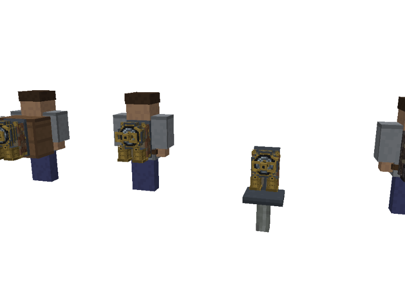
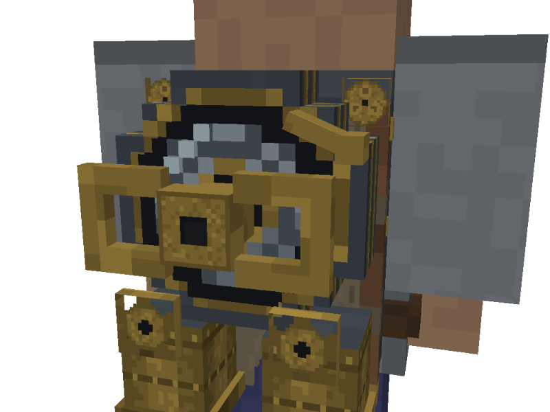
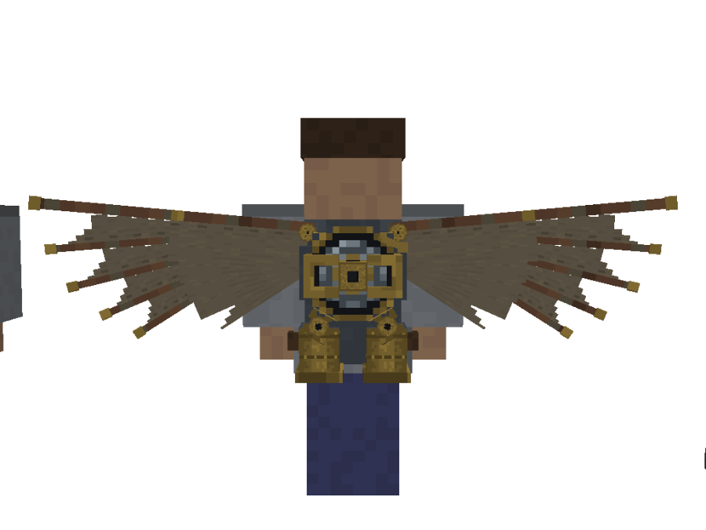
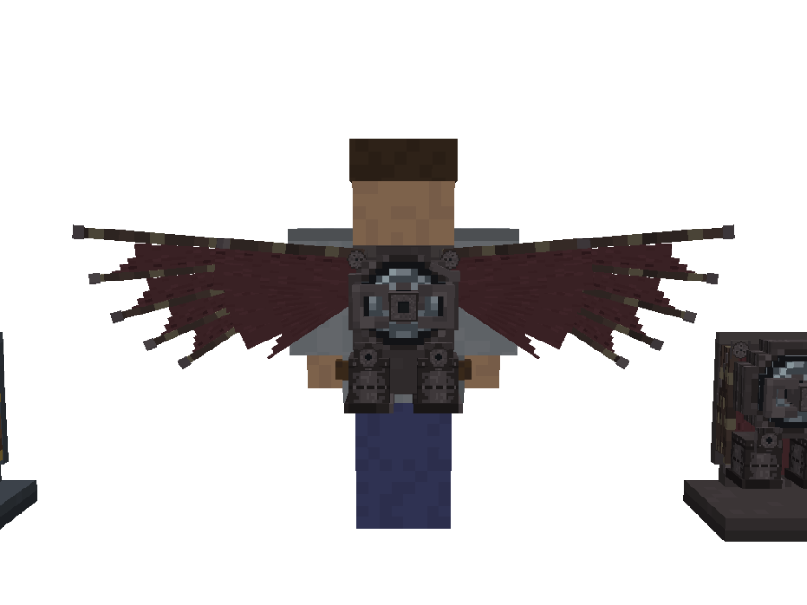
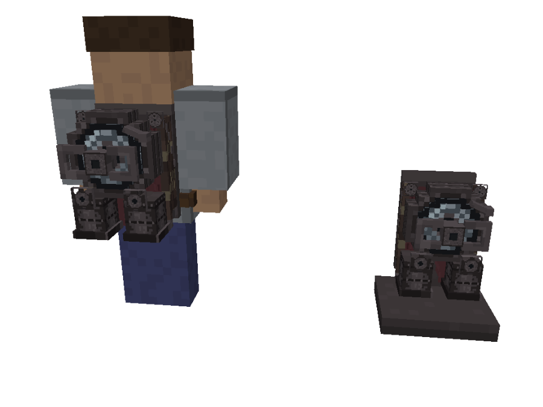
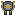

# Texture Review: Clockwork Jetpack

Family: the Aeronautics set (Compact Gyroscope, Torque Rotor, flight instruments: `ship-hardware.gen.js`), the Spring Engine and Mainspring (`juggernaut-props.gen.js`), the Netherite Clockwork Jetpack  ·  Brief: design/briefs/clockwork-jetpack.md  ·  Model: design/models/clockwork-jetpack.bbmodel (generator `clockwork-jetpack.gen.js`)  ·  Date: 2026-11-03

| Gameplay distance (worn, over a backpack, placed) | Hero close-up |
|---|---|
|  |  |

| Wings open | Netherite, open | Netherite, folded |
|---|---|---|
|  |  |  |

Inventory:  (16×16). Family reference: `design/models/ship-hardware-review/rotor-3q.png` (the Torque Rotor's brass and walnut).

## Texture Contract
New asset, nothing in the mod yet. Every texture is painted in `textures(variant, file)` in the generator, as `clockwork_jetpack_<key>.png` and `netherite_clockwork_jetpack_<key>.png` (16×16 each). Nothing is shared with other blocks; the shaft in the block preview is Create's `block/axis` (preview only).

## Design Intent
A player-built Create machine with an ancient part inside: the Juggernaut's Mainspring in an aviator's brass-and-steel harness. It must read as a **wind-up key on a spring drum** from behind (the hero), with the Mainspring readable through the porthole (the wind gauge), two fan ducts below, and da Vinci canvas wings when open. Theme: aviation and clockwork. Maker: Create-era engineers, Aeronautics set. New, so no wear (visual-language: crafted machines look new). The Netherite version shares the shape with all brass painted out in netherite (user call).

## Current Strengths
- **Brass shades are already the Aeronautics set's** (`#7e6832` `#8f7638` `#a3873f`), and the steel is the house steel (`#3c424a` field, `#4a5059` / `#2f343b` bevels).
- **The porthole coil is the Spring Engine's**, with the same four coil states and spring-steel shades (`#8a949c` `#6d7780` `#4a525a` on `#16181b`). A player who knows one reads the other. Keep this.
- **Walnut ribs and oiled canvas** carry the da Vinci look, and the canvas stays at the mid-grey ceiling (`#756a55` at most).
- **No glow, no stripes, no wear**: correct for a new clockwork machine.
- **Netherite** reads differently at a glance, folded or open: dark trim, darkest rims (`#2a2526`), crimson canvas.

## Current Weaknesses
1. **The brass is loud and competes with the hero.** The `brass` painter spends 15% of its pixels on `#a3873f`, where the Aeronautics set keeps `#a3873f` for bolts only (its brass is `#7e6832` with `#8f7638` rows). And since the ducts became brass, the two ducts are the largest brass mass on the back. At gameplay distance they outweigh the key, the primary element. (Your concern; the Aeronautics call was "brass too bright".)
2. **Noise on small faces (texel density).** Several faces map a whole 16-texel texture onto 1.5–2 px, so a single texel is about 1/8 px and the pattern turns to speckle:
   - `key_hub`: the hero's own centre, on a 2 px face;
   - `hub_cap`: the precision mechanisms, on a 1.5 px face;
   - `gear`: on a 2 px face.

   The duct's single-texel rivets (on a 3 px face, about 5 texels per px) read as grain, not rivets. The house rule is about one texel per model pixel, and twice that only for small hero discs (the porthole, at 2×).
3. **Dark brass is off by a shade.** `#5a4a22` isn't in the set; the ship set's dark brass is `#5e4c24`.
4. **The icon's brass is lighter than the family's icons.** It uses `#b39a55` and `#c9a75a`, where the Mainspring icon's brass is `#b08f45`.

## Storytelling Evaluation
- **Who made it and who uses it:** a player with Mechanical Crafters (the aviator's steel and brass, walnut) around a part taken from a boss (the bright spring-steel coil in the porthole). The contrast between new brass and ancient steel tells that story.
- **How expensive:** end game. Restraint suits it: the precision hubs and the key are the jewellery, not every surface.
- **Age:** new. There's no soot under the ducts, and that's right: the fans blow air, not exhaust.
- **What's missing:** the hierarchy doesn't yet say "the key matters most", because the ducts shout louder (weakness 1).

## Material Evaluation
| Material | Reads? | Matches family? |
|---|---|---|
| Steel (plate, drum) | Yes | Yes: house field and bevels |
| Brass (key, ducts, trims) | Yes, but loud | Same shades, but more highlight than the Aeronautics brass; one dark shade off (`#5a4a22`) |
| Walnut (ribs) | Yes | Yes: the Aeronautics walnut (`#4e3626` `#634532` `#6f4d36`) |
| Oiled canvas | Yes | New to the mod (see the visual-language proposal) |
| Spring steel (coil) | Yes | Yes: the Spring Engine's |
| Leather (pad, straps) | Yes | Yes: the props' leather |
| Netherite trim | Yes | New: no Netherite trim rule yet (see the proposal) |

## Minecraft Readability Evaluation
- **Primary:** the key and the porthole coil. Up close, the key reads. At gameplay distance it's lost against the brass ducts.
- **Secondary:** the drum, plate, ducts and wings. The ducts are too strong for secondary.
- **Tertiary:** rivets, stitching and lashings. Fine on the canvas and ribs; on the ducts and the small discs they become speckle (weakness 2).
- **No gradients or photographic detail.** The 2× porthole is fine (a hero disc, like the Cuckoo Clock's dial).

## Cohesion Evaluation
- **Shared materials:** brass, steel and walnut match the Aeronautics set once the brass mix matches (change 1).
- **Shared manufacturing language:** riveted brass, walnut and steel plates are aviator work. The jetpack reads as the same workshop as the Torque Rotor.
- **Colour logic** (`design/visual-language.md`): no glow, no copper (nothing electric), no cyan or amber. That's correct: nothing here makes power, so no lamp is due.
- **Age:** factory new, like the rest of the Create-era set.

## Recommended Texture Changes
1. **Brass mix to the Aeronautics brass.** `brass` painter: base `#7e6832`, about 35% `#8f7638`, and `#a3873f` only on rivets and the leading (top-left) edges. **Why:** your concern, and the Aeronautics "too bright" call.
2. **Ducts and collars a step darker, so the key leads.**
   - Field `#6e5a2a` and `#7e6832`; bands and lip `#5e4c24`; rivets `#8f7638` (no `#a3873f` on the ducts).
   - The key's bars keep `#8f7638` with a 1-texel `#a3873f` top-left bevel.

   **Why:** primary over secondary. The key becomes the brightest brass on the back.
3. **Coarser small faces.** Repaint `key_hub`, `hub_cap` and `gear` on a 4-texel grid (one visible step ≈ ½ px):
   - **Key hub:** brass with a dark square socket.
   - **Precision cap:** a dark rim ring, three cog dots and a dark centre.
   - **Gear:** 8 teeth.

   On the ducts, make the rivets 3×3 texels and the bands 3 texels high. **Why:** this removes the speckle and keeps them reading as real parts.
4. **Dark brass `#5a4a22` → `#5e4c24`**, the ship set's own dark brass. **Why:** one material, one set of shades.
5. **Icon brass `#b39a55` / `#c9a75a` → `#a3873f` / `#b08f45`**: still lighter than the block textures, but the same family as the Mainspring icon.
6. **Netherite:** no change. It already follows your call; changes 1–4 apply to its metal ramp too (rims stay darkest).

## Recommended Retexture Candidates
Now that this asset exists, are there earlier assets that should be revisited for visual consistency?

**None.**
- The jetpack borrows the Aeronautics set's brass, steel and walnut, and the Spring Engine's coil. Changes 1, 2 and 4 bring it in line with them, not the other way round.
- The Spring Engine's bronze is the Juggernaut's own (ancient maker, on purpose), so it differs from the jetpack's new brass by design.
- The Mainspring icon already sets the icon brass that change 5 adopts.

## Art Director Verdict
**Approved with changes.** The jetpack strengthens the mod's identity: it ties the aviation set to the clockwork family through the shared coil porthole and the family key. Before it counts as finished, take changes 1–3, which put the key back on top and clean the speckle; 4 and 5 are small alignments. No earlier assets need revisiting.

**Visual-language proposals** (written into `design/visual-language.md` only if approved):
- **Materials, new row "Oiled canvas":** `#6a604e` `#6f6552` `#756a55`, selvedge `#5a5242`; a faint weave, never above `#756a55`; for wings and sails.
- **Materials, new row "Netherite trim":** `#433d40` `#4d4649` `#5a5255`, rims `#2a2526`; on Netherite-tier gear it replaces every brass part (user, 2026-11-03).
- **Glow line:** "Clockwork machines have no glow; the Mainspring through glass is the gauge."

## Follow-up
User picked everything (2026-11-03): changes 1–5 and the visual-language rows.
- **1–3 applied** in `clockwork-jetpack.gen.js`:
  - the brass mixes `#7e6832` with `#8f7638`;
  - the key has its own brighter `key_metal`, so it leads;
  - the ducts and collars use `ductField` `#6e5a2a`/`#7e6832` with `#8f7638` rivets in 3×3-texel rows;
  - the key hub, precision caps and gears are on a 4-texel grid.
- **Found in the pass:** the gears' dark arbors sat side by side and read as a pair of eyes, so they're brass hubs now.
- **4 and 5 applied:** dark brass is `#5e4c24`; the icon brass is `#a3873f` / `#b08f45`.
- **The Netherite ramp** follows the same structure (its own `ductField` and `ductRivet`).
- **`design/visual-language.md`:** added Oiled canvas and Netherite trim to Materials, and the clockwork no-glow line to Glow.
- **Retexture candidates:** none (see above).
