# Texture Review: Clockwork Juggernaut

Family: Trade Bot, Helper Bot (the bots he's ancestor to); his props (Winding Key, Spring Engine, Mainspring); the Clockwork Wastes bots and city (briefed, not built).
Brief: design/briefs/clockwork-juggernaut.md (Revision 2) · Model: design/models/clockwork-juggernaut.bbmodel (from clockwork-juggernaut.gen.js) · Date: 2026-10-29

Screenshots, all in Blockbench in the idle pose at 0.4 s:

| | |
|---|---|
| 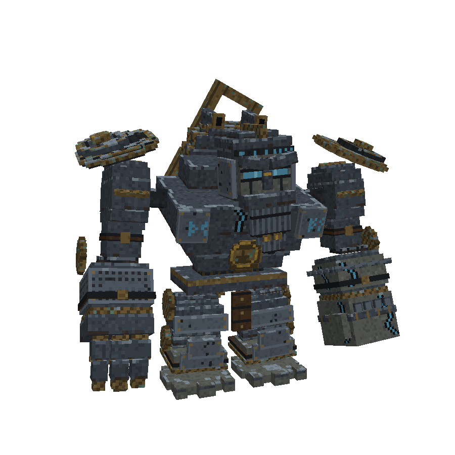 three-quarter, about 12 blocks | 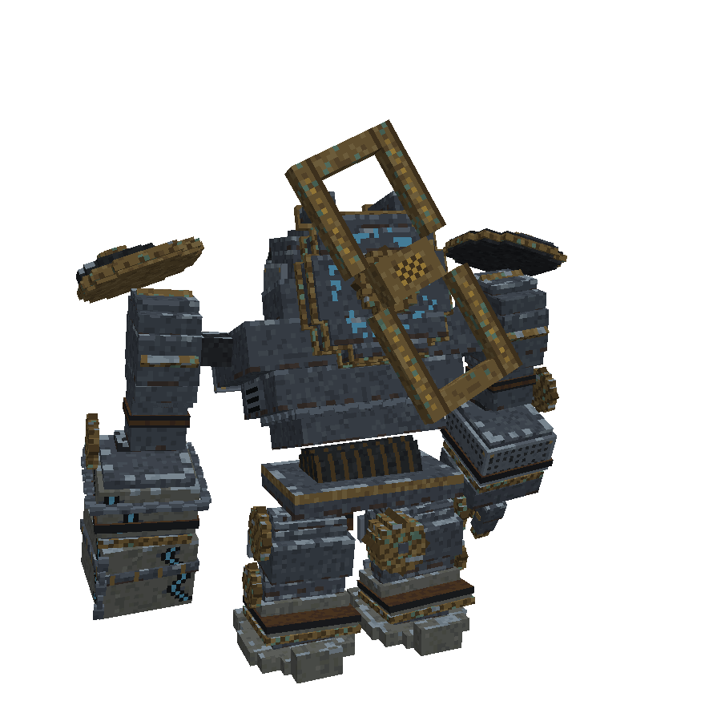 back three-quarter (the key) |
| 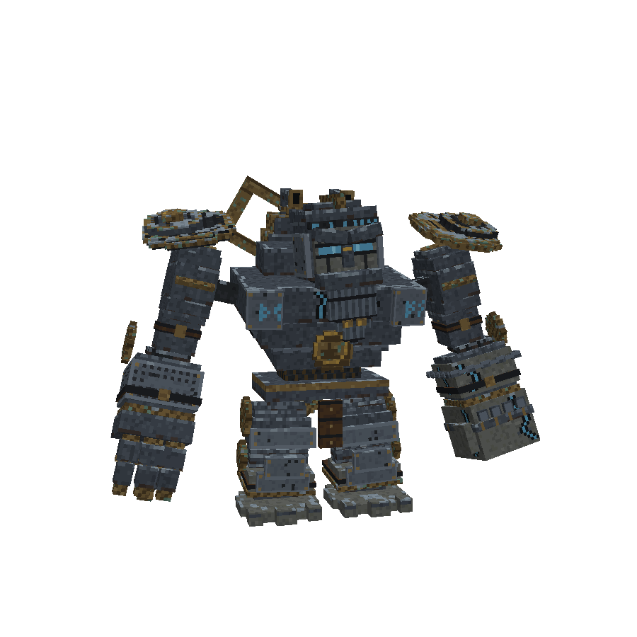 front, about 15 blocks | 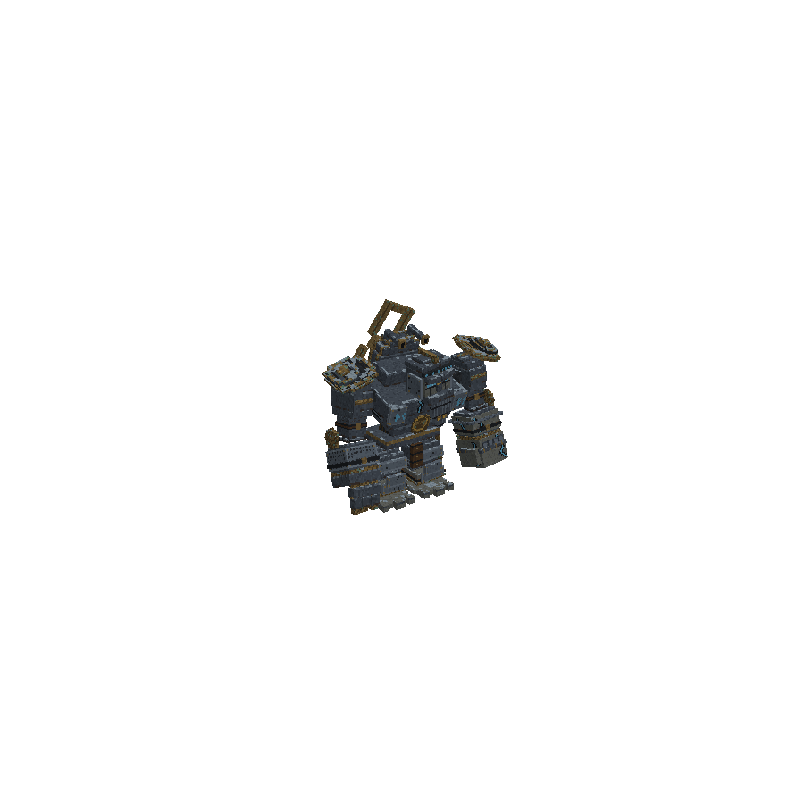 about 30 blocks (stands in for the inventory and spawn-egg read) |
| 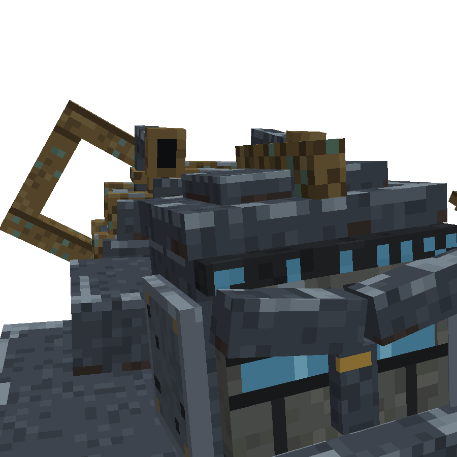 primary close-up: slit, brow runes, key | 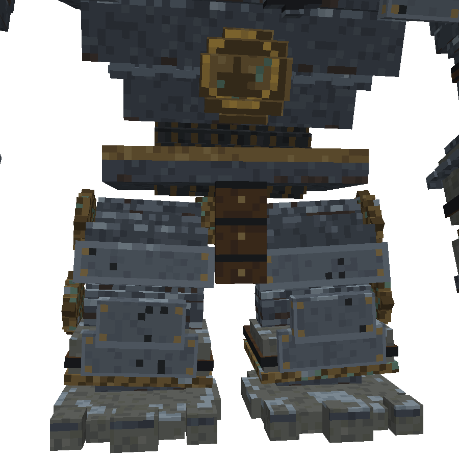 legs, girdle, seal, stone feet |
| 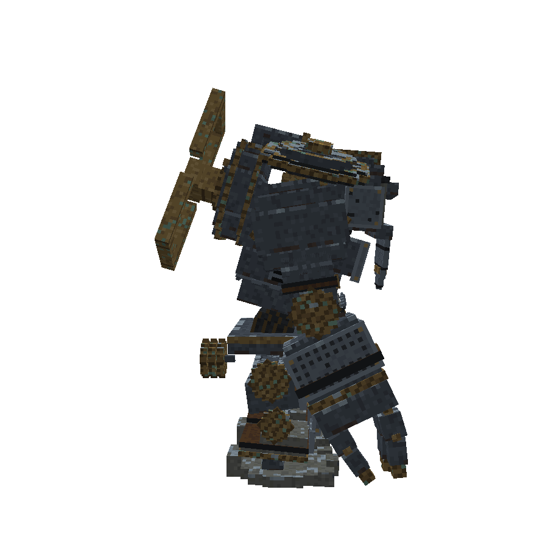 side | 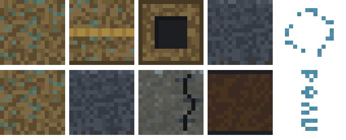 prop textures ×8: Winding Key bronze, key bar, hub, iron, runes; Spring Engine bronze, iron, stone, leather, rune band |

## Texture Contract

- `textures/entity/clockwork_juggernaut.png`: 1024 × 1024, box UV, packed and painted by `clockwork-juggernaut.gen.js` and cropped by `clockwork-juggernaut.game-export.js`. Repaint in the generator only; the UV packing is automatic, so nothing is moved by hand.
- `textures/entity/clockwork_juggernaut_glow.png`: written by the game export from **exact colour matches** on `#4f8fae` `#4a87a4` `#7ab8d0` (`GLOW` in game-export.js). Any change to the rune colours must change that list too, or the runes stop glowing in game.
- Both are named in `JuggernautRenderer` (`TEXTURE`, `GLOW`). No other model uses them.
- The props have their own textures (`block/winding_key_*`, `block/spring_engine_*`), painted by `juggernaut-props.gen.js` with the **same bronze recipe** (see Retexture Candidates).

## Design Intent

The first clockwork soldier, made by an older maker than the bots' makers: a mythic Norse siege construct, wound up for a forgotten war and left kneeling for centuries (brief Revision 2, from the user's own art direction). The theme is ancient, mechanical and martial, with weight and age.

- **Primary:** the one glowing eye slit, and the giant winding key (the hero element and the fight's tell).
- **Secondary:** the Viking-shield pauldrons, the stone fist, the iron gauntlet and the pectoral plates.
- **Tertiary:** runes, knotwork, chains, straps, staples, frost and the forge-maker's seal.

The palette is charcoal and blue-grey iron, tarnished bronze, gold only on inlays, stapled stone, frost on top edges and faint frost-blue runes.

## Current Strengths

- **The eye slit and the chest runes are the best-read features.** The frost-blue against charcoal is the strongest contrast on him, exactly where the brief puts the primary. Keep them.
- **Iron reads as iron.** The blue-grey charcoal-to-plate range sits in the house's dark band, and the stepped plates throw real shadow.
- **Gold is used with discipline.** It appears on the seal, the nose-guard rivet, the shield bosses and the key inlay, and nowhere else. The seal reads as an emblem from 15 blocks.
- **Leather straps and buckles** read clearly and do real work (holding plates on), and the chains are good.
- **The stone fist** is readable as a different material. The stapled crack with rune-light in it is the best piece of storytelling on the model.
- **His motifs are his alone.** The Wastes look bible already bans runes, frost, knotwork and gold from the city ("an older, different maker"), so these textures carry a maker identity that nothing else in the mod uses.

## Current Weaknesses

1. **The hero element doesn't read as metal.** The key's bronze (`#5c4a2e` `#6e5a36` `#7d6a44`) has the same value as the iron plates (both about 36% luminance), and an even sprinkle of patina pixels (10–25% of all pixels, `#4f6b5e` `#5b7a6c`) covers every face. In the back three-quarter it reads as a **wooden picture frame**. From 30 blocks the key nearly disappears against his back, while the brief says it is seen first from every side.
2. **The key's gold inlay is a chequerboard** (the hub, back view). It reads as a chess board or a placeholder texture, not an inlay.
3. **The brightest thing on him is his feet.** The frost (`#7a8791`) and stone highlights (`#666863`) on the feet, knee caps and tops of the greaves are lighter than anything above the waist, so the eye drops to the floor. The frost is still scattered per 2 × 2 cell at 45% (`frosty`), which speckles at distance. The earlier lesson already says to keep it to top edges in clusters.
4. **Random dents.** The plates get 3% single black pixels (`plated`: `hash < 0.03 → char`) all over the greaves and armour. They read as holes or dirt, not dents, and they're uniform: no story says where blows landed.
5. **The knotwork reads as perforation.** The 1-pixel diamond lattice on big plate borders (`knot`) reads as a **speaker grille** of dark dots on the right forearm guard and the pauldron plates: sci-fi, not Norse.
6. **Rune ring on the back drum = glitter.** The drum's ring of runes is a 45% random scatter of single blue pixels (`drumBack`), so the back carries a sprinkle of blue specks rather than an inscription.
7. **The forehead rune band reads as LEDs.** The band is 2 px tall, so the 3 × 5 glyphs are cut to two rows of evenly spaced bars. It looks like a visor display.
8. **The pectoral runes sit on light square panels** (the plate field `#535c66` with a `#626c77` rim), which read like screens or stickers on the chest, not runes carved into armour.

## Storytelling Evaluation

| Question | Answer from the brief | Does the texture show it? |
|---|---|---|
| Who made it? | An older maker: Norse forge-smiths (the seal: hammer over anvil) | Partly. Runes, gold and the seal say so. The perforated "knotwork" and LED band pull it toward sci-fi |
| Who uses it? | No one now; it serves forgotten orders | Yes. Kneeling, frost and wear say abandoned |
| How old? | Centuries | Mostly. Stone, cracks and staples say so. The even patina sprinkle says "dirty" rather than "old" |
| How often used? | Fought hard, then dormant for ages | **Weak.** No wear shows where he strikes (knuckles, fist face, shield fronts) or where his key is gripped and turned |
| Where? | Damp ruins under vines; frozen End islands | Frost, yes. Damp, no: patina should collect where water pools (inner corners, under rims), not everywhere |
| How expensive? | A war machine of a lost civilisation | Yes: gold inlays, a forged seal, layered shields |
| Who repairs it? | Field repairs: straps, staples, the bronze replacement shield | Yes, and it's the best story on him. The staples and the odd shield are exactly right |

## Material Evaluation

- **Iron and charcoal: good.** Keep the ranges. Lower the per-pixel contrast on big faces slightly (the `ironHi` 50% sprinkle on top rows), and give the shape its read from 1 px edge bevels instead.
- **Tarnished bronze: fails.** Three close shades plus scattered teal read as cork or wood. Minecraft reads metal from a bright edge and a smooth body (vanilla gold and copper blocks, Create's brass). Bronze needs:
  - a smooth body in 2 shades;
  - a 1 px lit top and outer edge;
  - a 1 px dark inner edge;
  - patina only where water would collect.
- **Gold: good**, apart from the chequerboard.
- **Stone: good on the fist**, too light on the feet with the frost on top.
- **Frost: right idea, wrong density.** It should be a few 2–4 px runs along top edges, not a 45% sprinkle.
- **Leather: good.**
- **Rune glow: good colour, mixed execution.** The slit and chest are carved and confident. The back ring and brow band are scattered or mechanical.

## Minecraft Readability Evaluation

| Tier | Feature | Now | Should be |
|---|---|---|---|
| Primary | Eye slit | Strong | Keep |
| Primary | Winding key | **Weak**: same value as the body, reads as wood | Strongest non-glow contrast on him |
| Secondary | Shields, fist, gauntlet, pectorals | Good shapes; shields read edge-on from the front (geometry, see note) | As now |
| Secondary | Feet and greaves | **Too strong**: the lightest values on him | Pushed down a step |
| Tertiary | Patina, dents, frost, knotwork | **Too strong**: scattered single pixels everywhere make the whole body shimmer at distance | Clustered and placed, or gone |

- **Texel density:** consistent at 1 texel per model pixel (1024 sheet, full-size model). Good.
- **Gradients and photo detail:** none. Good.
- **Detail only visible zoomed in:** the 1 px knotwork lattice and the single-pixel dents and patina. At gameplay distance they turn into noise, which is why the whole body looks "busy grey" from 15+ blocks while the brief's real-part detail (rivets, buckles, staples) is lost in it.

**Shape note, for the modeller and not for this pass:** in idle the shields lie almost flat on the shoulders, so their painted faces (planks, knotwork, boss) face the sky and only the rims show from the front. If the user wants the shields read as shields from the front, that's a geometry tilt, not a texture fix. They were approved as built, so this is only a note.

## Cohesion Evaluation

- **Shared materials:** he deliberately doesn't share the bots' materials. Bronze is not the bots' brass and frost is not their andesite; the brief's "older maker" justifies that. The link to the family is the **winding key and clockwork**, so the key carries the whole family resemblance. Its failing material is therefore a cohesion problem too.
- **Manufacturing language:** consistent within himself (straps, staples, rivets, gold inlays). The perforated lattice and LED band are the two details from a different manufacturer.
- **Colour logic:** his rune blue (`#4f8fae`, hue about 200°) sits close to Helper Bot's cyan irises (`#6fb7c4`, about 189°).
  - The shapes keep them apart: carved slit and runes against round lenses in brass rims. Nobody confuses a 7-block boss with Helper Bot, so this needs **no change**.
  - It is worth writing down as a rule (see the proposed visual-language updates below), so a future friendly bot doesn't get frost-blue or a future hostile doesn't get cyan lenses.
  - The Wastes give woken hostiles a starlight lens with an **ember pupil**. Ember isn't proposed for him: it would tie the Juggernaut to the uprising, which the lore separates.
- **Age:** he is the oldest thing in the mod and looks it. The props beside him in the ritual share his bronze recipe, so they share its problem (below). The bots look looked-after and the Wastes look war-damaged, so the age story across the mod is coherent.

## Recommended Texture Changes

All of these are in `clockwork-juggernaut.gen.js`. No geometry changes; previewed in Blockbench first.

1. **Bronze as metal** (key, shield rims and bosses, cogs, girdle rim, finger points, knuckle bands):
   - body: 2 shades `#6e5a36` `#7d6a44` with a soft mottle (no third dark shade in the field);
   - **1 px lit edge** on top and outer edges `#8c774a`;
   - **1 px dark edge** on bottom and inner edges `#463822`;
   - patina `#4f6b5e` `#5b7a6c` **only in recesses**: inner corners of the key loops, the underside of rims, between cog teeth. Use 2–3 px clusters, about 3% overall instead of 10–25%. *Story: patina collects where rain and condensation sit.*
2. **Make the key the hero.** On top of change 1, give the key bow and stem the widest bronze value range on him: lit edge `#8c774a` on every outer edge of the loops and dark `#463822` inside. Add **grip wear**: a smoother, lighter `#7d6a44` patch with no patina where the bow would be gripped and turned, and on the stem collar where the ratchet works. *Story: the only bronze anyone ever touched.*
3. **Replace the chequerboard inlay** on the key hub with one gold rune (a 3 × 5 glyph in `#a8873e` on dark bronze `#463822`) or a plain gold boss with a 1 px `#93763a` rim. Recommended: the rune, to match the seal's craft.
4. **Frost in runs, not specks.** On up faces, frost on the outer row only, in runs of 2–4 px with about 40% of the edge covered. Side-face frost off, except the knee caps and shield tops. Drop `stoneHi` on the feet (5% → 0). The feet then sit a step below the torso's brightest plates.
5. **Dents with a reason.** Remove the 3% random black pixels. Paint 2–3 dents per face only where blows land: shield fronts, knee caps, shin fronts, the fist's striking face. Each dent is a 2 px dark `#2a2d31` mark with a 1 px `#626c77` highlight below it.
6. **Knotwork that reads as carving.** Replace the 1 px diamond lattice with a **2 px-wide interlace band**: a twisted rope of `#2a2d31` with `#626c77` highlights, kept to borders of 3+ px. On plates too small to carry it, use an engraved 1 px groove border with a simple knot at each corner. No more dot grids.
7. **Back drum ring as an inscription:** a continuous ring of glyphs (dim `#23404c` with lit `#4f8fae` glyphs every quarter turn), replacing the random scatter. The key stays the hero, so the ring stays dim.
8. **Forehead band as a worn inscription:** vary the lit bars (full, half, dim `#23404c`, gap) so it reads as script with wear, not LEDs. A real glyph band would need the band 5 px tall, which is a geometry change and not part of this pass.
9. **Pectoral runes carved, not printed:** darken the pectoral plate field to `#4a525c` (no lighter `#535c66` field) and cut a 1 px `#1c1e21` groove round each glyph, so the runes sit in the iron.

Change 9 keeps the rune colours, so the game export's `GLOW` list stays valid. Changes 7 and 8 reuse the existing rune colours, so they don't touch it either.

## Recommended Retexture Candidates

Now that this asset exists, are there earlier assets that should be revisited for visual consistency?

| Asset | Reason for review | What has changed | Proposed update |
|---|---|---|---|
| **Winding Key** (block: `winding_key_bronze`, `_bronze_dark`, `_bronze_teeth`, `_key_bar`, `_key_hub`) | Same bronze recipe as the Juggernaut (even patina sprinkle, prop sheet above). It sits on his effigy and turns into his key on waking, so the two must match | His bronze changes to the metal recipe (changes 1–3) | Same bronze recipe at 16 px: smooth 2-shade body, lit and dark edges, patina in recesses only, grip wear on the bar. The hub keeps its dark socket |
| **Spring Engine** (block: `spring_engine_bronze`, `_bronze_teeth`, `_wheel`) | Same bronze speckle. It's built from his Mainspring, so it's his material in the player's base | As above | Same bronze recipe; its stone and rune band stay as they are (they already read well) |

Considered and left out:
- **Trade Bot and Helper Bot:** the shape keeps their glows apart from his, and their brass is a different maker's by design.
- **The Mainspring:** spring steel, reviewed 2026-10-28.
- **The ruins:** vanilla blocks.
- **The Wastes:** briefed, not built. They'll be checked against the visual-language doc when they're modelled.

### Proposed visual-language updates (`design/visual-language.md`, for your approval)

1. **Materials:** add **Tarnished bronze** (Norse makers): body `#6e5a36` `#7d6a44`, lit edge `#8c774a`, dark edge `#463822`. Grain: smooth body with a bright edge; patina `#4f6b5e` `#5b7a6c` in recesses only. Used on the Juggernaut, the Winding Key and the Spring Engine. Add **Forge iron**: `#1c1e21` `#232629` `#2a2d31` / `#343a42` `#3d444d` `#454d56`, edge `#56606b`.
2. **Colour meanings:**
   - add **Frost blue** (`#4f8fae`, `#7ab8d0`, dim `#23404c`): the Norse makers' runes and eye slit. Carved shapes only (runes, slits, cracks), never round lenses. Never in the Wastes.
   - add **Cool cyan** (`#6fb7c4`): a friendly bot's eyes (Helper Bot), round lenses in brass rims only.
3. **Families:**
   - the Bots row says "amber glow", but Helper Bot is cyan, so it should read "amber or cyan lens glow";
   - the Juggernaut row should add the Spring Engine (his material in the player's base).
4. **Markings:** runes and knotwork are carved, never printed, and drawn wide enough to read: knotwork bands 2 px or wider, no 1 px lattices.

## Art Director Verdict

**Approved with changes.** He already gives the mod something no other asset has: a second, older maker with its own visual language of runes, frost, gold, stapled stone and Norse craft. His primary glow is excellent. But his **hero element doesn't read**: the winding key, the one thing that ties him to the bots and tells the fight, is painted in a bronze that reads as wood and has no more contrast than his body. Around it, single-pixel noise (patina, dents, a lattice, frost specks) turns the real-part detail into shimmer at fighting distance.

Changes 1–5 are the important ones. They fix the key, the hierarchy and the noise without touching his palette, glow colours or geometry. 6–9 are polish. The Winding Key and Spring Engine should change with him in the same pass, so the ritual never shows two bronzes.

## Follow-up

**User's picks (2026-10-29):** all of it: changes 1–5 and 6–9, both retexture candidates and the visual-language additions.

**Applied in the generators** (`clockwork-juggernaut.gen.js`, `juggernaut-props.gen.js`) and previewed in Blockbench:
- New palette entries: `bronze`, `bronzeHi` `#8c774a`, `bronzeWorn` and `plateDark`.
- New painters and helpers:
  - `bronze` and `keyBronze` (lit and dark edges, patina in bottom-edge clusters);
  - `keyGrip` (the outer bars and stem rubbed smooth);
  - `hubPaint` (a gold tiwaz in place of the chequer);
  - `frosty` (outer-rim runs on top faces only, no side frost);
  - `platedWith(seed)` (a 2 px rope border, 1 px dents with a lit lip on shin guards and knee caps; no random black pixels);
  - shield boards dented, with a rope ring;
  - `stony(…, {specks: false})` on the feet, chips on the fist's face;
  - the mask brow as rope;
  - the brow band as a worn inscription (lit, dim, worn away);
  - the drum's back as a ring inscription (dim, three lit staves each quarter);
  - pectoral runes carved into a darker field.
- The rune glow colours are unchanged, so `GLOW` in the game export still matches.
- Every clip still passes the clipping check (geometry untouched).
- **Props:** smooth bronze body, a lit top row and a dark bottom row with patina clusters. The key's bars are worn smooth. The plate's dotted lattice became a 2 px cord. The tooth texture uses soft grooves every 4 px, because it also wraps the Spring Engine's broad bands.

| After | |
|---|---|
| 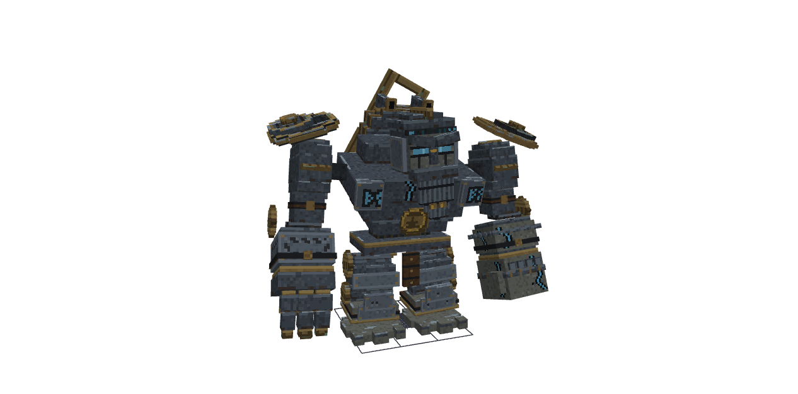 | 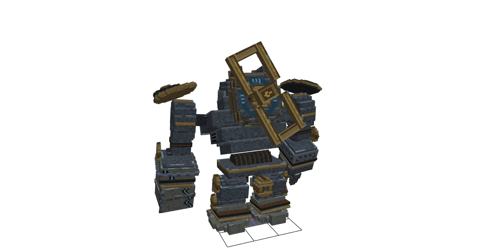 |
| 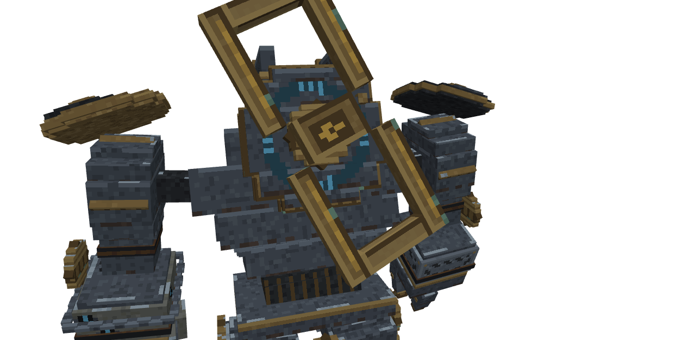 | 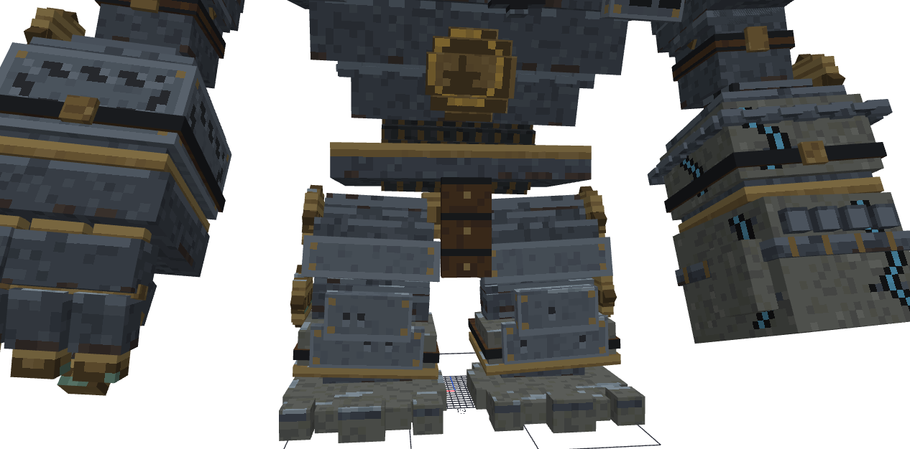 |
| 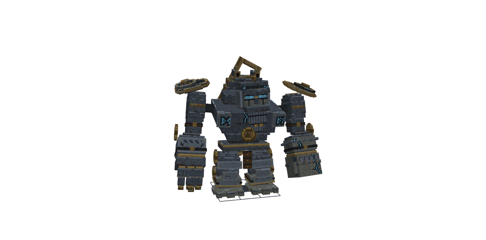 | 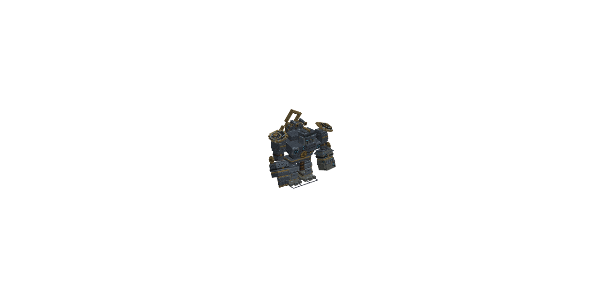 |
| 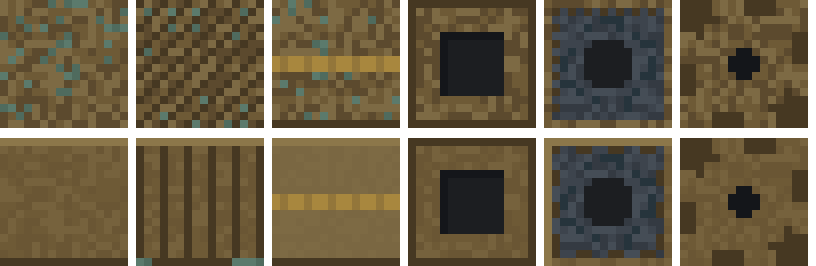 | 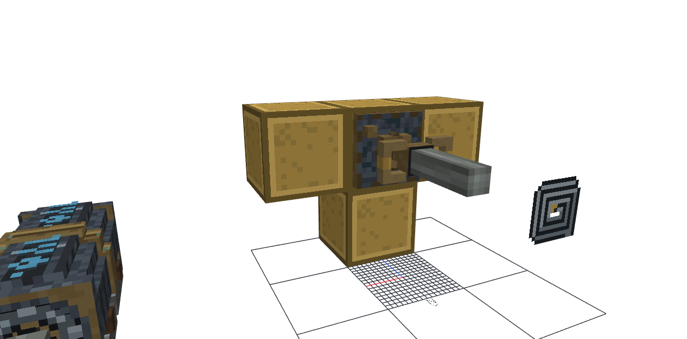 |

**Visual language:** the bronze and forge-iron materials, the frost-blue and cool-cyan meanings, the carving rule and the family fixes are added to `design/visual-language.md`, line by line.

**Approved in Blockbench** ("looks much better", 2026-10-29) and exported to the mod with `clockwork-juggernaut.game-export.js`, `winding-key.export.js` and `spring-engine.export.js`. Only textures changed:
- the entity texture and its glow layer (911 glowing px);
- 5 `winding_key_*` textures;
- 8 `spring_engine_*` textures.

The geometry, clips and block models came out identical. Not tested in game, at the user's request.
