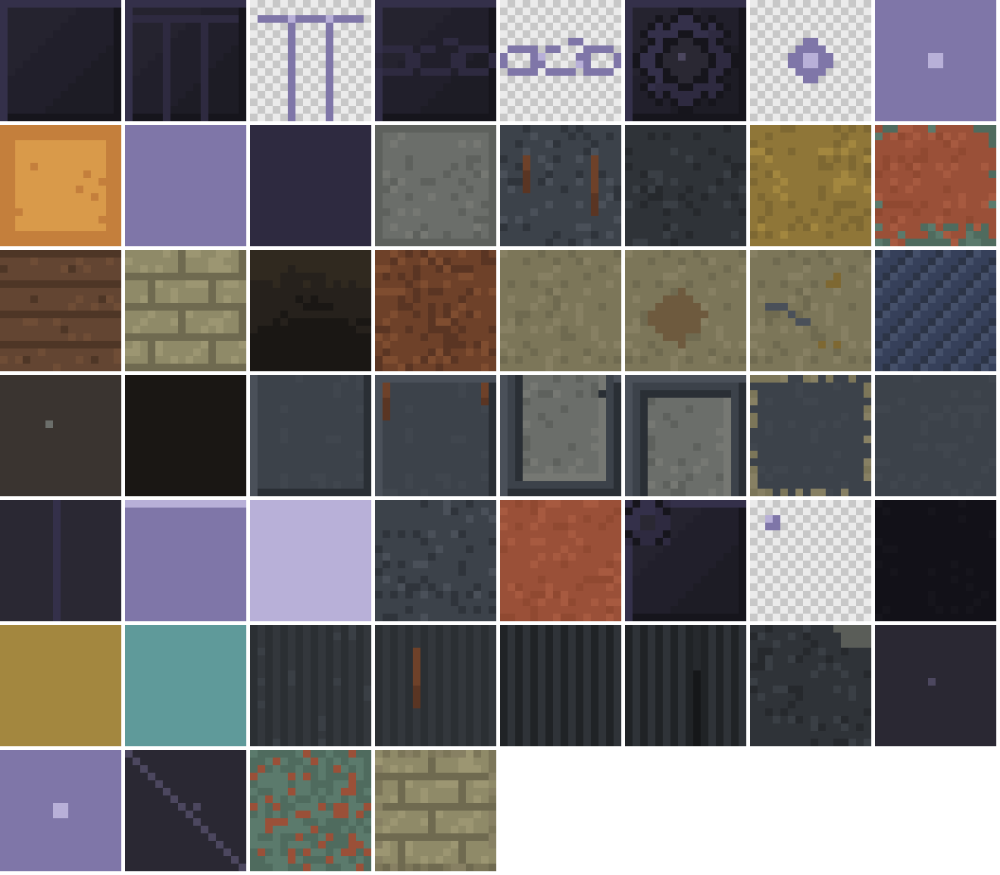
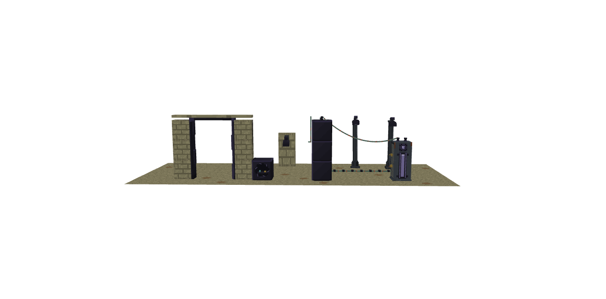
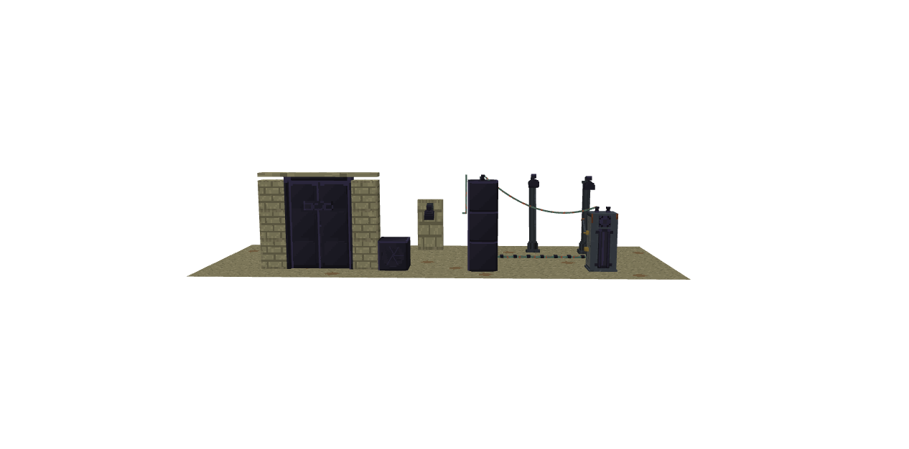
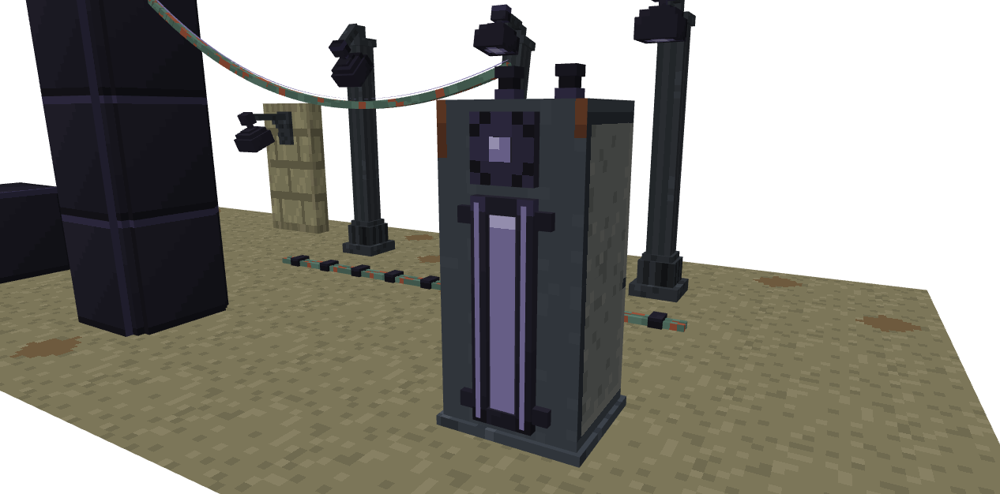
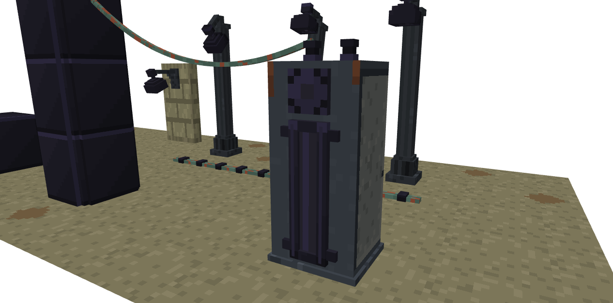
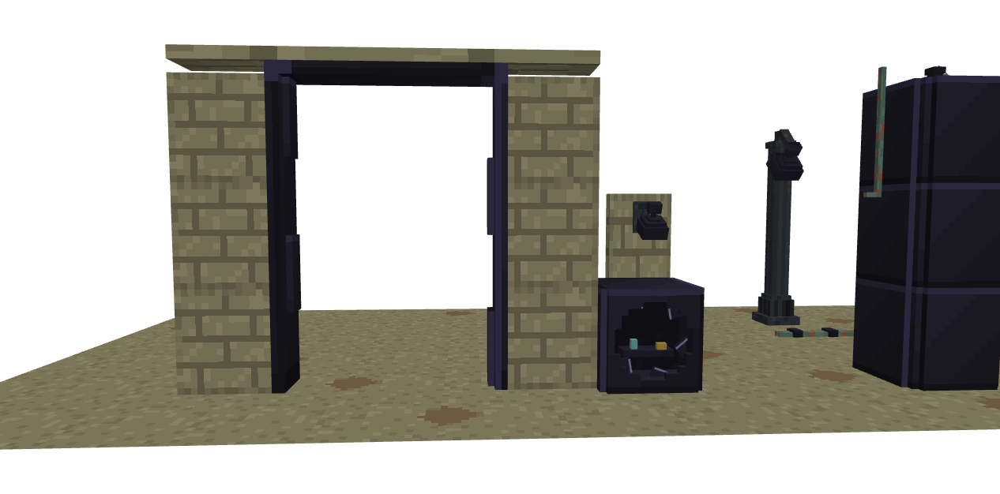
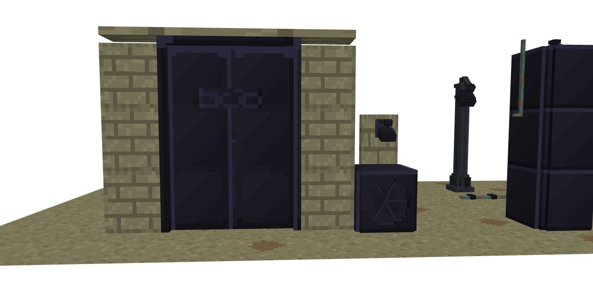
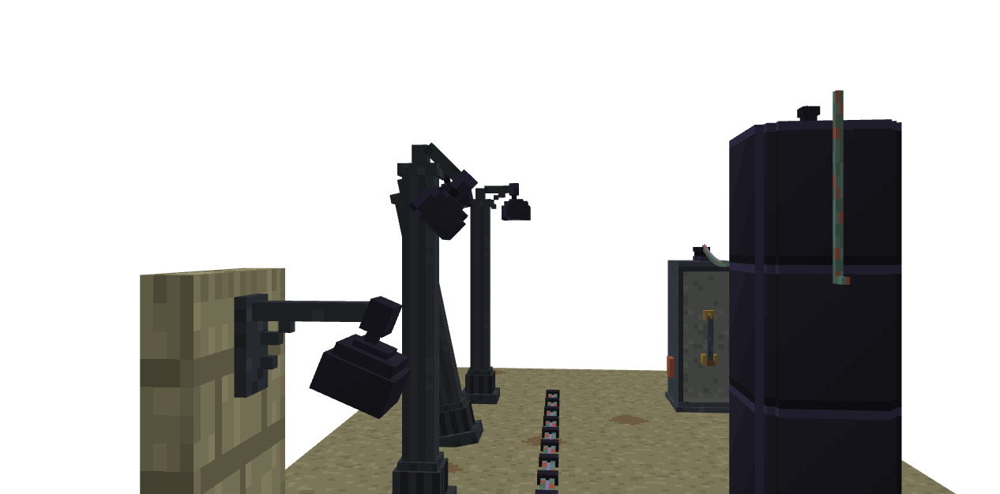
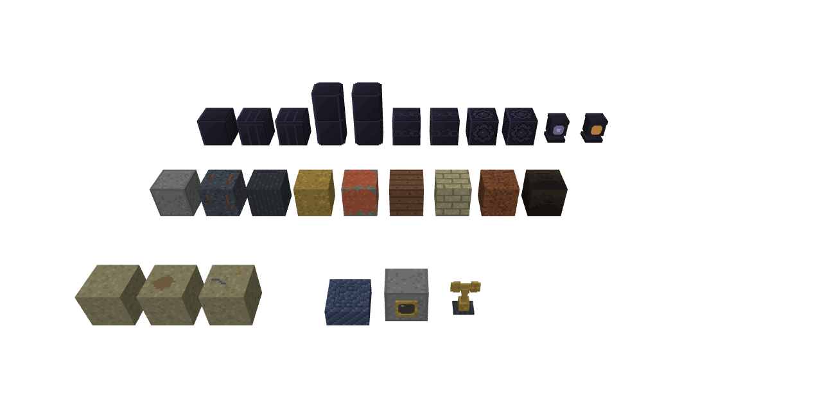
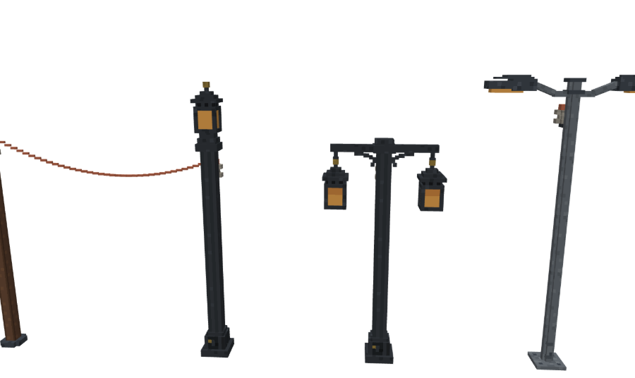

# Texture Review: Clockwork Wastes, material sheet and city blocks (batch 1)

Family: Wastes material sheet, Substation, City Vault, Sliding Door, Derelict Street / Wall Lamp, Derelict Cable; compared with the Electric Lights cast-iron posts, the Industrial Battery, the Spring Engine and Mainspring, the Juggernaut's Winding Key, and Trade Bot  ·  Briefs: design/briefs/clockwork-wastes-world.md, clockwork-wastes-blocks.md  ·  Models: design/models/clockwork-wastes-materials.bbmodel, clockwork-wastes-city.bbmodel (generators alongside)  ·  Date: 2026-10-28

Screenshots (in `clockwork-wastes-city/`):

| | |
|---|---|
|  | Every texture at 8x, in paint order (va … endbrick_dusty) |
|  | Gameplay distance, awake |
|  | Gameplay distance, dormant |
|  | Substation close-up, awake (the primary element) |
|  | Substation, dormant |
|  | Door and vault, awake |
|  | Door and vault, dormant |
|  | The street from the side, lamps lit |
|  | Material sheet |
|  | Family: the Electric Lights cast-iron posts |

## Design Intent

A dead machine city in three layers that a player can read without text: the **makers' Create-era town** (aged andesite, dark steel, cast iron, mid brass, Create copper going to patina), the **uprising's void-alloy** (near-black, violet cast, crisp facets, hairline starlight seams, cast and fitted, never bolted) and **the war** (soot, rust runs, snaps). Starlight is the city's power: pale, muted, never near-white, its core tone only at crossings and lens centres. The Substation is the district's heart and the one industrial set piece; vaults, doors and lamps are ordinary blocks and must stay restrained. Wear by layer: makers' metal rusts and dents, void-alloy **chips and cracks** (brief, Secondary Forms).

## Current Strengths

- **The two layers already read apart at gameplay distance** (shots 1, 2): cool violet-black void-alloy against warm, matte makers' steel and iron. This is the look's core idea and it works.
- **The starlight is disciplined.** Seams use the edge tone `#7f76a8`; the core `#b8b0d8` appears only as single pixels (sigil lens, lens centres, chain crossings). Beside the house amber it reads pale and muted (material sheet).
- **Makers' metals match the mod exactly.** Dark steel `#2f343b #3c424a #4a5059` is the house steel (Trade Bot, process-box family). Cast iron `#26292d #2f3338 #3a3f45` with its flutes is the Electric Lights post's iron, so the derelict lamps read as the same family, older.
- **Rust is told as runs, not faces**: two runs from the Substation's top corners, two from the steel swatch's bolts, one down the lamp shaft's north face. Each has a source.
- **Void-alloy has no mottle**, as the brief and the process-box lesson ask. Crisp fields, 1 px facet edges.
- **Glows are separate parts**, so dormant and awake are the same textures with parts switched (shots 3 and 3b).

## Current Weaknesses

1. **Void-alloy tiles into a grid.** `va` puts a full frame (lit `#34304a` top and left, dark `#16151c` bottom and right) on every face. On the 3-tall tower and any void-alloy wall, every block boundary shows a line (shot 3, left). It reads as stacked boxes, not one cast structure. Cohesion and theme ("cast and fitted").
2. **The violet gradient doesn't show.** The three diagonal bands `#25232f #211f2b #1d1c25` are 1 to 2 hex steps apart, invisible at any distance. Big faces read flat, the "black plastic" the brief warns about.
3. **Void-alloy has no wear.** The brief gives it chips (a bright-edged notch) and cracks (a dark line with a dim seam glow). Nothing on the door, vault or tower shows the war at all; only the makers' layer is aged. Story.
4. **The charge column is a flat lavender bar.** `column_lit` fills 2.5 × 18 px with the edge tone, the largest lit area in the city. It's rightly the hero, but it reads as a painted stripe, not light inside a glass tube.
5. **Three parallel lit bars compete on the Substation front.** The column and the two frame seams light together at the same tone (shot 3). The hierarchy is primary, then secondary, then tertiary, and these are three primaries.
6. **The cable is red-and-green confetti.** `cable` scatters copper `#9a5038` at random over patina: speckle with no reason, and at distance (shot 3) it reads as Christmas tinsel. Forbidden by the wear rules.
7. **Dust is a uniform ring.** `cab_top` and `endbrick_dusty` put End dust round every edge of the face, and the brick walls carry dusty edges on their **vertical** faces too (dust can't settle on a wall). Uniform edge wear, forbidden.
8. **The End Stone brick walls out-shout the door.** Bricks `#8f8a68 #9c9672` with `#6f6a50` mortar are the lightest large surface in the scene, and the high-contrast mortar makes them busy next to the near-black door (shot 4b). The door is the asset; the wall is set dressing.
9. **The Substation's andesite side panel is brighter than its column** at gameplay distance (shot 3). `#6b6e6a` with frequent `#767873` is the house andesite, but here, beside a dark cabinet, it's the first thing you see from the side.
10. **The plinth chip is a stuck-on patch.** `iron_chipped` is a flat 4 × 3 light square `#5a5d58` in the corner: no depth, no raw edge.
11. **Spring steel reads as denim, and it's the wrong spring steel.** The blued diagonal stripes on the material sheet look woven. The mod already has a spring steel: the Spring Engine's coil and the Mainspring item, grey `#4a525a #6d7780 #8a949c` with `#16181b` between turns. A second, blued spring steel for the resistance breaks "one material, one look".
12. **Two cast irons share one name** (technical). The material sheet's `iron` is the fluted shaft; the city generator repaints `iron` as plain mottle. Whichever ran last wins.

## Storytelling Evaluation

- **Who made it:** shown well for the makers (Create casing, house steel, cast iron) and for the uprising (void-alloy, seams, sigils). The join between them, the void-alloy brackets that bite into the steel, is visible on the Substation (shot 3). Good.
- **How old:** the makers' layer shows age (rust runs, patina, dust). The uprising's layer looks **factory fresh**, and that is the gap. A city "gutted by war" whose void-alloy has no chips reads as built yesterday. Weakness 3.
- **How often used, where:** the Substation's lever and contact jaws are where hands and arcs were. They carry no mark yet (see change 4b).
- **Who repairs it:** nobody, for ages. Right for the makers' metal. Void-alloy doesn't rust, but it should show damage it never got repaired from.
- **Expense:** void-alloy should look precious and strange. Crisp facets do that. A visible sheen would do it more (change 2).

## Material Evaluation

| Material | Reads? | Matches family? |
|---|---|---|
| Void-alloy | Yes as dark violet metal; flat on big faces; grids when tiled | New material; no sibling. Its facet edge `#34304a` is consistent across all parts |
| Starlight | Yes, pale and muted | New; its single-pixel discipline matches the house "never near-white" rule |
| Dark steel (cabinet) | Yes | Exact house steel |
| Cast iron (posts) | Yes | Exact Electric Lights iron. The flutes and hatch logic carry over |
| Andesite inset | Yes, slightly too bright here | House andesite; this context needs it a step darker (aged) |
| Mid brass (boss, jaws, key) | Yes | Aged a step below Trade Bot's `#8f7638 #b08f45 #c9a75a`. Correct for "aged". Close in hue to the Juggernaut Winding Key's bronze `#7d6a44 #5c4a2e`; the key's shape (butterfly bow against a T-bar) keeps them apart |
| Copper and patina | Patina reads; the copper flecks are noise | Create's copper ramp; the Electric Lights span is fresh copper `#b26247`, so the age difference is consistent |
| End Stone brick | Yes, too light and busy | Vanilla-derived; needs to sit under the Scorched End Stone ground's value `#7c7659` |
| Spring steel | No (reads as fabric) | Doesn't match the mod's Mainspring steel |

## Minecraft Readability Evaluation

- **Primary**: the Substation column, the vault iris seams, the door's stepped seam and chain, the lamp lenses. The column reads strongest; lamp lenses are almost invisible from the street (4 px under a 6 px hood, shot 5). That's a shape issue, for the modeller.
- **Secondary**: frames, panels, brackets, the hood. They read, though the frame seams compete with the column (weakness 5).
- **Tertiary**: rust runs, dust, rivets, chip. Rust is right; the dust ring and the cable flecks are too loud for tertiary (weaknesses 6 and 7).
- **Texel density**: one texel per model pixel throughout (fitUv). The cabinet's 15-px faces and the sigil's explicit 6 × 6 UV are correct.
- **No photographic detail, no heavy gradients.** If anything the void-alloy gradient is too subtle to exist.

## Cohesion Evaluation

- **Shared materials:** steel, iron, andesite and brass are the house materials. Void-alloy and starlight are new and need recording (proposed visual language below). Spring steel must be the mod's existing Mainspring steel, not a second one.
- **Manufacturing language:** makers = bolted, riveted, panelled (the process-box family's bevels). Uprising = cast and clamped, never bolted. Both hold on every block reviewed.
- **Colour logic:** starlight violet = the uprising's electricity, a new meaning (proposed). Amber stays the player's and makers' light. Patina green = makers' copper, aged; it isn't a signal colour. Hazard yellow is reserved for Substation yards, and must be the Battery's exact `#a1832e #b39234` on `#25282c` when they're built.
- **Age:** makers' layer aged, uprising layer new. This is the one cohesion break (weakness 3).

## Recommended Texture Changes

1. **Void-alloy that tiles** (`va`, every full-block face: tower, Seamed Plate, plain plate, vault body, door jambs). Split it in two:
   - `va` stays as is for **small parts** (brackets, clamps, hood, insulators, frames), where the full frame reads as a facet.
   - A new `va_tile` for block faces: keep the 1 px top-left highlight, drop the bottom-right line to the field colour.

   Joined blocks then read as one cast surface, with a single light edge where faces turn.
2. **A visible sheen on void-alloy** (`va`, `va_tile`, the seamed plate, chain, cog). Field bands from `#25232f / #211f2b / #1d1c25` to `#2a2838 / #232130 / #1d1c25`, the top-left third catching a faint violet lift. Still crisp bands, still no mottle, still darker than mid grey.
3. **Void-alloy wear by the war**, a new `va_chipped` and `va_cracked`:
   - **Chip**: a 2 px notch, `#16151c` inside with a 1 px `#34304a` bright lip.
   - **Crack**: a 1 px dark line `#121118`, with dim `#3a3552` beneath on lit blocks.

   Use them on outward-facing faces only, where the brief's war came from: the door's outer jamb, the vault's lower bezel corner, the tower's district-edge face. One mark per face at most. Not on the heart's blocks (intact core).
4. **The Substation's lit hierarchy**:
   - **4a. Column** (`column_lit`): make it a tube of light. A 1 px dim `#3a3552` column either side, the edge tone `#7f76a8` down the centre, the core `#b8b0d8` only on the top row (the meniscus).
   - **4b. Frame seams** (`seam_l`, `seam_r` lit): dim tone `#3a3552`, with the edge tone only on their end pixels, so the column alone is primary. This departs from the brief's "seams on the frame lit (edge tone)", so it's your call.
   - **4c. A scorch from arcing** on the cabinet's east side, round the contact jaws (`cab_side_lo`, around block y 10–12): a small soot fan `#26211c / #1a1714` rising above the jaws. A mark with a reason: every time it slammed, it arced.
5. **Cable** (`cable`): a patina base in two close tones `#4f6b5e / #5b7a6c`, gently mottled. Copper `#9a5038` only as a 1 px worn line along the top run, and at the clips and insulators where they grip and rub. No random flecks.
6. **Dust that drifts** (`cab_top`, `endbrick_dusty`): dust gathers along one edge (the north edge, the windward side) and in the two corners on that side. Nothing on the other edges. Dust only on **up** faces: the brick wall's sides go back to plain brick.
7. **Quieter End Stone brick** (`endbrick`, `endbrick_dusty`):
   - bricks from `#8f8a68 / #9c9672` to `#827d5f / #8d876a`;
   - mortar from `#6f6a50` to `#6c6750`, a softer contrast.

   It stays End Stone, sits one step above the ground `#7c7659`, and lets the door lead.
8. **Andesite inset on the Substation** (`cab_side_lo`, `cab_side_hi`): field from `#6b6e6a` (frequent `#767873`) to `#5e615d` base, `#666964` mid, rare `#6b6e6a`, so the column wins from every side. Keep the steel frame.
9. **A real chip on the cast-iron plinth** (`iron_chipped`): a stepped 3 px notch `#151719` with a 1 px raw-iron lip `#4a5059`, in place of the flat `#5a5d58` square.
10. **Spring steel = the Mainspring's steel** (material sheet `spring`; later the Resistance Shells and the siege winch). Coil bands along the turn direction:
    - body `#4a525a`;
    - band `#6d7780`;
    - a 1 px `#8a949c` highlight on tops only;
    - `#16181b` between turns.

    Drop the blued finish, and update the world brief's palette row to match.
11. **One cast iron** (technical): rename the material sheet's fluted swatch `iron_shaft`, and give plain cast iron one painter shared with the Electric Lights' `light/iron.png`, so `iron` means the same texture everywhere.
12. **For the modeller (shape, not texture):**
    - **Lamp lenses**: make them more visible from the street. Either a 6 px lens, or a 1 px dim `#3a3552` ring on the hood's lower lip so the eye shows from the side. Your call; the brief says 4 px.

## Recommended Retexture Candidates

Now that this asset exists, are there earlier assets that should be revisited for visual consistency?

| Asset | Reason for review | What has changed | Proposed update |
|---|---|---|---|
| Electric Lights (cast-iron posts, span) | The Derelict lamps are their older ancestors | Nothing they disagree with: same iron, same flutes, fresh copper against patina is a consistent age story | **None.** Share the plain cast-iron painter (change 11) so future edits stay in step |
| Industrial Battery | Substation yards will carry the city's only hazard band | Nothing yet | **None now.** When the yards are built, reuse `battery_hazard` and `battery_safety`'s exact colours |
| Spring Engine, Mainspring | Their steel is the source the resistance should match | The Wastes proposed a second, blued spring steel | **None.** The Wastes changes to match them (change 10) |
| Juggernaut Winding Key | Same object type as the resistance emblem; bronze `#7d6a44` against our brass `#8f7638` | Nothing | **None.** Keep them apart by shape (butterfly bow against a T-bar) and by material (brass without runes or green). Recorded so later Wastes keys don't drift toward bronze |
| Trade Bot, Helper Bot | The resistance's clockwork kin ("eyes like ours") | Nothing yet; the resistance isn't modelled | **None now.** When the Resistance Shells are textured, take their eye rims and brass from Trade Bot's ramp, aged one step |

No earlier asset needs retexturing for this batch. The new work adopts the mod's existing materials; everything new (void-alloy, starlight) has no earlier sibling to fall out of step with.

## Art Director Verdict

**Approved with changes.** The batch strengthens the mod's identity. It adds a second civilisation whose look is clearly not Create's, while every makers' surface uses the mod's approved materials exactly. Changes 1–3 (void-alloy that tiles, shows a sheen and shows the war) and 5–7 (cable, dust, brick) are the important ones: without them the uprising's layer reads new and flat, and the set dressing outshouts the blocks. Change 4b is your call against the brief. No earlier assets need revisiting before this feature is finished.

### Proposed visual language (`design/visual-language.md` doesn't exist yet; draft for your approval)

- **Makers:**
  - **The makers** (Create, the player's world): bolted, riveted, bevelled panels, house steel, andesite, brass, copper, walnut.
  - **The uprising** (Clockwork Wastes): cast void-alloy, chamfered, clamped onto others' work, never bolted; light lives in seams.
  - **The Norse makers** (the Juggernaut): stone, bronze, runes, frost.
  - **The resistance**: the makers' materials, field-repaired, never lit.
- **Materials:** add void-alloy (`#16151c #1d1c25 #232130 #2a2838`, edge `#34304a`, no grain) and starlight (dim `#3a3552`, edge `#7f76a8`, core `#b8b0d8`). Spring steel is the Mainspring's grey `#4a525a #6d7780 #8a949c`, with `#16181b` between turns.
- **Colour meanings:**
  - **Pale violet starlight**: the uprising's electricity. Never on makers' or resistance work.
  - **Amber**: makers' and player light.
  - **Ember** `#b5452f`: hostile intent, a pupil only.
  - **Hazard yellow**: industrial danger, Battery and Substation yards only.
- **Age and wear:**
  - Makers' metal rusts in runs from fasteners, and copper patinas from joints.
  - Void-alloy never rusts; it chips and cracks where fire hit it.
  - Dust settles on up faces only, drifting to one edge.

## Follow-up

User's picks (2026-10-28): changes 1–3 and 5–11, plus 4a and 4c; 4b with the seams dimmed; the dim lens ring on the hood lip (change 12); create `design/visual-language.md`.

Applied, in the generators (`clockwork-wastes-materials.gen.js`, `clockwork-wastes-city.gen.js`):
- **1. `va_tile`** for block faces that join up (tower, plates, pillars, vault body, door leaves and jambs). Previewing it showed the review's version (top-left edge kept) still gridded: the sheen restarted at every block, so the darkest corner of one met the lightest of the next. Final: no frame on `va_tile`, and a diagonal sheen wave that tiles across block boundaries. `va` keeps its full facet frame on small parts.
- **2.** Sheen bands `#2a2838 / #232130 / #1d1c25`.
- **3.** `va_chipped` on the vault's lower bezel and the door's lowest left panel; `va_cracked` on the tower's outward face. None at the heart.
- **4a.** The column as a tube: dim sides, edge tone centre, core on the top row; the glow part now 3 px wide at 1:1 texels.
- **4b.** Frame seams dim, with edge-tone ends.
- **4c.** A soot fan above the contact jaws on the Substation's east side.
- **5.** Cable in two patina tones; copper only beside the clips on the floor cable's top.
- **6.** Dust drifts to the north edge and its corners, on up faces only; walls have plain brick sides.
- **7.** End Stone brick `#827d5f / #8d876a`, mortar `#6c6750`.
- **8.** Andesite inset `#5e615d / #666964 / #6b6e6a`.
- **9.** A stepped chip on the plinth with a raw-iron lip.
- **10.** Spring steel is the Mainspring's. A first pass painted the dark between turns as stripes on a slab; the user found it "very odd" (it read as a grille). Final: the swatch is a mainspring lying flat, a square spiral of smooth 1 px strip (`#6d7780`, highlights `#8a949c`, edges `#4a525a`) with the ground showing between turns, its loose end sprung up, as the Mainspring item draws it. The world and blocks briefs and the look book no longer say "blued".
- **11.** One cast iron: `iron` and `iron_shaft` are the Electric Lights' painters, defined once in the material sheet.
- **12** (shape). Four dim starlight strips round the hood's lower lip on lit lamps.
- `design/visual-language.md` created from the draft above.

After shots: `clockwork-wastes-city/after-*.png`. No cross-texture z-fights in either model. Retexture candidates: none taken (none proposed).
