# Texture Review: Trade Master

Family: Trade Bot, Helper Bot (bots); the Netherite Clockwork Jetpack, the Netherite Upgraded Chest and the Netherite Monster Cage (every netherite surface in the mod)  ·  Brief: design/briefs/trade-master.md  ·  Model: design/models/trade-master.bbmodel (`trade-master.gen.js` → `trade-bot.gen.js --variant=trade-master.variant.js`)  ·  Date: 2026-11-04

| Trade Master | Trade Bot | Helper Bot |
|---|---|---|
| 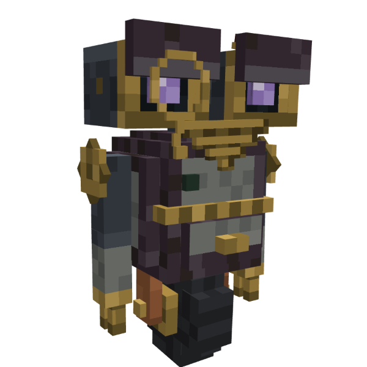 | 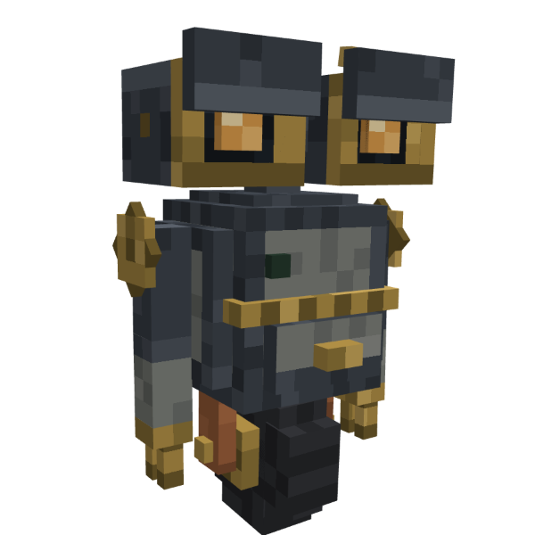 | 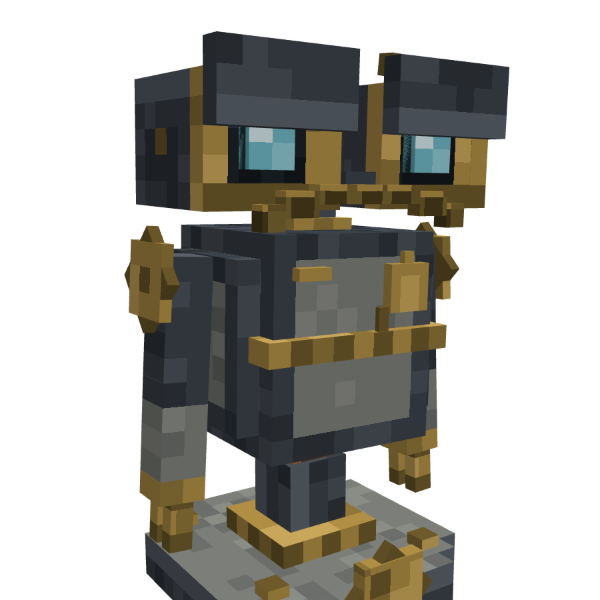 |

| Face close-up | Docked (station glow) | Monocle pop | Gameplay distance | Inventory size |
|---|---|---|---|---|
| 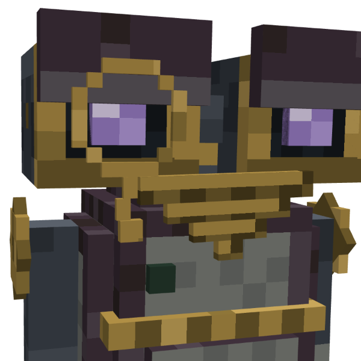 | 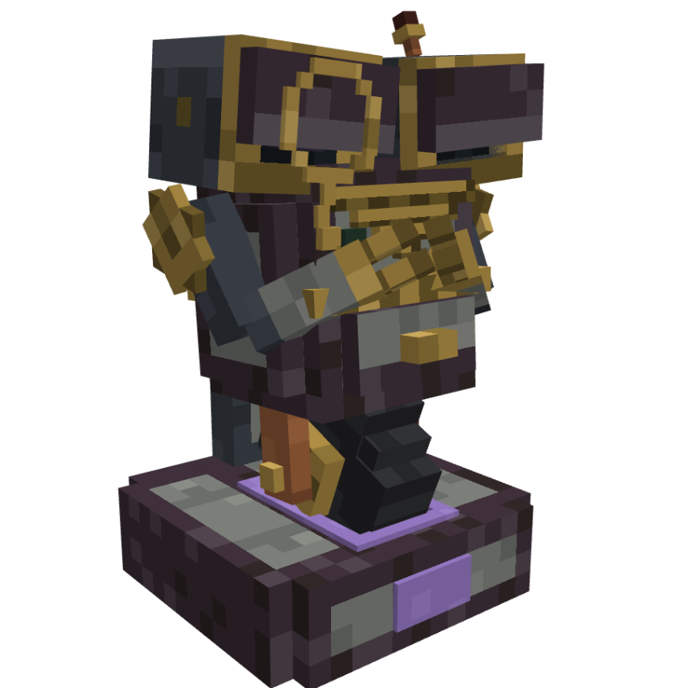 | 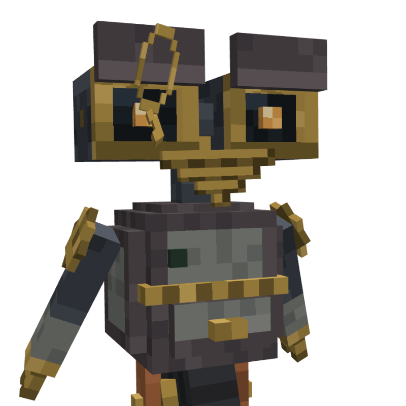 | 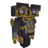 | 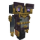 |

## Texture Contract
New asset, nothing in the mod yet. One 256 px box-UV texture (`trade-master.png`) painted by Trade Bot's generator through the variant's palette and paint hooks. Nothing is shared with other models; Trade Bot's own texture is unchanged (verified byte for byte).

## Design Intent
The Trade Bot who made it: a bearded old clockwork merchant with a monocle and a ledger, who runs the shop from his network. The same maker (the bots), the same job (trading), the same personality, a few years on and a little proud. The upgrade has to show at a glance (netherite plating, violet eyes, the beard) while he stays unmistakably Trade Bot's family (brass, andesite, the face).

## Current Strengths
- **The family read survives.** The eye pods, brass rims, waist band, andesite panels, shoulder cogs and claws are Trade Bot's own painters; side by side he is clearly the same robot.
- **The beard is the Helper Bot's grille.** It uses the same dark brass `#6e5a2a`/`#7a6530` with `#4a3c1b` slots and the same slot-dark ends, so moustache → beard reads as one family step. Keep this.
- **The netherite is vanilla's own.** It's sampled from `netherite_layer_1.png`: plum `#3f303b`, warm brown-black `#322727`, dusty plum `#51444e`, grey-lilac edge `#5d565d`. It reads as netherite armour and clearly differs from the blue-grey steel.
- **Violet eyes make him distinct.** He no longer shares Trade Bot's amber or Helper Bot's cyan, and the station glow follows the eyes, so "his light moves into the station" still works.
- **No wear, no stripes, glow small**: correct for a crafted bot.

## Current Weaknesses
1. **Two dark metals of the same value on one body.** The upper arms, neck and eye pods stay blue-grey steel (`#3c424a`) beside the plum netherite frame (`#3f303b`). At gameplay distance the arms read as a different machine's parts: patchwork rather than "plated".
2. **The unlit iris keeps Trade Bot's amber glint.** `iris_dark` paints a fixed `#6b5038` (warm brown) pixel; with the violet unlit shades (`#2e2638`/`#362c42`) it shows as a brown fleck whenever his eyes are off (docked, dozing, wound down).
3. **The ledger's walnut is the dark walnut** (`#3b2a1f`/`#4e3626`/`#5a3f2c`, the generator's prop walnut). The visual-language doc says that one "reads black in game"; at 2 px wide the book then reads as a dark lump, not a book.
4. **The mod now has four netherite palettes** (see Cohesion). His is the only one taken from vanilla armour, which is right for him, but it leaves the others inconsistent.

## Storytelling Evaluation
- **Who made him?** The bots' maker, upgraded with netherite plates: the plating sits on the frame and lid plates, where a refit would go. The face and claws are original, which fits an upgrade (weakness 1 is about the arms only).
- **Who uses him, how often?** A wealthy base's shopkeeper: polished, no wear. Correct.
- **How expensive?** Netherite corners in his recipe show as netherite plating: yes.
- **Who repairs him?** Not applicable (he winds down, never breaks).
- **His personality** (proud old merchant) reads from the beard, the monocle and the ledger. The textures support it; the brass monocle with a highlight top bar adds a glint of vanity.

## Material Evaluation
| Material | Reads? | Matches family? |
|---|---|---|
| Andesite panels | Yes | Identical to Trade Bot |
| Bot brass (rims, band, claws, monocle, buckle) | Yes | Identical; `#c9a75a` only on small trims (monocle top bar) |
| Whisker brass (beard) | Yes | Identical to Helper Bot's grille |
| Dark steel (pods, neck, upper arms) | Yes | Identical to Trade Bot, but clashes in hue with his netherite (weakness 1) |
| Netherite (frame, lid plates, plinth) | Yes | Matches vanilla armour; no other mod asset uses this ramp yet (weakness 4) |
| Walnut (ledger) | Weakly | Uses the dark prop walnut, not the house walnut (weakness 3) |
| Paper (pages) | Yes | Trade Bot's `#8a8170` with `#7a7262` rules |
| Copper (aerial rod, fork) | Yes | Identical |
| Rubber (wheel) | Yes | Identical |

## Minecraft Readability Evaluation
- **Primary:** the violet eyes in brass rims. Strongest contrast on the model, readable at inventory size.
- **Secondary:** the beard (a brass mass under the face), the netherite frame against the andesite panels, the waist band. All read at gameplay distance.
- **Tertiary:** the grille slots, monocle ring, chain, ledger, bulb. These are only visible up close, which is correct for tertiary detail.
- **Texel density:** one texel per model pixel everywhere except the sub-pixel parts (monocle bars, chain links, bulb), which are flat brass or glass; fine.
- **No gradients, no clutter.** The Stock Link bulb is near-black when unlit (`#3b1a17`), which is correct (an unlit lens, not a hole).

## Cohesion Evaluation
- **Shared materials:** with the bots, yes (every material borrowed from Trade Bot or Helper Bot). Netherite: four ramps in the mod:

  | Asset | Netherite ramp | Source |
  |---|---|---|
  | Trade Master (this) | `#322727` `#3f303b` `#51444e`, edge `#5d565d` | vanilla netherite **armour** |
  | Netherite Monster Cage | `#31292a` `#3a3233` `#443a3b`, highlight `#5d5052` | vanilla netherite **block/ingot** |
  | Netherite Clockwork Jetpack (worn gear) | `#433d40` `#4d4649` `#5a5255`, rims `#2a2526` | none (a neutral grey) |
  | Netherite Upgraded Chest | `#211c1e` `#2b2729` `#3a3438` `#443c40`, highlight `#6b6266` | none (a dark grey-plum) |

  Vanilla itself uses two looks: plum for armour, warm grey-brown for the block and ingot. **Proposed rule: worn gear and plating follow the armour; blocks follow the netherite block.** The Trade Master and the Monster Cage already do; the Jetpack (worn) and the Upgraded Chest (block) don't.
- **Manufacturing language:** the bots' own (stepped corners, brass band, rims, grille). ✓
- **Colour logic:** violet is a new glow meaning ("the Trade Master's eyes"). The Stock Link bulb's red is Create's own convention and blinks only, so it doesn't read as the mod's steady dark-red "fault" lamp. Both need doc entries.
- **Age:** factory fresh, like the other bots. ✓

## Recommended Texture Changes
1. **Upper arms to netherite** (`upper_arm_left/right`, and the steel top row of each forearm shell): steel `#2f343b`/`#3c424a`/`#4a5059` → netherite `#322727`/`#3f303b`/`#51444e`, top face `#5d565d`. Why: one plated body instead of two competing dark metals (weakness 1). **Keep the eye pods and neck steel**, so the face and telescoping neck stay Trade Bot's (the family read).
2. **Unlit iris glint:** `iris_dark_left/right` fixed pixel `#6b5038` → `#4a3d5a` (a dark violet glint). Why: no brown fleck when his eyes are off (weakness 2).
3. **Ledger walnut to the house walnut:** covers and spine from `#3b2a1f`/`#4e3626`/`#5a3f2c` → `#4e3626`/`#634532`/`#6f4d36` (cover end rows `#6f4d36`). Why: it reads as wood in game, per the doc (weakness 3).

No shape problems for the modeller.

## Recommended Retexture Candidates
Now that this asset exists, are there earlier assets that should be revisited for visual consistency?

| Asset | Reason for review | What has changed | Proposed update |
|---|---|---|---|
| **Netherite Clockwork Jetpack** (in the mod, 2.6.0) | Worn gear with a netherite ramp from no source | The Trade Master set netherite = vanilla armour for worn gear and plating | Metal ramp `#433d40`/`#4d4649`/`#5a5255` → `#322727`/`#3f303b`/`#51444e`, rims `#2a2526` → `#241f20` (armour's darkest), highlights → `#5d565d`. Crimson canvas unchanged (it already sits in the plum family) |
| **Netherite Upgraded Chest** (in the mod) | A block with its own netherite ramp, unlike the Monster Cage and vanilla's block | The netherite rule: blocks follow the netherite block | Ramp `#211c1e`/`#2b2729`/`#3a3438`/`#443c40`, highlight `#6b6266` → the Monster Cage's `#31292a`/`#3a3233`/`#443a3b`, highlight `#5d5052` (keep `#211c1e` only as the frame's deepest shadow) |
| Netherite Monster Cage | Checked: already follows vanilla's block | — | None |
| Trade Bot, Helper Bot | Checked: the Trade Master borrows from them and adds nothing they lack; their eye colours stay their own | — | None |

For later briefs: the **Netherite Sheet** item is a pressed ingot, so it should use the block/ingot ramp. The **Trade Board** should borrow the Trade Master's bot parts (brass flap, andesite).

## Proposed visual-language updates
- **Materials:** replace the "Netherite trim" row with **"Netherite"**, two ramps from vanilla: **armour** (worn gear and bot plating) `#241f20` `#322727` `#3f303b` `#51444e`, edge `#5d565d`; **block** (blocks and ingot-made items) `#31292a` `#3a3233` `#443a3b`, highlight `#5d5052`. On Netherite-tier gear it still replaces every brass part (user, 2026-11-03).
- **Colour meanings:** add **muted violet glow** `#9c80c9`/`#b89ee0`: the Trade Master, his eyes and his station's glow (never machines). Add **dark violet** `#2e2638`: the Trade Master's eyes at rest. Add **Stock Link red** (muted `#9a2a20`, blinks only): talking to his network (never a steady lamp; steady dark red stays "fault").
- **Makers, the bots:** the eye list becomes "amber, cyan or violet: one colour per bot, and his station's glow follows it". Add "whisker grilles (Helper Bot's moustache, Trade Master's beard) in dark brass `#6e5a2a`/`#7a6530`, slots `#4a3c1b`".
- **Families:** add the Trade Master to "Bots and bot-built machines".

## Art Director Verdict
**Approved with changes.** He strengthens the bots' identity: the same family, clearly upgraded, and the beard ties him to the Helper Bot. Make changes 1–3 here. The feature counts as finished once the two netherite retexture candidates (the Jetpack and the Upgraded Chest) are done, deferred or declined, so the mod has one netherite rule.

## Follow-up
User picks (2026-11-04): **all three changes, both retexture candidates, and the visual-language updates.**

- **Changes 1–3 applied** in `trade-master.variant.js`: upper arms and forearm cuff rows netherite; unlit iris glint `#4a3d5a`; ledger in the house walnut. All 46 clips still identical to Trade Bot's on all 1409 shared tracks.
- **Netherite Clockwork Jetpack** (`clockwork-jetpack.gen.js`, preview and icon regenerated): trim `#49393f` `#51444e` `#5d565d`, rims `#241f20`. Ducts: deep `#322727`, field `#3f303b`/`#49393f`, rivets `#5d565d`. The first pass used `#171111`/`#241f20` there and the user found the dark patches too dark (2026-11-04); the steps now match the brass version's (deep only a shade under the field); icon trims `#5d565d`/`#766a76`/`#3f303b`, edge `#241f20`. The armour ramp at the values the grey trim had, so the trim stays lighter than the dark plates. No z-fights.
- **Netherite Upgraded Chest** (`upgraded-chest.gen.js`, preview regenerated): `#241e1f` `#31292a` `#3a3233` `#443a3b`, highlight `#5d5052` (vanilla's block, as on the Monster Cage).
- **Visual language updated:** two netherite rows (armour / block), violet glow, dark violet, Stock Link red (blink only), whisker grilles, upgraded-bot plating, the Trade Master in the bots family, the netherite tier rule.
- **Exported into the mod** (user: "go for all changes", 2026-11-04): `clockwork-jetpack.export.js` and `upgraded-chest.export.js`. 31 textures changed, all netherite (15 jetpack, 16 chest and barrel); no models or code. Build and unit tests pass; the dev client was launched for the user to check in game. Both are shipped assets, so this is a visible change in the next release.

| After: Trade Master | Ledger | Netherite Jetpack | Netherite Chest and Barrels |
|---|---|---|---|
| 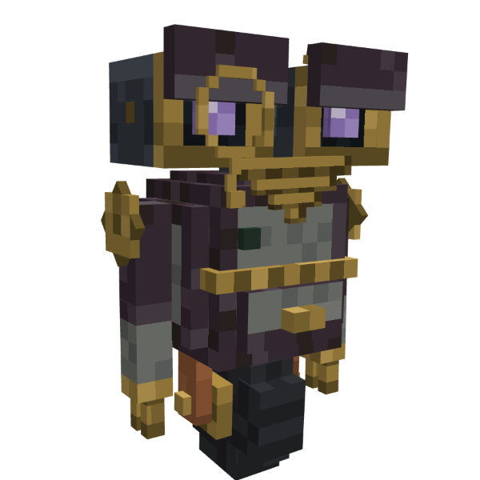 | 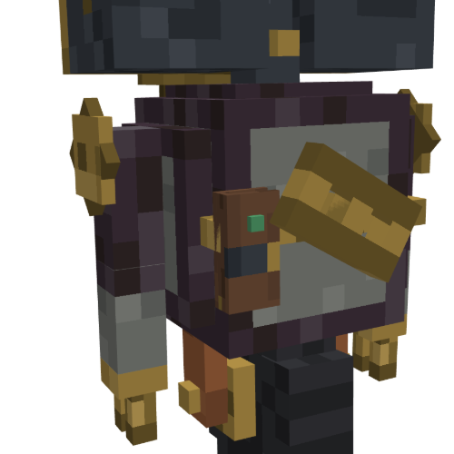 | 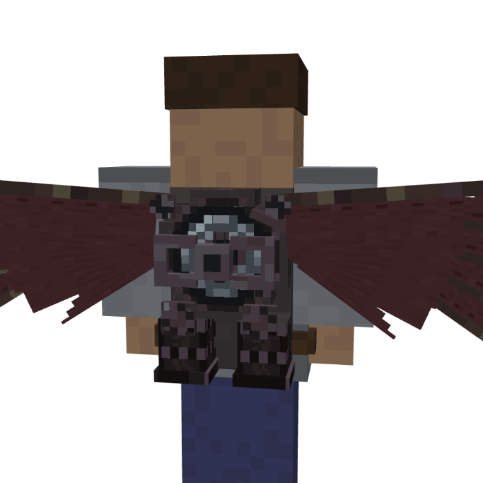 | 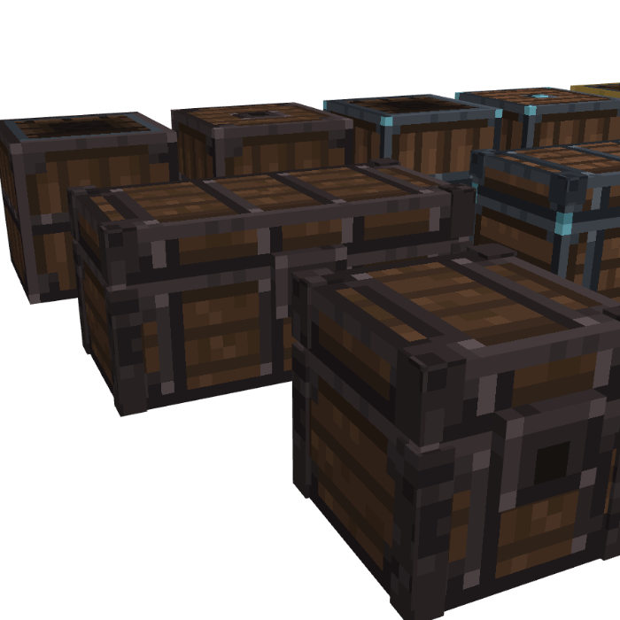 |
